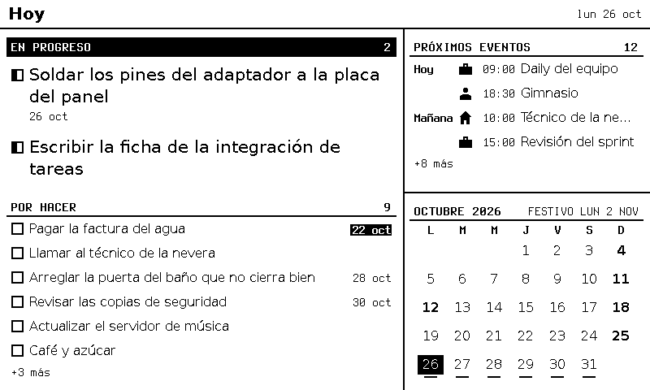
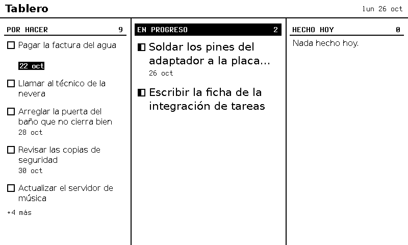
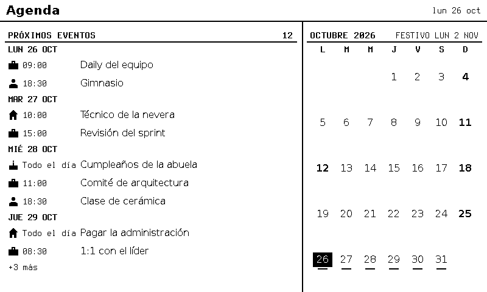

# Tintero

[Read in English](README.md)

> Servidor de pantallas e-ink para ESP32: el servidor es el tintero y las pantallas, las hojas.

Tintero prepara lo que muestra una pantalla e-ink: un tablero de tareas, un calendario, los festivos y más. El ESP32 solo descarga imágenes de 1 bit y las muestra. **El servidor dibuja todo**, así que el aparato se mantiene simple y duerme casi todo el tiempo.



*La vista de ejemplo `hoy`, dibujada con los datos de ejemplo de `config/`.*

## Cómo funciona


1. Tus fuentes (tareas, calendarios, festivos) alimentan pequeñas integraciones en el servidor.
2. El motor las convierte en imágenes de 1 bit, una por vista, del tamaño del panel.
3. Una API privada (TLS mutuo: solo se conectan tus propias pantallas) sirve esas imágenes.
4. El ESP32 despierta, descarga solo lo que cambió, lo muestra y vuelve a dormir.

### Vistas

|  |  |  |
| :-------------------------------------------: | :---------------------------------------------------: | :-------------------------------------------------: |
|        `hoy`: tareas, eventos y el mes        |         `tablero`: por hacer, en curso y hechas       |      `agenda`: eventos de la semana y festivos      |

### Dos botones

- **Mover:** pulsación corta = siguiente zona; larga = siguiente vista.
- **Aceptar:** pulsación corta = marcar una tarea o abrirla; larga = volver o actualizar ahora.

Los detalles están en [las notas del firmware](firmware/README.md).

### El circuito


Piezas y cableado: [guía de hardware](docs/guide/es/hardware.md).

## Qué hace falta

Para verlo funcionar basta un computador:

- Node 24 y Docker (el servidor dibuja las vistas en un contenedor de Chromium con todo restringido).

Para armar la pantalla real, además:

- Una placa ESP32 DevKit.
- Un panel e-paper GDEY075T7 de 7,5" (800 × 480) con su adaptador DESPI-C02.
- Dos pulsadores (Mover y Aceptar) y una protoboard con cables.

## Verlo funcionando sin hardware

```bash
npm ci && npm run setup                       # 1. instalar
docker pull "$(grep '^CHROMIUM_IMAGE=' tools/images.conf | cut -d= -f2 | cut -d' ' -f1)"
npm run server -- --port 8790 \
  --views config/hoy.views.example.json \
  --data config/hoy.data.example.json         # 2. arrancar con los ejemplos
npm run emulator -- --server http://127.0.0.1:8790 --store /tmp/tintero-emu --wakes 1   # 3. el emulador (en otra terminal)
```

Después abre `/tmp/tintero-emu/screen.png`. Los pasos completos, con explicaciones, están en [Primeros pasos](docs/guide/es/getting-started.md).

## Guía

- [Primeros pasos](docs/guide/es/getting-started.md): de una máquina limpia a la vista `hoy`.
- [Hardware](docs/guide/es/hardware.md): piezas, cableado, circuito y firmware.
- [Certificados](docs/guide/es/certificates.md): tu propia autoridad privada, un certificado por pantalla.
- [Exposición](docs/guide/es/exposure.md): cómo llegan las pantallas al servidor de forma segura.
- [Configuración](docs/guide/es/configuration.md): vistas, datos, integraciones y llaves.
- [Integraciones](docs/guide/es/integrations.md): cómo escribir una nueva.
- [Bloques](docs/guide/es/blocks.md): cómo escribir un bloque de vista nuevo.

La política de seguridad está en [SECURITY.es.md](SECURITY.es.md); cómo contribuir, en [CONTRIBUTING.es.md](CONTRIBUTING.es.md). Los documentos internos del proyecto (decisiones, fichas de trabajo) están en español dentro de `docs/`.

## Licencia

MIT, ver [LICENSE](LICENSE). El *software* de terceros está en [NOTICE](NOTICE). Ojo: un binario compilado del firmware enlaza GxEPD2 (GPL-3.0); este repositorio publica solo código fuente.
