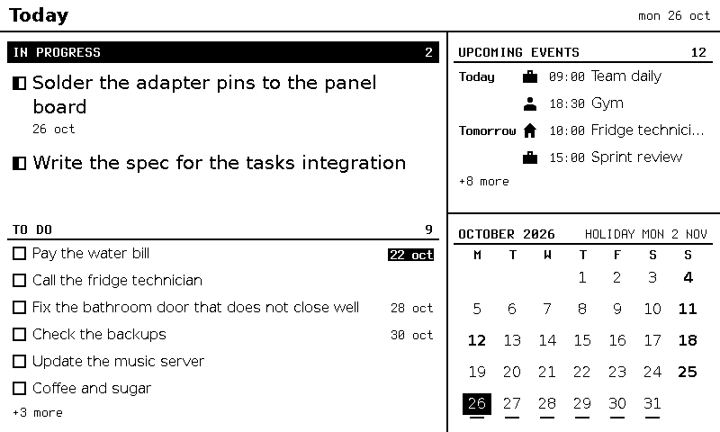

# Tintero

[Leer en español](README.es.md)

> A server for e-ink displays driven by an ESP32. The server is the inkwell; the displays are the pages.

Tintero prepares what an e-ink display shows: a to-do board, a calendar, public holidays, and more. The ESP32 only downloads 1-bit images and shows them. **The server draws everything**, so the device stays simple and sleeps most of the time.



*The `today` example view, drawn from the sample data in `config/`.*

## What you need

To see it working you only need a computer:

- Node 24 and Docker (the server draws the views in a locked-down Chromium container).

To build the real display you also need:

- An ESP32 DevKit board.
- A GDEY075T7 7.5" e-paper panel (800 × 480) with its DESPI-C02 adapter.
- Two push buttons (Move and Accept) and a breadboard with wires.

## See it working without hardware

```bash
npm ci && npm run setup                       # 1. install
docker pull "$(grep '^CHROMIUM_IMAGE=' tools/images.conf | cut -d= -f2 | cut -d' ' -f1)"
npm run server -- --port 8790 \
  --views config/hoy.views.example.en.json \
  --data config/hoy.data.example.en.json      # 2. start with the examples
npm run emulator -- --server http://127.0.0.1:8790 --store /tmp/tintero-emu --wakes 1   # 3. the emulator (in another terminal)
```

Then open `/tmp/tintero-emu/screen.png`. The full steps, with explanations, are in [Getting started](docs/guide/en/getting-started.md).

## Guide

- [Getting started](docs/guide/en/getting-started.md): from a clean machine to the `today` view.
- [Hardware](docs/guide/en/hardware.md): parts, wiring, the circuit, and the firmware.
- [Certificates](docs/guide/en/certificates.md): your own private authority, one certificate per display.
- [Exposure](docs/guide/en/exposure.md): how displays reach the server safely.
- [Configuration](docs/guide/en/configuration.md): views, data, integrations and keys.
- [Integrations](docs/guide/en/integrations.md): how to write a new one.
- [Blocks](docs/guide/en/blocks.md): how to write a new view block.

The security policy is in [SECURITY.md](SECURITY.md); how to contribute is in [CONTRIBUTING.md](CONTRIBUTING.md). Internal project documents (decisions, work cards) are in Spanish under `docs/`.

## License

MIT, see [LICENSE](LICENSE). Third-party software is listed in [NOTICE](NOTICE). Note that a compiled firmware binary links GxEPD2 (GPL-3.0); this repository publishes source code only.
