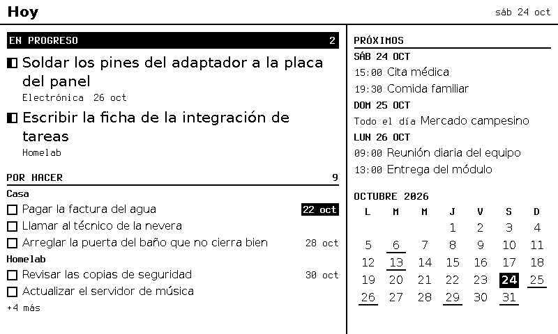
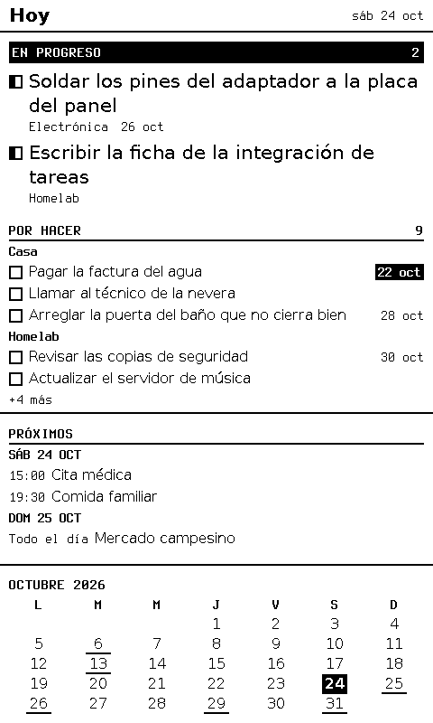
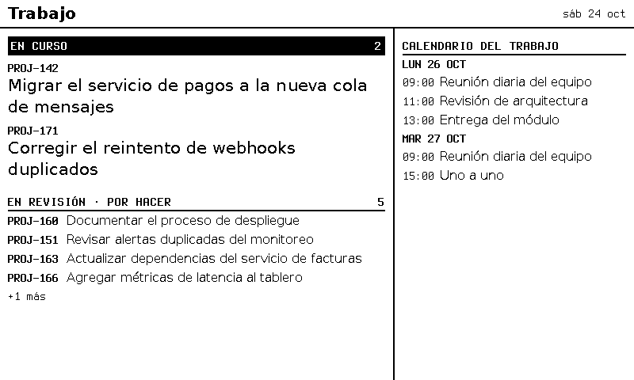
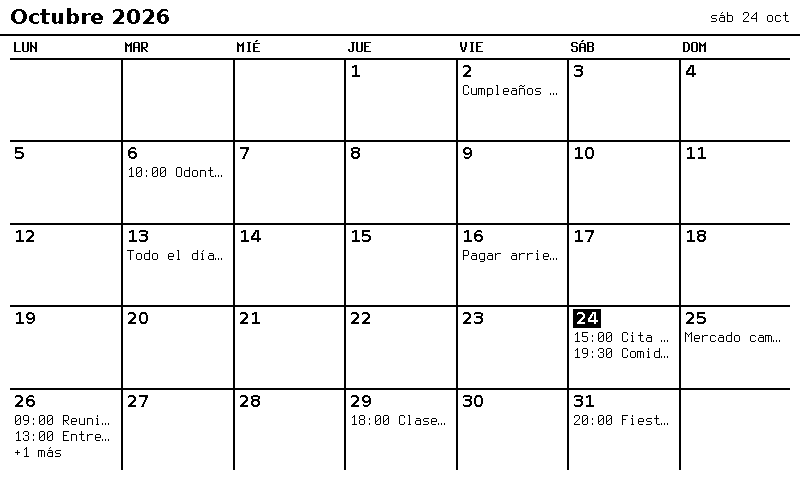

# F-006 · Tareas del tablero Kanban en la pantalla

**Estado:** **aprobada** · el dueño aprobó D0–D10 el 2026-10-24 (ADR-0037 a ADR-0041) y pidió empezar el mismo día
**Modelo del programador:** sonnet
**Dependencias nuevas permitidas:** ninguna.

## Decisiones que pide esta ficha (puerta 1)

**Todas aprobadas por el dueño el 2026-10-24** (ADR-0037 a ADR-0041). La integración (antes «Parte B») pasó a **F-009** (D0).

| # | Decisión | Aprobado |
|---|----------|----------|
| **D0** ✅ | ¿Una ficha o dos? | **Dos.** Esta ficha es la **pantalla** (se verifica con `--data`, sin red); el núcleo mínimo de integraciones y `trilium-tareas` van en **F-009** (ADR-0040) |
| **D1** ✅ | Atributos del tablero | `status` (*Por hacer*, *En progreso*, *Hecho*) y `vence` opcional; sin prioridad; sin fecha de cierre propia (ADR-0037). **`categoria` pospuesta** por el dueño (2026-10-24): el bloque solo pone encabezados si alguna tarea trae categoría |
| **D2** ✅ | Etapa en el tipo `Task` | `stage` (`todo` \| `doing` \| `done`) y `doneAt`; sin `stage` = `done ? "done" : "todo"` (ADR-0038) |
| **D3** ✅ | Aceptar corto sobre una tarea | La marca *Hecho*; otra vez, vuelve a su etapa anterior (ADR-0039) |
| **D4** ✅ | Bloque `task-board` | Opciones `stages`, `lead`, `group_by`, `density` (ver *Contrato*) |
| **D5** ✅ | Vistas | `hoy` y `tablero`; `trabajo` y `mes` quedan dibujadas, fuera de esta ficha |
| **D6** ✅ | *Hecho* en la pantalla | Hasta la medianoche local del día en que se cerró (ADR-0037) |
| **D7** ✅ | Orden | La posición en el tablero; las vencidas se marcan, no suben (ADR-0037) |
| **D8** ✅ | Núcleo mínimo | En F-009 (ADR-0040) |
| **D9** ✅ | Escribir sin pisar | En F-009 (ADR-0041) |
| **D10** ✅ | Fuente sin conexión | Más de 5 min sin lectura buena → la franja dice «sin datos desde HH:MM» (ADR-0041). Esta ficha la dibuja; F-009 entrega la hora |

## Diseños

PNG de 1 bit dibujados con el mismo Chromium del motor (800 × 480, 124 ppp), con datos inventados. El HTML de cada maqueta y su generador están en `docs/disenos/F-006/`. Las maquetas aproximan; **manda el contrato** de esta ficha.

**`hoy`, fase 1** (lo que sale con esta ficha): lo *En progreso* manda; *Por hacer* agrupado por categoría; el riel muestra *Hecho hoy* y el mes.


**`hoy` con el calendario** (cuando llegue): solo cambia el espacio de arriba del riel.



**`tablero`:** *En progreso* en el centro, más ancha y en negro; `Tab` empieza por ella.


**`hoy` en vertical** (usa `portrait`).



**Estados de una fila** (el foco lo dibuja el aparato, ADR-0006).


**Futuro, fuera de esta ficha:** `trabajo` (Jira, ADR-0011) y `mes` (bloque `month-agenda`, con la ficha del calendario).





## Listo para programar (se marca antes de pedir aprobación)
- [x] Cada CA se puede comprobar con una prueba, con valores concretos.
- [x] El contrato (interfaces, formatos, errores) está escrito.
- [x] Los archivos a crear o tocar están listados.
- [x] Presupuestos y reglas de seguridad que aplican, nombrados.
- [x] Lo que queda fuera de alcance, escrito.
- [x] **Nombres de archivos, rutas, puertos y URLs** que las pruebas necesiten, escritos.
- [x] Toda **función que se pruebe tiene nombre y firma**, y todo **contador o medida** dice desde cuándo cuenta.

## Contexto
F-005 dejó el motor de vistas con datos de prueba y la puerta `setSource` para las integraciones. Esta ficha pone en la pantalla el tablero Kanban de tareas del dueño (ADR-0010, ADR-0037 a ADR-0039) con un diseño que **crece**: hoy solo hay tareas, y la misma distribución recibe después el calendario (F13) y Jira (F10, ADR-0011) sin rehacerse (F14). Aplican ADR-0005 (dos botones), ADR-0006 (zonas), ADR-0009 (bloques por tipo), ADR-0032 (cuadrícula fija y bloques dueños de su diseño), ADR-0034 (letras) y ADR-0035 (dibujar cuando hay información nueva).

## Alcance
`stage` y `doneAt` en el tipo `Task`; bloque `task-board`; regla de *Hecho* hasta medianoche; `toggle` que recuerda la etapa anterior; la franja «sin datos desde» (el motor recibe la hora de la última lectura buena por `setSource`); vistas `hoy` y `tablero` en un **par de ejemplos propio** (`config/tablero.views.example.json` + `config/tablero.data.example.json`, ya escritos por el arquitecto): los ejemplos de F-005 **no se tocan**, porque sus pruebas los fijan.

**Fuera de alcance:** el núcleo de integraciones y `trilium-tareas` (**F-009**); calendario e integración de Google (`hoy` completa, `trabajo` y `mes` quedan solo dibujadas); Jira; bloque `month-agenda`; bóveda cifrada, base de datos y web de configuración; varios usuarios; crear o editar tareas desde la pantalla; F-008; el planificador; reemplazar las vistas de demostración de F-005.

## Requisitos
- R1. Lo que no cambie esta ficha sigue igual: las pruebas de aceptación de F-001 a F-005 pasan, y los datos de F-005 (sin `stage`) cargan y se dibujan igual.
- R2. El bloque nuevo sigue la regla común de F-005: filas de alto fijo, «+N más», nunca cortar ni desplazar, `data-fit` en el contenedor y en cada fila; los textos que terminan en «…» a propósito no cuentan como desborde.
- R3. `server/README.md`: el bloque `task-board`, sus opciones y su regla de «cabe».
- R4. Todo texto de los datos se escapa (como en F-005); nada del contenido sale en registros.

## Contrato

### Tipo `Task` (`server/src/engine/config.ts`)
```ts
export type Stage = "todo" | "doing" | "done";
export interface Task {
  id: string; title: string; done: boolean;
  stage?: Stage;      // NUEVO. Sin él: done ? "done" : "todo". Si viene, done === (stage === "done")
  doneAt?: string;    // NUEVO. RFC 3339 con zona; solo con stage "done"
  category?: string; due?: string; key?: string; status?: string; description?: string;
}
export function stageOf(task: Task): Stage;
```
`parseDataFile` y `setSource` rechazan `stage` y `done` que no coinciden, `doneAt` sin `stage: "done"`, `doneAt` que no es RFC 3339 con zona y un `stage` desconocido.

### Medidas nuevas del tema `base` (`theme.ts`, en `Metrics`)
| Medida | Valor | A 124 ppp | A 200 ppp |
|--------|-------|-----------|-----------|
| `strip`: franja de etapa | 5 mm | 24 px | 39 px |
| `sectionGap`: entre etapas | 3 mm | 15 px | 24 px |
| `leadLine`: interlínea del título que manda | 5,5 mm | 27 px | 43 px |
| `metaLine`: línea de detalle (fila que manda y `card`) | 4 mm | 20 px | 31 px |
| `cardLine`: interlínea del título en `card` | 4 mm | 20 px | 31 px |
| Antes de cada fila que manda y de cada `card` | `gap` (1,5 mm) | 7 px | 12 px |

Altos derivados (en píxeles ya redondeados): **fila que manda** = 2 × `leadLine` + `metaLine` (74 px a 124 ppp); **`card`** = 2 × `cardLine` + `metaLine` (60 px). Letra: el título que manda usa la del papel `title` (12 pt) **sin negrita**; `card` y `row` la de `text`; franja, línea de detalle y «+N más», la de `detail`.

### Bloque `task-board` (`server/src/engine/blocks/task-board.ts`)
Opciones (campos desconocidos → error, como en F-005):

| Opción | Valores | Por defecto |
|--------|---------|-------------|
| `stages` | 1–3 de `"doing"`, `"todo"`, `"done"`, sin repetir, en el orden en que se dibujan | `["doing", "todo"]` |
| `lead` | booleano: la primera etapa **manda** | `false` |
| `group_by` | `"category"` \| `"none"` (solo las etapas que no mandan) | `"category"` |
| `density` | `"row"` \| `"card"` (solo las etapas que no mandan) | `"row"` |

**Qué entra en cada etapa:** las tareas con `stageOf(task)` igual a la etapa, en el orden de los datos (D7); en `done`, **solo** las de `doneAt` del día local de hoy (`timezone` de la vista) (D6).

**Diseño, de arriba abajo** (todo desde el borde del contenido, a `M` del borde del espacio; `x0` = izquierda del contenido, `W` = su ancho):

1. **Franja** de cada etapa, alto `strip`. Texto en `detail` negrita con 1 px de espaciado entre letras: a la izquierda `EN PROGRESO` / `POR HACER` / `HECHO HOY`; a la derecha el **total** de la etapa (no lo que cabe), o el aviso de *Sin conexión*. Con 4 px de margen a cada lado del texto.
   - **Si manda:** fondo negro en todo el rectángulo `x0 … x0+W−1` × alto `strip`; texto blanco.
   - **Si no:** texto negro y línea negra de `L` en las **últimas** `L` filas de la franja, de `x0` a `x0+W−1`.
2. Antes de cada franja salvo la primera: `sectionGap` en blanco.
3. **Filas de la etapa que manda:** cada una precedida de `gap`. Casilla a la izquierda (arriba de la fila + `floor((leadLine − box) / 2)`); título a `x0 + box + gap`, en **hasta 2 líneas** de `leadLine` (la segunda termina en «…» si no cabe); debajo, en la línea de detalle, `categoría` (si la tarea la tiene) y `vence` separados por dos espacios. El alto es **siempre** el de la fila que manda, aunque el título quepa en una línea.
4. **Filas `row`** (las demás etapas): las de `task-list` de F-005 (una línea con «…», `vence` a la derecha), con los encabezados de categoría de F-005 si `group_by` es `category` **y al menos una tarea de esa etapa tiene categoría**; si ninguna la tiene, **no hay encabezados** (el tablero real todavía no tiene `categoria`).
5. **Filas `card`:** cada una precedida de `gap`; casilla, título en hasta 2 líneas de `cardLine`, y la línea de detalle como en 3. Con `group_by: "category"`, los mismos encabezados que en 4.
6. **Casilla** (lado `box`, borde `boxBorder`): *Por hacer* vacía; *En progreso* con **relleno negro desde su borde izquierdo hasta `x + floor(box / 2) − 1`**; *Hecho* rellena, y el título tachado. En una fuente `readonly`, sin casilla (el título empieza en `x0`).
7. **`vence`** (`25 oct`): si es **antes de hoy**, en negrita, **blanco sobre negro**, con un fondo que va de 3 px antes del texto al final de este y de 2 px bajo el borde de arriba de su línea a 2 px sobre el de abajo. Si no, negro sobre blanco.
8. **Vacío:** una etapa sin tareas pone, tras su franja, una fila `row` (sin zona) con `Nada en progreso.`, `Nada por hacer.` o `Nada hecho hoy.`
9. **«+N más»** (alto `moreRow`), justo después de lo último dibujado, con N = tareas sin mostrar **de todas las etapas**.

**Regla de «cabe»** (`H` = alto del contenido menos la fila de título si el espacio tiene `title`):
- Si todo cabe en `H`, se dibuja todo, sin «+N más».
- Si no, se reserva `moreRow` al final (`A = H − moreRow`) y se recorre etapa por etapa, en orden: se pone su `sectionGap` (salvo la primera) y su franja; después sus filas (con sus encabezados) **mientras** el final de la fila no pase de `A − R`, donde `R` = lo que necesitan **las etapas que faltan** para mostrar su `sectionGap`, su franja y su **primera** unidad (la primera fila, con su encabezado si lleva, o la fila de vacío). **En cuanto una fila no cabe, se pasa a la etapa siguiente** (no se salta a otra fila).
- Mínimo: 30 mm de ancho; de alto, `2M` + franja + la primera unidad de la primera etapa + `moreRow`. Si no alcanza: «No cabe» y `tooSmall`, como en F-005.

**Zonas:** una por fila de tarea (no por encabezados, filas de vacío ni «+N más»), con la caja de la fila **sin** el `gap` de antes: `toggle` si la fuente no es `readonly`, `open` si lo es. Orden: el de dibujo.

### `toggle` y `open` (`server/src/engine/engine.ts`)
- `toggle` sobre una zona de `task-board` (fuente no `readonly`), sobre una tarea que **no** está `done` → `stage: "done"`, `done: true`, `doneAt` = la hora del reloj del motor (RFC 3339 en UTC), y el motor **recuerda** su etapa anterior (por fuente e id). Sobre una `done` → vuelve a la etapa recordada (o `"todo"` si no hay), `done: false` y sin `doneAt`. Igual que en F-005: idempotente por `id` y para todas las vistas y aparatos que usan esa fuente.
- `open` sobre una zona de `task-board` de una fuente `readonly` → el detalle de F-005. Las demás combinaciones → `stale`, como en F-005.

### Hora de la última lectura
```ts
setSource(id: string, items: unknown, meta?: { readAt?: Date }): { ok: true; changed: boolean } | { ok: false; error: string };
export function staleLabel(readAt: Date | undefined, now: Date, timeZone: string): string | undefined;
```
`stageOf`, `staleLabel` y el tipo `Stage` se exportan en `server/src/engine/index.ts` (como el resto del motor; aclarado tras la fase de pruebas). `staleLabel` da `sin datos desde HH:MM` (hora local de `readAt`, 24 h) si `now − readAt` es **mayor que 5 min**, y `undefined` si no o si no hay `readAt`. Si una etapa que manda tiene aviso, su franja lo muestra **en lugar del total**. El aviso de cada fuente, **calculado para la hora de ese dibujo**, entra en la clave de dibujo de las vistas que la usan: así se redibuja cuando cruza los 5 min (también desde `prewarm`) y no cuando solo cambia `readAt` sin cruzarlo. `setSource` encola las vistas cuya **clave** cambió (datos o aviso), aunque `changed` sea `false`: `changed` sigue diciendo solo si cambiaron los **datos**.

### Ejemplos (`config/tablero.views.example.json`, `config/tablero.data.example.json`)
Zona `America/Lima`. Aparato `"*"`: vistas `hoy` y `tablero`.
- **`hoy`**: columnas `[62, 38]`, filas `[45, 55]`, áreas `[["tareas", "hechas"], ["tareas", "mes"]]`; `portrait`: columnas `[100]`, filas `[55, 20, 25]`, áreas `[["tareas"], ["hechas"], ["mes"]]`. `tareas`: `task-board` de `tablero` con `{ "stages": ["doing", "todo"], "lead": true }`; `hechas`: `task-board` de `tablero` con `{ "stages": ["done"] }`; `mes`: `month-calendar` de `calendario` (fuente de eventos **vacía**: cuando llegue el calendario, `hechas` pasa a `{ "block": "agenda", "source": "calendario", "options": { "days": 3 } }` y no cambia nada más).
- **`tablero`**: columnas `[32, 38, 30]`, filas `[100]`, áreas `[["por_hacer", "en_progreso", "hechas"]]`, `tab: ["en_progreso", "por_hacer", "hechas"]`; `portrait`: columnas `[100]`, filas `[30, 50, 20]`, áreas `[["en_progreso"], ["por_hacer"], ["hechas"]]`. `por_hacer`: `{ "stages": ["todo"], "density": "card", "group_by": "none" }`; `en_progreso`: `{ "stages": ["doing"], "lead": true }`; `hechas`: `{ "stages": ["done"], "density": "card" }`.
- **Fuente `tablero`** (14 tareas, **sin categorías**, en este orden): `b-01` *doing* «Soldar los pines del adaptador a la placa del panel», `due 2026-10-26`; `b-02` *todo* «Pagar la factura del agua», `due 2026-10-22`; `b-03` *doing* «Escribir la ficha de la integración de tareas»; `b-04` *todo* «Llamar al técnico de la nevera»; `b-05` *todo* «Arreglar la puerta del baño que no cierra bien», `due 2026-10-28`; `b-06` *todo* «Revisar las copias de seguridad», `due 2026-10-30`; `b-07` … `b-11` *todo* (cinco más, sin `due`); `b-12` *done* «Cambiar el filtro del agua», `doneAt 2026-10-24T09:00:00-05:00`; `b-13` *done* «Pedir el ESP32 de repuesto», `doneAt 2026-10-24T10:30:00-05:00`; `b-14` *done* «Sacar el reciclaje», `doneAt 2026-10-23T20:00:00-05:00`.

## Criterios de aceptación
Reloj fijo **`2026-10-24T17:00:00Z`** (12:00 del sábado 24 en Lima) salvo que se diga otra cosa. Paneles `P124` = `w=800,h=480,dpi=124,depth=1`, `P200` (igual, `dpi=200`) y `V124` = `w=480,h=800,dpi=124,depth=1`. «Los ejemplos» = `config/tablero.views.example.json` + `config/tablero.data.example.json`. Las pruebas con Chromium lo arrancan con `startChromium()` y lo detienen al terminar; las demás usan un `Renderer` falso. Carpetas temporales fuera del repo. Una caja es `{x, y, w, h}`; «negro en `(x, y)`» se mira en `raw1`.

- **CA1 (compatibilidad).** Los datos de F-005 cargan sin cambios; `stageOf` da `"done"` para `t-002` y `"todo"` para las demás tareas de `tareas`. `npm run test:acceptance` (F-001 a F-005) pasa.
- **CA2 (validación).** `parseDataFile` lanza `ConfigError` con su ruta JSON para: `stage: "done"` con `done: false`; `doneAt` con `stage: "todo"`; `doneAt: "2026-10-24 09:00"`; `stage: "blocked"`. `parseViewsConfig` lanza para `stages: []`, `stages: ["todo", "todo"]`, `stages: ["later"]`, `density: "grid"`, `lead: "yes"` y un campo `"colour"` en las opciones de `task-board`. Ningún mensaje contiene un título.
- **CA3 (`hoy`, P124, Chromium real).** `overflow = []`, `tooSmall = []`, `gray = 0`. Zonas, en orden: `toggle` de `b-01` `{10, 77, 476, 74}` y `b-03` `{10, 158, 476, 74}`; `toggle` de `b-02`, `b-04`, `b-05`, `b-06`, `b-07`, `b-08`, `b-09` en `{10, 271, 476, 24}` y `y` + 24 cada una (la última en `y = 415`); `toggle` de `b-12` `{508, 70, 282, 24}` y `b-13` `{508, 94, 282, 24}`. Total **11**. `hidden = { tareas: 2, hechas: 0, mes: 0 }`. Píxeles: negro en `(11, 47)` y `(484, 68)` y al menos 50 blancos en el rectángulo `x 10…485, y 46…69` (franja que manda); negro en `(200, 269)` y `(200, 270)`, blanco en `(200, 258)` y `(200, 268)` (franja `POR HACER`, sin encabezado de categoría debajo); negro en `(13, 90)`, blanco en `(20, 90)` (casilla de `b-01` a medias); negro en `(515, 81)` (casilla de `b-12` rellena); negro en `(600, 68)` y `(600, 69)` (franja `HECHO HOY`).
- **CA4 (vencida).** En `hoy`, P124: negro en `(484, 274)` y `(484, 291)` (fecha de `b-02`, vencida, invertida); blanco en `(484, 345)` (fila de `b-06`, que vence el 30) y en `(484, 300)` (`b-04`, sin fecha).
- **CA5 (hecho hoy y medianoche).** Con el reloj de siempre, `hechas` tiene `b-12` y `b-13` (no `b-14`, que es del 23). Con el reloj en `2026-10-25T05:01:00Z` (00:01 del 25 en Lima), `index` de `local` en P124 da otra huella para `hoy` y `tablero`, `hechas` de `hoy` no tiene zonas y dibuja `Nada hecho hoy.`
- **CA6 (marcar y deshacer).** Con `hoy` y `tablero` ya dibujadas para `local` en P124: `toggle` sobre la zona de `b-01` en `hoy` → `applied`, `changed: true`; tras `idle()`, `renders()` subió en **2**. Ahora `tareas` tiene 10 zonas (`b-03` y luego las 9 *Por hacer*), `hidden.tareas = 0`, y `hechas` tiene 3, la primera la de `b-01` en `{508, 70, 282, 24}`. Otro `toggle` (otro `id`) sobre esa zona → `b-01` vuelve a *En progreso* y la huella de `hoy` es **igual a la del principio**. Repetir un `id` → `duplicate`.
- **CA7 (vacío).** Con la fuente `tablero` sin tareas *doing* (las demás iguales), la primera zona de `hoy` es la de `b-02` en `{10, 133, 476, 24}`, y la franja que manda sigue en negro en `(11, 47)`.
- **CA8 (`tablero`, P124).** `overflow = []`, `tooSmall = []`. Zonas, en orden: `b-01` `{268, 77, 282, 74}`, `b-03` `{268, 158, 282, 74}`; `b-02`, `b-04`, `b-05`, `b-06`, `b-07` en `{10, 77, 236, 60}` y `y` + 67 cada una; `b-12` `{572, 77, 218, 60}`, `b-13` `{572, 144, 218, 60}`. `hidden = { por_hacer: 4, en_progreso: 0, hechas: 0 }`.
- **CA9 (vertical y otros ppp).** `hoy` en V124 usa `portrait`: `overflow = []`, `tooSmall = []`; primera zona `{10, 77, 460, 74}`, `hidden.tareas = 3`; las de `hechas` en `{10, 492, 460, 24}` y `{10, 516, 460, 24}`. `tablero` en V124: `overflow = []` y `tooSmall = []`. `hoy` y `tablero` en P200: `overflow = []`.
- **CA10 (sin conexión).** `staleLabel(new Date("2026-10-24T16:50:00Z"), reloj, "America/Lima") = "sin datos desde 11:50"`; con `16:55:00Z` → `undefined` (5 min justos); sin `readAt` → `undefined`. En el motor: `setSource("tablero", <los mismos elementos>, { readAt: 16:57Z })` → `changed: false` y la huella de `hoy` no cambia; con `readAt: 16:50Z` → `changed: false`, la huella de `hoy` **cambia**, y su `raw1` es igual al de antes **fuera** del rectángulo `x 10…485, y 46…69`.
- **CA11 (categorías).** Una fuente con tres tareas *todo*: `c-1` categoría `Casa`, `c-2` sin categoría, `c-3` categoría `Casa`, en un `task-board` `{ "stages": ["todo"] }` → zonas en orden `c-1`, `c-3`, `c-2` (encabezados `Casa` y `Sin categoría`). Con `group_by: "none"` → `c-1`, `c-2`, `c-3`.
- **CA12 (solo lectura).** Con la fuente `tablero` marcada `readonly`, las zonas de `hoy` son `open`, blanco en `(13, 90)` (sin casilla), y `open` sobre la de `b-01` trae `hoy-d` en el siguiente `index`; `toggle` → `stale`.
- **CA13 (vista previa).** `npm run render -- --views config/tablero.views.example.json --data config/tablero.data.example.json --panel w=800,h=480,dpi=124,depth=1 --now 2026-10-24T17:00:00Z --out <tmp>` sale con 0 y escribe `hoy.png` y `tablero.png`.

## Presupuestos
- `task-board` dibuja `hoy` en lo mismo que F-005 (180–370 ms medidos).

## Seguridad
- [ ] Toda entrada externa con **límite de tamaño antes de parsear** (los archivos de vistas y datos, como en F-005).
- [ ] Servicios locales solo en **127.0.0.1** (sin cambios).
- [ ] Dependencias nuevas: ninguna.
- [ ] Todo texto de las tareas se escapa (como en F-005) y no sale en registros ni en errores.

## Archivos
**A crear:** `server/src/engine/blocks/task-board.ts` (+ prueba), `tests/acceptance/F-006/`.
**A tocar:** `server/src/engine/{config,engine,theme,view}.ts`, `server/src/engine/blocks/{index,types,common}.ts` (si hace falta), `server/README.md`.
**Ya existen (del arquitecto, no se tocan):** `config/tablero.views.example.json`, `config/tablero.data.example.json`, `docs/disenos/F-006/*`. Los ejemplos de F-005 (`config/views.example.json`, `config/data.example.json`) **no se tocan**.

## Resultado esperado
`npm run render` con los ejemplos de esta ficha dibuja `hoy` y `tablero` como `docs/disenos/F-006/1-hoy-fase1.png` y `3-tablero.png`, y Aceptar pasa una tarea a *Hecho hoy* y la devuelve. Con F-009, las tareas salen del tablero de Trilium.

## Terminado (se marca al cerrar)
- [ ] Todos los CA pasan en la verificación (informe adjunto).
- [ ] `tools/revisar` limpio, o hallazgos resueltos o anotados como mejora.
- [ ] `tools/check-scope` limpio para cada rol.
- [ ] Resultado obtenido y resumen para aprobar escritos; métricas y lecciones actualizadas.
- [ ] El dueño aprobó integrar.

---

## Resultado obtenido
*(Lo llena el arquitecto al cerrar.)*

## Resumen para aprobar
*(Una pantalla, con `docs/plantillas/resumen-aprobacion.md`.)*
