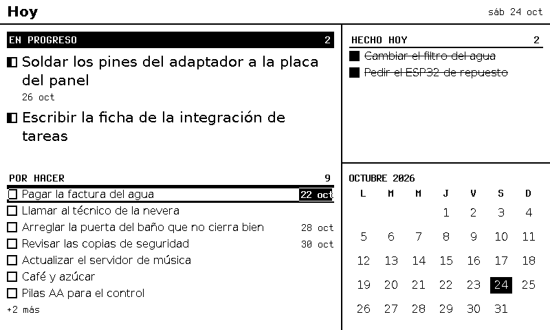
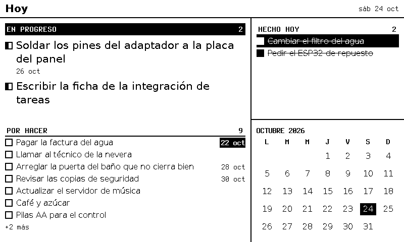
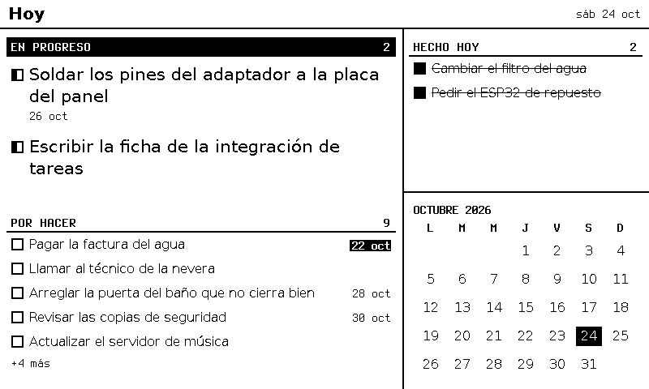
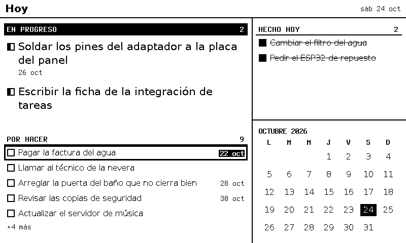
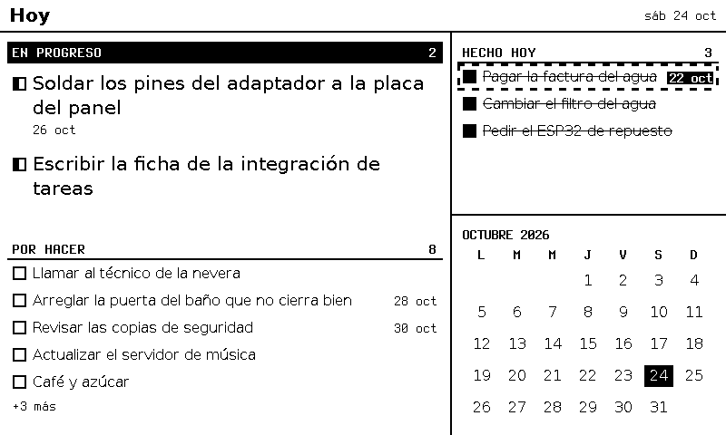
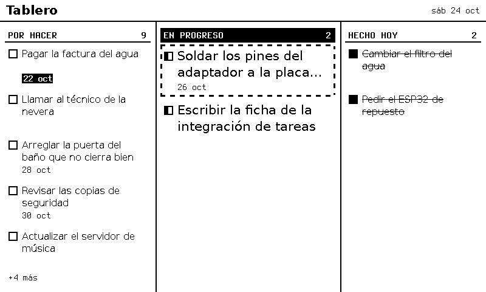

# F-008 · Foco limpio en el panel y vista informada

**Estado:** aprobada · el dueño la aprobó el 2026-10-25 con el foco **punteado** (D1–D4 y D6; ADR-0048 a ADR-0050; `Tintero-View` ya estaba aprobada como idea en ADR-0036)
**Modelo del programador:** sonnet
**Dependencias nuevas permitidas:** ninguna.

## Decisiones que pide esta ficha (puerta 1)

| # | Decisión | Aprobado |
|---|----------|----------|
| **D1** ✅ | Zonas alineadas al byte | x y ancho de cada zona en **múltiplos de 8**; regla del contrato (`unaligned`) (ADR-0048) |
| **D2** ✅ | Espacio para el foco | Anillo **punteado** (tramos de 8 px) de `focusRing` (3 px a 124 ppp) que el aparato invierte; **banda de `focusPad` (6 px) en blanco** por dentro de cada zona; **filas de 30 px**. «Enviando» es el anillo **sólido** (ADR-0048) |
| **D3** ✅ | Contraste con el refresco rápido | Trazos de al menos 2 px (también el tachado) y una **vista de calibración** antes de cambiar letras (ADR-0049) |
| **D4** ✅ | `full_refresh` | «La próxima imagen, con el completo lento»; el servidor lo pone en el **primer índice del día** de cada pantalla; el aparato limpia al quedarse quieto (ADR-0050) |
| **D5** — | `stale_zone` | **No entra.** Sigue en el contrato sin uso (`/actions` responde 200 con estado por acción) |
| **D6** ✅ | Vista que muestra el aparato | Cabecera opcional **`Tintero-View`** en esta misma ficha (ADR-0036) |

## Diseños

PNG de 1 bit del motor con los ejemplos de F-006 (800 × 480, 124 ppp, reloj `2026-10-24T17:00:00Z`). Los de la propuesta se dibujaron con una copia del motor que aplica las reglas de esta ficha; el foco está puesto como lo pone el aparato (inversión sobre la imagen guardada). **Manda el contrato** de esta ficha.

**Por qué cambia:** hoy el marco de 3 px se pega a la raya de *Por hacer* y le abre huecos a la etiqueta de vencida (izquierda); invertir la zona entera hace que una tarea hecha se vea pendiente (derecha).





**Reposo** (al despertar, al cambiar de vista y tras un rato sin tocar nada): ninguna zona lleva borde.



**Foco en una fila** y **en una tarjeta que manda**: el anillo punteado es el único recuadro de la pantalla.


**Enviando** (anillo sólido, lo dibuja el aparato al soltar Aceptar) y **después**: la tarea pasó a *Hecho hoy* y el foco la siguió (mismo id de zona), así que deshacer es otro Aceptar (ADR-0039).





**`tablero`** con las mismas reglas (columnas en x = 8, 264 y 568).



## Listo para programar (se marca antes de pedir aprobación)
- [x] Cada CA se puede comprobar con una prueba, con valores concretos.
- [x] El contrato (interfaces, formatos, errores) está escrito.
- [x] Los archivos a crear o tocar están listados.
- [x] Presupuestos y reglas de seguridad que aplican, nombrados.
- [x] Lo que queda fuera de alcance, escrito.
- [x] **Nombres de archivos, rutas, puertos y URLs** que las pruebas necesiten, escritos.
- [x] Toda **función que se pruebe tiene nombre y firma**, y todo **contador o medida** dice desde cuándo cuenta.

## Contexto
El firmware del dueño ya baja el índice y las imágenes `raw1`, y cambia de vista con los botones; falta el foco con refresco parcial (ADR-0006) y las acciones. El panel trabaja la ventana parcial por bytes y, con el refresco rápido, los trazos de 1 px se ven tenues. Además, el aparato cambia de vista con Mover largo sin decírselo al servidor (ADR-0036). Aplican ADR-0005, ADR-0006, ADR-0032, ADR-0034, ADR-0035, ADR-0039, ADR-0048 a ADR-0050.

## Alcance
Contrato (alineación, `focus` en las zonas, `Tintero-View`, significado de `full_refresh`); geometría del foco en el motor para **todos** los bloques con zonas (`task-list`, `task-board`, `agenda`, `issue-list`) y comprobación de la banda; tachado de 2 px; `full_refresh` diario; `Tintero-View` en el servidor y en el emulador; anillo del emulador con `focus.ring`; bloque y ejemplos de **calibración**; guía del firmware al día.

**Fuera de alcance:** el firmware (lo escribe el dueño, ADR-0013); el estado «Enviando» en el emulador; quitar el foco del emulador al despertar; recordar en disco las acciones ya vistas (`seen`); quitar la etiqueta de vencida de las tareas hechas; `stale_zone`; elegir la letra de los detalles (después de la calibración, M9); el planificador.

## Requisitos
- R1. Lo que esta ficha no cambia sigue igual: las pruebas de aceptación de F-001 a F-012 pasan, salvo las afirmaciones de **geometría** que esta ficha reemplaza (ver *Pruebas anteriores que cambian*).
- R2. Ningún bloque dibuja tinta en la banda de una zona; todo texto, casilla y etiqueta de una fila con zona queda dentro de su caja menos `focusPad` por cada lado.
- R3. `server/README.md`: las medidas del foco, la regla de la banda y el bloque `calibration`. `firmware/README.md`: cómo dibujar el foco, los estados (sin foco, foco, enviando, aplicado, descartado, sin red), la secuencia de Aceptar, `full_refresh`, la limpieza al quedarse quieto y `Tintero-View` (sección *Foco y acciones*, ver *Contrato*).
- R4. `contract/README.md` y el OpenAPI: `unaligned`, `focus_pad`, `focus` y `Tintero-View`. Los JSON Schema se regeneran (`npm run contract:schema`).

## Contrato

### Contrato del protocolo (`contract/src/`)
- `LIMITS`: `zoneAlign: 8`, `maxFocusRing: 16`, `maxFocusPad: 32`, `maxFocusDash: 64`.
- `ZonesResponseSchema`: campo **opcional** `focus: { ring: entero 1…maxFocusRing, pad: entero 1…maxFocusPad, dash: entero 0…maxFocusDash }` (`dash` = largo de los tramos del punteado; 0 = sólido).
- **Regla del anillo** (la usan el emulador y el firmware): se invierten los píxeles de la zona a menos de `ring` de su borde; con `dash > 0`, un píxel de la franja de **arriba o de abajo** se invierte solo si `floor((x − zona.x) / dash)` es par, y uno de la franja **izquierda o derecha** (fuera de las de arriba y abajo) solo si `floor((y − zona.y) / dash)` es par.
- `validateZones`: además de lo de F-001, error **`unaligned`** (ruta `/zones/<i>`) si `x % 8 ≠ 0` o `w % 8 ≠ 0`; error **`focus_pad`** (ruta `/focus`) si `focus.pad < focus.ring`. Los ejemplos existentes no se tocan; se **agregan** `valid/zones-focus.json` (dos zonas alineadas con `focus: { ring: 3, pad: 6, dash: 8 }`), `invalid/zones-unaligned-x.json` (`x: 10`), `invalid/zones-unaligned-w.json` (`w: 476`) e `invalid/zones-focus_pad-thin.json` (`ring: 4, pad: 3`).
- Función nueva, exportada en `contract/src/index.ts`:
  ```ts
  /** Ids of the zones with at least one black pixel within `pad` px inside their border. */
  export function checkFocusBand(raw1: Uint8Array, panel: Panel, zones: Zone[], pad: number): string[];
  ```
  Un píxel está en la banda si está dentro de la zona y a menos de `pad` de alguno de sus cuatro bordes. Negro = **bit 1** en `raw1` (como en F-001). *(Corregido el 2026-10-25 tras la fase de pruebas: decía «bit 0».)*
- `DeviceHeadersSchema`: campo opcional **`view`** (patrón `ID_PATTERN`); `validateDeviceHeaders` lee **`Tintero-View`**; un valor que no cumple el patrón → error de cabecera (el servidor responde `400 invalid_request`, como con las demás).
- `full_refresh` (sin cambio de forma): **`true` = la próxima imagen que muestre el aparato va con el refresco completo lento**.

### Medidas nuevas o cambiadas del tema `base` (`theme.ts`, en `Metrics`)
| Medida | Valor | A 124 ppp | A 200 ppp |
|--------|-------|-----------|-----------|
| `focusRing` (nueva): grosor del anillo | 0,6 mm | 3 px | 5 px |
| `focusDash` (nueva): tramo del punteado | 8 px (fijo: un byte) | 8 px | 8 px |
| `focusPad` (nueva): banda en blanco | 1,2 mm | 6 px | 9 px |
| `focusGap` (nueva): antes de cada fila que manda y de cada `card` | 0,6 mm | 3 px | 5 px |
| `row` (cambia, antes 5 mm) | 6,2 mm | 30 px | 49 px |
| `line` (cambia) | `max(2, mm(0,5))` | 2 px | 4 px |

### Geometría (`view.ts` y bloques)
- **Columna de foco de cada área.** Con `X` y `W` el rectángulo del área (`slotRects`) y `M` = `margin`: `Z0 = ceil8(X + M − focusPad)`, `Z1 = floor8(X + W − M + focusPad)` (`ceil8`/`floor8` = al múltiplo de 8 de arriba/de abajo). El bloque recibe `w = Z1 − Z0`, a la izquierda `Z0`; arriba y alto, como en F-005 (`M` y `H − 2M`). Toda zona ocupa el ancho entero de la columna.
- **Dentro de una zona**, todo lo visible va a `focusPad` de sus cuatro bordes (casilla en `Z0 + focusPad`).
- **Lo que no es zona** (franjas, encabezados de categoría, «+N más», filas de vacío, `month-calendar`, detalle): su **texto** empieza en `Z0 + focusPad`. Los fondos negros y las rayas de las franjas van de `Z0` a `Z1 − 1`.
- **Altos:** fila `row` de `task-list`, `task-board` y `agenda` = `row`; fila que manda = `2·leadLine + metaLine + 2·focusPad` (86 px); `card` = `2·cardLine + metaLine + 2·focusPad` (72 px); filas de `issue-list` = `issueRow + 2·focusPad` y `issueDescRow + 2·focusPad`. Antes de cada fila que manda y de cada `card`: `focusGap` (en lugar de `gap`). Entre filas `row`: nada.
- **Etiqueta de vencida:** alto `row − 2·focusPad − 4`, centrada en la fila.
- **Tachado** de las tareas hechas: `text-decoration-thickness` = `line`.

### Motor (`engine.ts`)
- Después de cada dibujo: una zona con `x % 8 ≠ 0` o `w % 8 ≠ 0` **se deja fuera** y se registra `{ event: "zone-unaligned", view }`; luego `checkFocusBand(raw1, panel, zones, focusPad)`: si da ids, `RenderedView.bandInk` los lista y se registra `{ event: "focus-band-ink", view, count }` (sin textos).
- `RenderedView` gana `bandInk: string[]` y `focus: { ring: number; pad: number; dash: number }` (de las medidas del panel).
- Firma nueva:
  ```ts
  index(device: string, panel: Panel, options?: { view?: string }): Promise<
    { ok: true; value: { current: string; views: RenderedView[]; fullRefresh: boolean } } | BusyResult>;
  ```
  - **`current`:** el detalle si se acaba de abrir (como en F-005); si no, `options.view` cuando está entre las vistas del aparato en ese índice; si no, la primera vista. Una vista desconocida en `options.view` se ignora (no es error).
  - **Prioridad:** si `options.view` está entre las vistas, su dibujo se encola **antes** que el de las demás.
  - **`fullRefresh`:** `true` en el primer `index` de cada **día local** (`timezone` de la configuración) por aparato; el motor recuerda en memoria el último día; tras reiniciar, el primer `index` da `true`.
- **Modo demostración de F-003** (sin motor, `server/src/views.ts`): sus zonas también cumplen la alineación: x = `floor8(u)` y ancho = `floor8(6u)` (a 800 × 480, x = 16 y w = 120; antes x = 20). Lo que se dibuja de cada casilla sigue a su zona. *(Agregado tras la fase de pruebas.)*
- `GET /api/v1/index`: pasa `Tintero-View` a `options.view` y pone `full_refresh` = `fullRefresh` (sin motor, el modo demostración de F-003 sigue con `false`). `GET …/zones`: agrega `focus`.

### Bloque `calibration` (`server/src/engine/blocks/calibration.ts`)
Sin fuente (`slot.source` **no se permite** en este bloque; los demás bloques la siguen exigiendo) y sin zonas. Desde la esquina del contenido (`x0`, `y0`), todo fijo:
1. Tres rayas horizontales de **1, 2 y 3 px** de grueso (en píxeles, a propósito), de `mm(40)` de largo, con su borde de arriba en `y0`, `y0 + mm(3)` y `y0 + mm(6)`.
2. Tres rayas verticales de 1, 2 y 3 px, de `mm(10)` de alto, con su borde izquierdo en `x0 + mm(45)`, `x0 + mm(48)` y `x0 + mm(51)`, desde `y0`.
3. Desde `y0 + mm(12)`, siete líneas de alto `mm(6)` con el texto `Ñandú pingüino ÁÉÍÓÚ 0123 22 oct`: Terminus 14 normal, Terminus 14 negrita, Terminus 16 normal, Terminus 16 negrita, DejaVu Sans 9 pt, DejaVu Sans 12 pt y DejaVu Sans 9 pt tachado (con `line`). Cada línea empieza con su nombre (`Terminus 14 normal: …`).
4. Debajo: las tres casillas (vacía, a medias, llena), la etiqueta de vencida `22 oct`, un anillo **punteado** de muestra de `focusRing` con la regla del anillo (`mm(30)` × `mm(8)`, texto `Foco`) y uno sólido (texto `Enviando`).

Ejemplos: `config/calibracion.views.example.json` (vista `calibracion`, título `Calibración`, una sola área `todo` con `calibration`; aparato `"*"`) y `config/calibracion.data.example.json` (`{ "version": 1, "sources": {} }`).

### Emulador (`emulator/src/`)
- Manda `Tintero-View: <current>` en cada petición cuando su estado tiene `current`.
- `renderScreen(raw1, panel, focus?, ring = 3, dash = 0)`: el marco invertido sigue la regla del anillo; quien la llama pasa `zones.focus?.ring ?? 3` y `zones.focus?.dash ?? 0` (sin `focus`, como en F-002: sólido de 3 px).
- Tras `ok` con imagen nueva: el foco se queda en la zona con el **mismo id**; si ya no está, pasa a la zona con el **mismo índice** en el orden nuevo (o la última si hay menos; `null` si no hay zonas).

### Guía del firmware (`firmware/README.md`, sección *Foco y acciones*)
Lo que el aparato hace (no lo verifica esta ficha; es la referencia para el dueño): anillo **punteado** con `focus.ring` y `focus.dash` según la regla del anillo (ventana parcial = la zona); **sin foco** al despertar y al cambiar de vista; Mover corto = siguiente zona (la primera vez, la zona 1); al soltar Aceptar, **anillo sólido** («Enviando») por parcial y `POST /api/v1/actions`; con `index_changed: true`, `GET /api/v1/index` en la misma conexión (el servidor espera hasta 2 s el dibujo), con `503 busy` esperar `Retry-After` y reintentar **una** vez; la imagen nueva se muestra con un solo completo rápido y el anillo ya puesto en la zona del mismo id (o la del mismo índice); `stale` → sacar de la cola y pedir el índice; `duplicate` → sacar de la cola; sin red → vuelve el anillo punteado y la acción queda en la cola (hasta 8), sin marca optimista (ADR-0025); completo rápido al quedarse quieto (unos 30 s, quitando el foco) y tras un tope de parciales que se mide en el panel (para empezar, 10); `full_refresh: true` → completo lento; mandar `Tintero-View` en cada petición.

## Pruebas anteriores que cambian
El verificador puede tocar **solo** estas pruebas de fichas anteriores, y solo sus afirmaciones de coordenadas, píxeles, alturas o cantidad de zonas visibles:
- **F-005:** CA7, CA9, CA10, CA12, CA14. Sus coordenadas pasan a las reglas de esta ficha, comprobadas con CA3 (propiedades); los ids de zona de cada bloque deben ser un **prefijo** (en el mismo orden) de los de antes, y `zonas visibles + hidden` de cada bloque, igual que antes.
- **F-006:** CA3, CA4, CA6, CA7, CA8, CA9, CA12 y CA13. Los valores nuevos de `hoy` y `tablero` en `P124` son los de CA4 a CA7 de esta ficha (CA13: `hoy` tiene 9 zonas); los de `V124` y `P200`, las propiedades de CA3.
- **F-005 (además):** CA20 y CA23 (píxeles que miran una casilla: pasan a la casilla en su sitio nuevo, a `Z0 + focusPad` de la zona) y CA21 (cantidad de zonas de `hoy`: la que dé la regla de prefijo y `visibles + hidden`).
- **F-003:** CA2/D2, CA5 y CA7: las coordenadas de las zonas de demostración (y los píxeles que miran sus casillas) pasan a x = 16 (ver *Modo demostración*); nada más cambia.
- **F-001:** CA4: las zonas que la prueba arma para comprobar que se aceptan (hasta 48) pasan a tener x y ancho múltiplos de 8; los rechazos siguen igual.

*(Lista ampliada el 2026-10-25 tras la fase de pruebas, a pedido del verificador, y tras la vuelta 1 del programador: F-001 CA4 y F-003 CA5.)*

## Criterios de aceptación
Reloj fijo **`2026-10-24T17:00:00Z`** salvo que se diga otra cosa. Paneles `P124` = `w=800,h=480,dpi=124,depth=1`, `P200` (igual, `dpi=200`) y `V124` = `w=480,h=800,dpi=124,depth=1`. «Los ejemplos del tablero» = `config/tablero.views.example.json` + `config/tablero.data.example.json` (no cambian); «los de F-005» = `config/views.example.json` + `config/data.example.json`. Pruebas con Chromium como en F-006. Una caja es `{x, y, w, h}`; «negro en `(x, y)`» se mira en `raw1`. Ids de zona de los ejemplos del tablero (de `zoneId`): `b-01` en `hoy` = `z4ba4457e13`, `b-02` en `hoy` = `z5b74b95d24`.

- **CA1 (contrato).** Los ejemplos de F-001 siguen validando igual. `validateZones` (panel `P124`) da `ok` para `valid/zones-focus.json`; `unaligned` para `invalid/zones-unaligned-x.json` y `-w.json`; `focus_pad` para `invalid/zones-focus_pad-thin.json`. `npm run contract:check` sale con 0 después de regenerar.
- **CA2 (`checkFocusBand`).** Panel 16 × 16, zona `{0, 0, 16, 16}`, `pad = 3`: todo blanco → `[]`; negro solo en `(2, 8)` → `["z"]`; negro solo en `(3, 8)` → `[]`; negro solo en `(13, 8)` → `["z"]`; negro solo en `(12, 12)` → `[]`.
- **CA3 (propiedades, todas las vistas).** Para los ejemplos del tablero y los de F-005, en `P124`, `P200` y `V124`, cada vista dibujada con el Chromium real tiene: toda zona con `x % 8 = 0` y `w % 8 = 0`; `bandInk = []`; `overflow = []`; `gray = 0`; toda zona a 4 px o más de los divisores y del borde del panel; la respuesta de zonas pasa `validateZones` y trae `focus` = `{ ring: 3, pad: 6, dash: 8 }` en `P124` y `{ ring: 5, pad: 9, dash: 8 }` en `P200`.
- **CA4 (`hoy`, P124).** Zonas, en orden: `b-01` `{8, 73, 480, 86}`, `b-03` `{8, 162, 480, 86}`; `b-02`, `b-04`, `b-05`, `b-06`, `b-07` en `{8, 287, 480, 30}` y `y` + 30 cada una (la última en `y = 407`); `b-12` `{504, 70, 288, 30}`, `b-13` `{504, 100, 288, 30}`. Total **9**. `hidden = { tareas: 4, hechas: 0, mes: 0 }`. Píxeles: negro en `(300, 46)`, `(300, 69)`, `(8, 50)` y `(487, 50)`; blanco en `(300, 70)`, `(300, 72)`, `(7, 50)` y `(488, 50)` (franja que manda y el espacio debajo); negro en `(200, 285)` y `(200, 286)`, blanco en `(200, 287)` (raya de `POR HACER`); negro en `(15, 92)`, blanco en `(23, 92)` (casilla a medias de `b-01`); negro en `(516, 84)` (casilla llena de `b-12`); etiqueta vencida de `b-02`: negro en `(481, 296)` y `(481, 309)`, blanco en `(481, 295)` y `(481, 310)`.
- **CA5 (`tablero`, P124).** Zonas, en orden: `b-01` `{264, 73, 288, 86}`, `b-03` `{264, 162, 288, 86}`; `b-02`, `b-04`, `b-05`, `b-06`, `b-07` en `{8, 73, 240, 72}` y `y` + 75 cada una; `b-12` `{568, 73, 224, 72}`, `b-13` `{568, 148, 224, 72}`. `hidden = { por_hacer: 4, en_progreso: 0, hechas: 0 }`.
- **CA6 (el foco sigue a la tarea).** Con `hoy` dibujada para `local` en `P124`: `toggle` sobre `z5b74b95d24` → `applied`; tras `idle()`, la primera zona de `hechas` es `z5b74b95d24` en `{504, 70, 288, 30}` y las siguientes `b-12` en `y = 100` y `b-13` en `y = 130`; en `tareas`, la primera zona *Por hacer* es la de `b-04` en `{8, 287, 480, 30}` y `hidden.tareas = 3`.
- **CA7 (tachado).** En `hoy` `P124`, el HTML de las filas de `b-12` y `b-13` lleva `text-decoration-thickness:2px`; en `P200`, `4px`.
- **CA8 (`full_refresh`).** Con el motor: primer `index("local", P124)` → `fullRefresh: true`; otro a los 10 min → `false`; con el reloj en `2026-10-25T05:01:00Z` (00:01 del 25 en Lima) → `true`; otro aparato (`otro`) en su primer `index` → `true`. Por HTTP, `GET /api/v1/index` lleva `full_refresh` igual a `fullRefresh`.
- **CA9 (`Tintero-View`).** Con los ejemplos del tablero: `index("local", P124, { view: "tablero" })` → `current = "tablero"`; con `{ view: "nada" }` → `current = "hoy"`; sin `view` → `"hoy"`. Con un `Renderer` falso que anota el orden y la caché vacía, `index(…, { view: "tablero" })` dibuja primero `tablero`. Por HTTP: `Tintero-View: tablero` → `current: "tablero"`; `Tintero-View: Tablero!` → `400 invalid_request`.
- **CA10 (emulador).** Con el servidor de prueba de F-002: toda petición del emulador lleva `Tintero-View` igual a su `current` cuando lo tiene (la primera despertada, sin `current`, no la lleva). `renderScreen` con `ring = 5, dash = 0` invierte exactamente los píxeles a menos de 5 px del borde de la zona; con zona `{8, 8, 40, 24}`, `ring = 3, dash = 8`: invertidos `(8, 8)`, `(15, 9)`, `(24, 10)` y `(9, 25)`; sin invertir `(16, 8)`, `(16, 31)`, `(9, 16)`, `(9, 20)` y `(20, 20)`. Tras `ok`, si el id del foco ya no está en las zonas nuevas, el foco pasa a la zona del mismo índice (o la última).
- **CA11 (calibración).** `npm run render -- --views config/calibracion.views.example.json --data config/calibracion.data.example.json --panel w=800,h=480,dpi=124,depth=1 --out <tmp>` sale con 0 y escribe `calibracion.png` con `overflow = []` y sin zonas. En `P124`, `x0 = 14` e `y0 = 46`. En la columna `x = 34`: negro en `y = 46`, `61`, `62`, `75`, `76` y `77`; blanco en `45`, `47`, `60`, `63`, `74` y `78`. En la fila `y = 66`: negro en `x = 234`, `248`, `249`, `263`, `264` y `265`; blanco en `233`, `235`, `247`, `250`, `262` y `266`. Un `calibration` con `source` → `ConfigError`.
- **CA12 (compatibilidad).** `npm run test:acceptance` (F-001 a F-012, con las pruebas de *Pruebas anteriores que cambian* actualizadas) pasa.

## Presupuestos
- Dibujar `hoy` en `P124` no pasa de lo medido en F-005 (180–370 ms) más 50 ms por `checkFocusBand` (se mide en la prueba de CA4 y se reporta).
- `checkFocusBand` recorre solo las bandas: 48 zonas en `P124` en menos de 5 ms.

## Seguridad
- [ ] Toda entrada externa con **límite de tamaño antes de parsear**: `Tintero-View` se valida con `ID_PATTERN` (16 caracteres como mucho) antes de usarla.
- [ ] Servicios locales solo en **127.0.0.1** (sin cambios).
- [ ] Dependencias nuevas: ninguna.
- [ ] Los registros nuevos (`zone-unaligned`, `focus-band-ink`) no llevan textos de tareas ni la vista que manda el aparato si no existe.

## Archivos
**A crear:** `server/src/engine/blocks/calibration.ts` (+ prueba), `config/calibracion.views.example.json`, `config/calibracion.data.example.json`, `contract/fixtures/v1/valid/zones-focus.json`, `contract/fixtures/v1/invalid/zones-unaligned-x.json`, `zones-unaligned-w.json`, `zones-focus_pad-thin.json`, `tests/acceptance/F-008/`.
**A tocar:** `contract/src/{limits,schemas,validate,index,openapi}.ts`, `contract/schema/v1/*` y `contract/openapi/v1.json` (regenerados), `contract/README.md`; `server/src/engine/{theme,view,engine,config,index}.ts`, `server/src/engine/blocks/{common,task-list,task-board,agenda,issue-list,index,types}.ts`, `server/src/app.ts`, `server/README.md`; `emulator/src/{http,screen,sync,press,wake}.ts`; `firmware/README.md`; las pruebas de *Pruebas anteriores que cambian* (solo el verificador).
**Ya existen (del arquitecto, no se tocan):** `docs/disenos/F-008/*`, ADR-0048 a ADR-0050.

## Resultado esperado
Con el servidor al día, el aparato recibe zonas alineadas y una banda limpia: su anillo punteado de 3 px nunca toca contenido y sale con una sola ventana parcial por zona. Marcar una tarea la pasa a *Hecho hoy* con el foco encima; la pantalla vuelve a la vista que el dueño eligió aunque despierte; una vez al día el panel se limpia con el refresco lento. La vista `calibracion` permite decidir en el panel la letra y los grosores.

## Terminado (se marca al cerrar)
- [ ] Todos los CA pasan en la verificación (informe adjunto).
- [ ] `tools/revisar` limpio, o hallazgos resueltos o anotados como mejora.
- [ ] `tools/check-scope` limpio para cada rol.
- [ ] Resultado obtenido y resumen para aprobar escritos; métricas y lecciones actualizadas.
- [ ] El dueño aprobó integrar.

---

## Resultado obtenido
*(Lo llena el arquitecto al cerrar.)*

## Resumen para aprobar
*(Una pantalla, con `docs/plantillas/resumen-aprobacion.md`.)*
