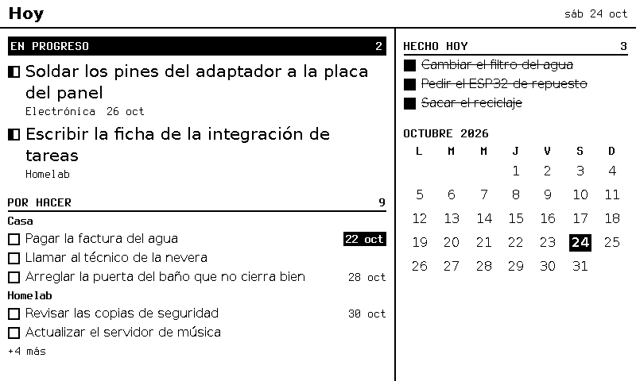
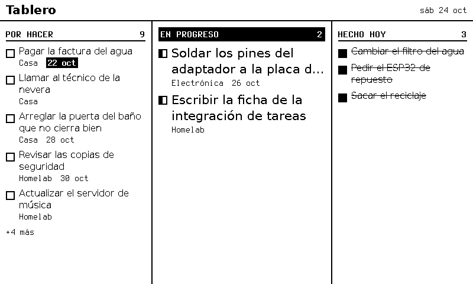
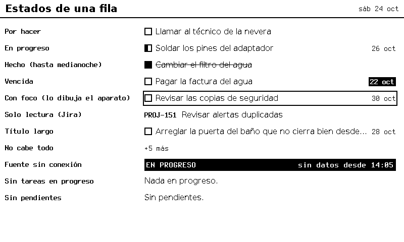

# F-009 · Núcleo mínimo de integraciones y tareas de Trilium

**Estado:** **aprobada** · el dueño aprobó D11–D16 el 2026-10-24 (ADR-0042, ADR-0043); D1, D2 y D8–D10 venían aprobadas de F-006 (ADR-0037, 0038, 0040, 0041)
**Modelo del programador:** sonnet
**Dependencias nuevas permitidas:** ninguna (el `fetch` de Node 24).

## Decisiones

Esta ficha es la antigua «Parte B» de F-006 (D0: dos fichas).

| # | Decisión | Aprobado |
|---|----------|--------|
| **D1** ✅ | Atributos del tablero | `status` y `vence` (`categoria` pospuesta: se lee si existe); orden = posición en el tablero; cierre = fecha de modificación de `status` (ADR-0037) |
| **D2** ✅ | Etapa | La integración traduce el nombre de la columna a `todo` \| `doing` \| `done` (ADR-0038) |
| **D8** ✅ | Núcleo mínimo | Manifiesto TypeScript; llave en archivo local 600 hasta la bóveda; cliente HTTP vigilado; escribir pide `writes` y `allowWrite` (ADR-0040) |
| **D9** ✅ | Escribir sin pisar | Solo si `status` sigue siendo el que se leyó; si no, gana Trilium; sin conexión, reintento en cada lectura durante 24 h (ADR-0041) |
| **D10** ✅ | Sin conexión | Se entrega a `setSource` la hora de la última lectura buena; la pantalla dice «sin datos desde HH:MM» pasados 5 min (ADR-0041) |
| **D11** ✅ | HTTP sin TLS hacia el ETAPI local | Excepción como la de CDP (F-005): `http://` **solo** hacia `127.0.0.1:<puerto>`, desde un único archivo (`server/src/integrations/http.ts`); cualquier otro host exige `https://`. Trilium corre en la misma máquina y su puerto solo escucha en `127.0.0.1`. Si Tintero pasa a un contenedor, la ficha del servicio permanente decide cómo llega (red del host o HTTPS). **ADR-0042** |
| **D12** ✅ | Rutas permitidas en el manifiesto | Un token ETAPI **lo puede todo** (verificado: Trilium no tiene alcances; el token solo guarda nombre y *hash*), incluso borrar notas. El manifiesto declara además **qué métodos y rutas** usa la integración (`GET /notes…`, `PATCH /attributes/…`), y el cliente vigilado rechaza lo demás sin llamar. Token **propio** de Tintero, revocable (S4). **ADR-0043** |
| **D13** ✅ | Lectura en dos llamadas | Cada lectura hace **dos** GET: la nota del tablero (sus `childNoteIds` vienen ya **en el orden del tablero**, verificado) y una búsqueda `#status` en profundidad 1 (trae título y atributos de todas las tarjetas a la vez). No una llamada por tarjeta. Si en Trilium se ordena una columna por un campo, Tintero sigue el orden manual (mejora futura: leer `board.json`). |
| **D14** ✅ | Qué tarjetas entran | Solo cuentan los atributos **propios** de la tarjeta (ETAPI también entrega los heredados del tablero). No entran: sin `status` propio, con un `status` que no es una columna configurada, o archivadas. **Nunca** se escribe un atributo heredado (cambiaría el tablero o la plantilla). Las *Hecho* de hace más de 26 h no se envían (la pantalla solo muestra lo cerrado hoy, ADR-0037; I5 y el tope de 500). |
| **D15** ✅ | `allowWrite` y `readonly` coinciden | Si la configuración dice `allowWrite: false`, la fuente del archivo de datos tiene que ser `readonly: true` (y al revés); si no, el servidor no arranca. Así Aceptar nunca marca algo que no se va a escribir. |
| **D16** ✅ | Antes de la primera lectura | Al arrancar, la integración llama `setSource(fuente, [], { readAt: <arranque> })`: si Trilium no responde desde el principio, a los 5 min la pantalla dice «sin datos desde <hora de arranque>» en vez de quedarse vacía sin aviso. |

## Diseños

Lo que esta integración alimenta (las pantallas son de F-006; HTML y generador en `docs/disenos/F-006/`). Son PNG de 1 bit del mismo Chromium del motor, con datos inventados.

**`hoy`, fase 1:** las tarjetas *En progreso* mandan, *Por hacer* va por `categoria`, `vence` a la derecha (invertida si ya pasó) y lo cerrado hoy en el riel.



**`tablero`:** las tres columnas del tablero de Trilium.



**Estados de una fila**, incluida la fuente sin conexión (D10).



## Listo para programar (se marca antes de pedir aprobación)
- [x] Cada CA se puede comprobar con una prueba, con valores concretos.
- [x] El contrato (interfaces, formatos, errores) está escrito.
- [x] Los archivos a crear o tocar están listados.
- [x] Presupuestos y reglas de seguridad que aplican, nombrados.
- [x] Lo que queda fuera de alcance, escrito.
- [x] **Nombres de archivos, rutas, puertos y URLs** que las pruebas necesiten, escritos (ETAPI falso y sus datos, abajo).
- [x] Toda **función que se pruebe tiene nombre y firma**, y todo **contador o medida** dice desde cuándo cuenta.

## Contexto
F-006 dibuja las tareas con datos de prueba. Esta ficha las trae del tablero Kanban de Trilium (ADR-0010) y escribe ahí la marca de *Hecho*: es la primera integración y la primera de doble vía (I4). Arranca el núcleo del documento 7 en su forma mínima (ADR-0040), sin esperar la base de datos ni la web. Aplican ADR-0009 (la integración pide, el núcleo concede), ADR-0035 (dibujar cuando hay información nueva), ADR-0039 (Aceptar marca *Hecho* y deshace) y las reglas I1, I2, I4, I5, I7, S4 y S6 de `docs/seguridad.md`.

**Verificado contra un Trilium real** (TriliumNext 0.106, 2026-10-24, por el arquitecto): un tablero es una nota `book` con `#viewType=board` (por plantilla); las columnas son las opciones de `label:status`; cada tarjeta es una hija con el atributo `status` propio; `GET /etapi/notes/<id>` entrega `childNoteIds` ordenados por posición (el orden manual del tablero) y **todos** los atributos, propios y heredados (los heredados traen otro `noteId`); `utcDateModified` de un atributo viene como `"2026-10-24 16:15:04.871Z"` (espacio, no `T`); `PATCH /etapi/attributes/<id>` acepta `{ "value" }` en etiquetas; una búsqueda con `ancestorNoteId` y `ancestorDepth=eq1` entrega las notas completas con atributos (unos 1,5 KB por tarjeta); los tokens ETAPI no tienen alcances.

## Alcance
Manifiesto, configuración de integraciones, cliente HTTP vigilado, `trilium-tareas` (lectura cada 60 s y escritura de `status`), conexión con el motor (`setSource` y un aviso de `toggle` nuevo), registro de llamadas sin contenido, opción `--integrations` del servidor.

**Fuera de alcance:** bóveda cifrada, OAuth y web de configuración; Google Calendar y Jira; varios usuarios (I6); integraciones de terceros en proceso aparte (I10); avisos de vencimiento por Telegram (I9); avisos entrantes (I11: aquí solo se consulta); crear o mover tarjetas desde la pantalla (solo *Hecho* y deshacer, ADR-0039); orden por campo de una columna (D13); el token real y la configuración real del dueño (fuera del repo).

## Requisitos
- R1. Código en `server/src/integrations/`, con pruebas unitarias contra un ETAPI falso en `127.0.0.1`; **ninguna prueba toca un Trilium real**. El programador escribe su propio ETAPI falso para las unitarias y el verificador el suyo en `tests/acceptance/F-009/`, los dos a partir de la sección *ETAPI falso* de esta ficha (así no se copian los errores).
- R2. Toda respuesta de Trilium se limita en tamaño **antes** de parsearla, y nada del contenido de las tareas, ningún id de nota o de atributo, ni la llave salen en registros ni en mensajes de error.
- R3. `server/README.md`: cómo crear el token ETAPI propio de Tintero (en Trilium: *Opciones → ETAPI → Crear token*, nombre `tintero`), dónde va el archivo de la llave (fuera del repo, permisos 600, solo el token en una línea) y cómo se revoca. Solo **instrucciones** (ADR-0023).
- R4. Sin `--integrations`, el servidor se porta igual que antes: las pruebas de aceptación de F-001 a F-007 pasan.
- R5. `docs/seguridad.md` tiene la sección de la excepción D11 (ya escrita por el arquitecto, ADR-0042).

## Contrato

### Manifiesto (`server/src/integrations/manifest.ts`)
```ts
export interface Route { method: "GET" | "PATCH"; prefix: string }   // "/notes", "/attributes/"
export interface Manifest {
  id: string;                        // "trilium-tareas"
  version: string;                   // "1"
  delivers: "tasks" | "events";
  hosts: "configured" | string[];    // "configured": solo el origen de baseUrl (servicio propio del dueño)
  routes: Route[];                   // D12: lo demás se rechaza sin llamar
  writes: boolean;                   // I4
  pollS: number;                     // cada cuánto lee (I11: se consulta, nada entra)
}
export const triliumTasksManifest: Manifest = {
  id: "trilium-tareas", version: "1", delivers: "tasks", hosts: "configured",
  routes: [{ method: "GET", prefix: "/notes" }, { method: "PATCH", prefix: "/attributes/" }],
  writes: true, pollS: 60,
};
```

### Cliente vigilado (`server/src/integrations/http.ts`, único archivo con `fetch` fuera de pruebas)
```ts
export type HttpErrorCode =
  | "host" | "route" | "write-denied" | "bad-path"
  | "key-missing" | "key-permissions" | "key-too-large" | "key-empty"
  | "timeout" | "too-large" | "network" | "status" | "bad-json";
export class IntegrationHttpError extends Error {
  constructor(readonly code: HttpErrorCode, readonly httpStatus?: number) { super(code); }
}
export interface GuardedHttp {   // la integración no ve la llave (I1) ni tiene otra red (I2)
  request(method: "GET" | "PATCH", path: string, body?: unknown): Promise<{ status: number; json: unknown }>;
}
export function guardedHttp(
  base: URL, keyFile: string, manifest: Manifest,
  options?: { maxBytes?: number; timeoutMs?: number; allowWrite?: boolean;
              log?: (line: Record<string, unknown>) => void; clock?: () => Date },
): GuardedHttp;
```
- **Al crearlo** (lanza `IntegrationHttpError`, sin abrir conexiones): `base` tiene que ser `https://…` o `http://127.0.0.1:<puerto>/…` (D11), si no `host`; con `hosts` lista, el `host` de `base` tiene que estar en ella, si no `host`. La llave: el archivo tiene que existir (`key-missing`), sin permisos para grupo ni otros (`mode & 0o077 === 0`, si no `key-permissions`), ≤ 4 KiB (`key-too-large`, se mira el tamaño antes de leer) y no vacío tras quitar espacios y saltos de línea (`key-empty`). Se lee **una vez**, al crearlo.
- **En cada `request`**, antes de llamar: `path` empieza con `/`, no empieza con `//`, no tiene `..`, `\`, `#` ni `://` (si no `bad-path`); método y `path` casan con alguna `route` (`path.startsWith(prefix)`, si no `route`); `PATCH` pide `manifest.writes` **y** `allowWrite === true` (si no `write-denied`). La URL es `base` + `path`, conservando el `pathname` de `base` (`http://127.0.0.1:N/etapi` + `/notes/x` → `/etapi/notes/x`).
- **Llamada:** cabecera `Authorization: <token>` (como pide ETAPI, sin `Bearer`), `Content-Type: application/json` si hay cuerpo, `redirect: "error"`. Tope de tiempo `timeoutMs` (por defecto **5000**) para toda la llamada, cuerpo incluido (`timeout`). La respuesta se lee por partes y se corta al pasar `maxBytes` (por defecto **1 048 576**; también si `Content-Length` ya lo pasa) → `too-large`. Error de red → `network`. Estado fuera de 200–299 → `status` con `httpStatus` (nunca el cuerpo). Cuerpo vacío → `json: null`; si no, `JSON.parse` (`bad-json` si falla).
- **Registro (I7, S6):** cada `request` que llega a la red escribe **una** línea por `log`: `{ ts, integration, host, method, status, ms }`. `ts` en ISO de `clock()`; `host` = `host` de `base`; `status` = 0 si no hubo respuesta (`timeout`, `network`). Nada más: ni rutas, ni ids, ni cuerpos, ni cabeceras.

### Configuración (`server/src/integrations/config.ts`)
```ts
export interface TriliumTasksConfig {
  source: string;            // id de la fuente de tipo "tasks" en el archivo de datos
  baseUrl: string;           // p. ej. "http://127.0.0.1:8080/etapi"
  keyFile: string;           // ruta absoluta
  boardNoteId: string;       // /^[A-Za-z0-9_]{1,32}$/
  allowWrite: boolean;
  columns: Record<string, Stage>;  // por defecto {"Por hacer":"todo","En progreso":"doing","Hecho":"done"}
}
export interface IntegrationsFile { version: 1; integrations: { "trilium-tareas"?: TriliumTasksConfig } }
export function loadIntegrations(file: string): IntegrationsFile;   // lanza ConfigError (de engine/config)
```
Archivo ≤ **64 KiB** (se mira antes de leer). Campos desconocidos, en cualquier nivel → error. `columns` es opcional (vale el por defecto); si viene: 1 a 10 nombres de 1 a 40 caracteres, valores solo `todo`, `doing` o `done`, y al menos una columna `done` y una `todo`. `baseUrl` como en D11. Los mensajes llevan la ruta JSON del campo (`/integrations/trilium-tareas/baseUrl`) y nunca el valor. Ejemplo con valores de relleno: `config/integrations.example.json` (fuente `tablero` de `config/tablero.data.example.json`).

### Integración (`server/src/integrations/trilium-tasks.ts`)
```ts
export function readBoard(http: GuardedHttp, boardId: string, columns: Record<string, Stage>,
                          now: Date, log?: (line: Record<string, unknown>) => void):
  Promise<{ tasks: Task[]; statuses: Map<string, string> }>;
export function markStage(http: GuardedHttp, noteId: string, expected: string, next: string):
  Promise<"written" | "conflict">;
export interface TriliumTasks {
  start(): void;                    // primer ciclo ya, luego cada manifest.pollS
  cycle(): Promise<void>;           // un ciclo completo (en la fila); las pruebas lo llaman directo
  onToggle(change: ToggleChange): void;
  idle(): Promise<void>;            // espera a que la fila quede vacía (para las pruebas)
  stop(): Promise<void>;            // para el temporizador y espera la llamada en curso
}
export function createTriliumTasks(options: {
  http: GuardedHttp; config: TriliumTasksConfig; manifest: Manifest;
  engine: Pick<Engine, "setSource">; clock?: () => Date;
  log?: (line: Record<string, unknown>) => void;
}): TriliumTasks;
```

**`readBoard`** (D13, D14): `GET /notes/<boardId>` → `childNoteIds` (el orden); `GET /notes?search=%23status&ancestorNoteId=<boardId>&ancestorDepth=eq1&limit=1000` → `results`. Por cada id de `childNoteIds`, en orden, con su nota de `results` (si no está, no entra y se registra `no-status`): solo atributos con `noteId` igual al de la tarjeta y `type: "label"`. No entra si: no tiene `status` propio; su `status` no es una clave de `columns`; tiene `archived` (propio o heredado); el título queda vacío tras quitar espacios; es `done` y su cierre es de hace más de 26 h respecto de `now`. Al `Task`: `id` = `noteId`; `title` recortado a 200 caracteres (199 + `…` si era más largo); `stage` = `columns[status]`; `done = stage === "done"`; `doneAt` solo si es `done`, = `utcDateModified` del atributo `status` pasado a RFC 3339 (`"2026-10-24 16:30:00.000Z"` → `"2026-10-24T16:30:00.000Z"`); `due` = `vence` si es una fecha `YYYY-MM-DD` válida (si no, se omite); `category` = `categoria` si tiene de 1 a 40 caracteres. Ningún otro campo. Máximo **500** tareas (las primeras en orden). `statuses` = el `status` leído de cada tarea que entró. Cada tarjeta que no entra deja una línea `{ ts, integration, event: "skipped", reason }` con `reason` ∈ `no-status`, `unknown-status`, `archived`, `empty-title`, `old-done`, `too-many` (sin ids). Una respuesta sin la forma esperada → `IntegrationHttpError("bad-json")`.

**`markStage`** (ADR-0041, D14): `GET /notes/<noteId>`; busca el atributo `label` `status` **propio**. Si la nota no existe (404), no tiene `status` propio, o su valor no es `expected` → `"conflict"` **sin** PATCH. Si es `expected` → `PATCH /attributes/<attributeId>` con `{ "value": next }` → `"written"`. Otros errores se lanzan.

**Aviso de `toggle` del motor** (`server/src/engine/engine.ts`, único cambio ahí):
```ts
export interface ToggleChange { sourceId: string; taskId: string; stage: Stage; previous: Stage }
// EngineOptions gana: onToggle?: (change: ToggleChange) => void;
```
Se llama, una vez y después de aplicar, por cada `toggle` con resultado `applied` sobre una tarea con etapa (no en el `task-list` de F-005 sin `stage`). `stage` es la etapa nueva y `previous` la de antes. Si lanza, el motor lo atrapa, registra `{ ts, event: "onToggle-error" }` y sigue. Sin `onToggle`, todo igual que en F-006.

**Funcionamiento de `createTriliumTasks`:**
- Al crearse llama una vez `engine.setSource(config.source, [], { readAt: clock() })` (D16).
- Guarda `s[tarea]` = el último `status` conocido en Trilium (lo leído, o lo escrito con éxito) y, como mucho, **un pendiente por tarea**: `{ next: <columna deseada>, since }`. La columna de una etapa es la **primera** clave de `columns` con esa etapa.
- Todo lo que llama a Trilium va **en una fila**, una cosa a la vez (ciclos y escrituras no se cruzan).
- **`onToggle`** de la fuente `config.source` (las demás se ignoran): si la tarea no tiene `s`, se registra `{ event: "write", result: "unknown-task" }` y nada más. Si no, el pendiente pasa a ser `{ next: <columna de stage>, since: clock() }` (reemplaza al anterior, así un deshacer pisa la marca) y se pone en la fila una **escritura** de esa tarea.
- **Escritura** de una tarea (en la fila): si no hay pendiente, nada. Si `next === s`, se borra el pendiente sin llamar (fue un deshacer antes de escribir). Si no → `markStage(http, tarea, s, next)`: `written` deja `s = next` y borra el pendiente **solo si** su `next` no cambió mientras tanto (si cambió, vuelve a la fila); `conflict` borra el pendiente (gana Trilium); un error de red, tiempo o estado lo deja para el próximo ciclo (línea `pending`).
- **`cycle()`** (en la fila): 1) cada pendiente con `since` de hace más de **24 h** se descarta (línea `expired`); 2) escritura de cada pendiente restante; 3) `readBoard`: si sale bien, actualiza `s` con `statuses`, a cada tarea con pendiente le pone la etapa del pendiente (`stage`, `done`, y `doneAt` = `since` en ISO si es `done`), y llama `engine.setSource(config.source, tasks, { readAt: clock() })`; si falla, **no** llama `setSource` (la pantalla conserva lo último y la marca local) y deja `{ ts, integration, event: "read", ok: false, code }`.
- Cada escritura deja `{ ts, integration, event: "write", result }` con `result` ∈ `written`, `conflict`, `pending`, `expired`, `unknown-task`. Un ciclo nunca lanza hacia afuera; `start()` repite cada `pollS` sin solaparse.

### Servidor
`--integrations <archivo>` (pide `--views` y `--data`; si no, sale con 2). Al arrancar: carga el archivo, comprueba que `source` exista en los datos con tipo `tasks` y que `readonly === !allowWrite` (D15), crea el cliente y la integración, conecta `onToggle` y llama `start()`; `stop()` entra en el apagado ordenado antes del motor. Cualquier error de configuración o de llave sale con **2** y un mensaje con la ruta JSON o el código (`key-permissions`…), nunca un valor ni el token. Las líneas de `log` van a la salida estándar como las demás.

## ETAPI falso (para las pruebas)
Servidor HTTP en `127.0.0.1`, puerto 0 (elige uno libre), `baseUrl = http://127.0.0.1:<puerto>/etapi`. Token `token-de-prueba-123`, en un archivo de una carpeta temporal **fuera del repo**, con permisos 600. Toda petición sin `Authorization: token-de-prueba-123` exacto → 401 `{"status":401,"code":"NOT_AUTHENTICATED","message":"…"}`. Guarda cada petición recibida (`method`, ruta con consulta, cuerpo) para que la prueba la mire. Se puede poner **sin conexión** (cierra cada conexión sin responder), **lento** (espera N ms antes de responder) o hacer que devuelva un cuerpo dado.

| Ruta | Respuesta |
|------|-----------|
| `GET /etapi/notes/tablero00001` | 200 `{ noteId, title: "Tablero", type: "book", childNoteIds, attributes: [] }` |
| `GET /etapi/notes?search=%23status&ancestorNoteId=tablero00001&ancestorDepth=eq1&limit=1000` (parámetros en cualquier orden; `search` decodificado = `#status`) | 200 `{ results: [<nota>…] }`: las tarjetas que tienen algún atributo `status` (propio **o heredado**), **en orden inverso** al del tablero (para probar que el orden sale de `childNoteIds`) |
| `GET /etapi/notes/<id>` de una tarjeta | 200 `<nota>`; id desconocido → 404 `{"status":404,"code":"NOTE_NOT_FOUND","message":"…"}` |
| `PATCH /etapi/attributes/<attributeId>` con `{ "value" }` | 200 con el atributo actualizado (`utcDateModified` = hora de la prueba); el falso cambia su estado. Id desconocido → 404 `ATTRIBUTE_NOT_FOUND` |
| Cualquier otra | 404 |

Una `<nota>` es `{ noteId, title, type: "text", utcDateModified, attributes: [...] }` y cada atributo `{ attributeId, noteId, type: "label", name, value, isInheritable: false, utcDateModified }` (fecha por defecto `2026-10-20 09:00:00.000Z`). **Toda** tarjeta trae además los dos heredados del tablero (`noteId: "tablero00001"`): `label:status` = `"promoted,alias=Estado,single,select,options=Por hacer;En progreso;Hecho"` y `label:vence` = `"promoted,alias=Vence,single,date"`.

**Datos** (`childNoteIds` en este orden):

| noteId | título | atributos propios (`attributeId`: nombre = valor, fecha) |
|--------|--------|------------------|
| `tarjeta00002` | `Soldar los pines` | `atrstatus002`: status = `En progreso`; `atrvence0002`: vence = `mañana` |
| `tarjeta00004` | `Esperar repuesto` | `atrstatus004`: status = `Bloqueada` |
| `tarjeta00001` | `Comprar pilas` | `atrstatus001`: status = `Por hacer`; `atrvence0001`: vence = `2026-10-26` |
| `tarjeta00005` | `Solo título` | ninguno |
| `tarjeta00003` | `Pagar el agua` | `atrstatus003`: status = `Hecho`, `2026-10-24 16:30:00.000Z` |
| `tarjeta00006` | `Heredada` | ninguno propio; heredado `status` = `Por hacer` con `noteId: "plantilla001"`, `attributeId: "atrplantilla"` |
| `tarjeta00007` | 250 veces `x` | `atrstatus007`: status = `Por hacer` |
| `tarjeta00008` | `Cerrada ayer` | `atrstatus008`: status = `Hecho`, `2026-10-23 12:00:00.000Z` |
| `tarjeta00009` | `Archivada` | `atrstatus009`: status = `Por hacer`; `atrarchiv009`: archived = `""` |

(Trilium real no devuelve archivadas en la búsqueda; el falso sí, para probar la defensa.)

## Criterios de aceptación
Reloj fijo **`2026-10-24T17:00:00Z`** (12:00 en Lima) salvo que se diga otra cosa; zona `America/Lima`. ETAPI falso como arriba; las pruebas lo llaman solo a través de la función auxiliar de `docs/seguridad.md`. `cfg` = `{ source: "tablero", baseUrl, keyFile, boardNoteId: "tablero00001", allowWrite: true }` (columnas por defecto). «El motor» = `createEngine` con `config/tablero.views.example.json`, un archivo de datos igual a `config/tablero.data.example.json` pero con `tablero.items = []`, un `Renderer` falso (`fakeRenderer()`) y el reloj de la prueba. «Espía» = un objeto con `setSource` que guarda cada llamada y la pasa al motor. «Esperar la fila» = `await idle()`.

- **CA1 (origen y rutas).** `guardedHttp` lanza `host`, y el falso no recibe nada, con: `base` `http://127.0.0.1:<p>/etapi` y `hosts: ["example.org"]`; `base` `http://192.168.1.10:8080/etapi` y `hosts: "configured"`; `base` `ftp://127.0.0.1:<p>/`. Con un cliente bueno, `request` lanza sin llamar: `bad-path` para `"notes/x"`, `"//example.org/x"`, `"/notes/../app"` y `"/notes/x#y"`; `route` para `GET /app/info` y `PATCH /notes/tarjeta00001`. El falso sigue con **0** peticiones.
- **CA2 (llave).** Con el archivo de la llave en `0644` → `key-permissions`; inexistente → `key-missing`; con 4097 bytes → `key-too-large`; con `"\n  \n"` → `key-empty`. Ningún `message` contiene `token-de-prueba-123`. Con la llave buena (con un salto de línea al final), el falso recibe `Authorization: token-de-prueba-123` exacto en cada petición, y ninguna propiedad propia del objeto `GuardedHttp` contiene el token.
- **CA3 (topes).** Respuesta de 1 048 577 bytes → `too-large` (también si el falso no manda `Content-Length`); con `timeoutMs: 200` y el falso lento 1500 ms → `timeout` antes de 1000 ms desde la llamada; sin conexión → `network`; 401 → `status` con `httpStatus: 401`; cuerpo `{` → `bad-json`. Cada uno deja exactamente una línea de registro con `status` 0 (`timeout`, `network`) o el estado recibido.
- **CA4 (escribir pide permiso).** Con `manifest.writes: false`, o con `allowWrite` ausente o `false`, `request("PATCH", "/attributes/atrstatus001", { value: "Hecho" })` → `write-denied` y 0 peticiones.
- **CA5 (lectura).** `readBoard(http, "tablero00001", <por defecto>, reloj, log)` hace **exactamente 2** peticiones (las dos GET de la tabla) y `tasks` es, en este orden y sin más campos:
  `{ id: "tarjeta00002", title: "Soldar los pines", done: false, stage: "doing" }`,
  `{ id: "tarjeta00001", title: "Comprar pilas", done: false, stage: "todo", due: "2026-10-26" }`,
  `{ id: "tarjeta00003", title: "Pagar el agua", done: true, stage: "done", doneAt: "2026-10-24T16:30:00.000Z" }`,
  `{ id: "tarjeta00007", title: <199 «x» + "…">, done: false, stage: "todo" }`.
  `statuses` tiene esas cuatro con su `status`. El registro tiene una línea `skipped` por cada una de `tarjeta00004` (`unknown-status`), `00005` (`no-status`), `00006` (`no-status`), `00008` (`old-done`) y `00009` (`archived`). Con `columns: { "Por hacer": "todo", "Bloqueada": "doing", "Hecho": "done" }`, `tarjeta00004` entra con `stage: "doing"` y `tarjeta00002` no.
- **CA6 (escritura sin pisar).** `markStage(http, "tarjeta00001", "Por hacer", "Hecho")` → `"written"`; el falso recibió `GET /etapi/notes/tarjeta00001` y luego `PATCH /etapi/attributes/atrstatus001` con cuerpo exactamente `{"value":"Hecho"}`. Con el falso cambiado a `En progreso` → `"conflict"` y **ningún** PATCH. `markStage` sobre `tarjeta00006` (solo heredado) y sobre `tarjeta99999` (404) → `"conflict"` y ningún PATCH; en particular **nunca** un PATCH a `atrplantilla`.
- **CA7 (marcar y deshacer de punta a punta).** Motor + espía + `createTriliumTasks` con `onToggle` conectado al motor. Tras `cycle()`, el espía recibió primero `([], { readAt: reloj })` (D16) y luego las 4 tareas de CA5. Un `toggle` del motor sobre la zona de `tarjeta00001` en `hoy` → `applied`; tras esperar la fila, el falso recibió `PATCH /etapi/attributes/atrstatus001` `{"value":"Hecho"}`. Otro `toggle` (otro `id`) sobre la misma tarea → PATCH `{"value":"Por hacer"}`. Aparte: con el falso lento 300 ms, un `toggle` y su deshacer seguidos (sin esperar) → tras esperar la fila, a lo sumo **2** PATCH, el falso termina en `Por hacer`, y el siguiente `cycle()` entrega `tarjeta00001` con `stage: "todo"`.
- **CA8 (gana Trilium).** Tras `cycle()`, el falso cambia `tarjeta00001` a `En progreso` (como desde el celular); `toggle` en la pantalla → tras esperar la fila, ningún PATCH y una línea `{ event: "write", result: "conflict" }`; el siguiente `cycle()` entrega al espía `tarjeta00001` con `stage: "doing"`.
- **CA9 (sin conexión y 24 h).** `cycle()` bueno a las 17:00Z; falso sin conexión; `toggle` sobre `tarjeta00001` a las 17:01Z → `applied` y, tras esperar la fila, línea `result: "pending"`; `cycle()` a las 17:02Z → ninguna llamada nueva al espía; el falso vuelve; `cycle()` a las 17:03Z → el GET de la tarjeta y el PATCH `{"value":"Hecho"}` llegan **antes** de las dos GET de la lectura, línea `written`, y el espía recibe `tarjeta00001` con `stage: "done"`. Aparte: sin conexión, `toggle` a las 17:01Z, reloj en `2026-10-25T17:01:01Z`, el falso vuelve, `cycle()` → línea `expired`, **ningún** PATCH, y el espía recibe `tarjeta00001` con `stage: "todo"`.
- **CA10 (hora de lectura).** En el escenario de CA9, el `readAt` de cada llamada al espía es el reloj de ese ciclo, y tras el fallo de las 17:02Z el último `readAt` entregado sigue siendo 17:00Z. Con el falso sin conexión desde el arranque (reloj 17:00Z) y un `cycle()`, la única llamada al espía es `([], { readAt: 17:00Z })`, y `staleLabel(<ese readAt>, 17:06Z, "America/Lima") = "sin datos desde 12:00"`.
- **CA11 (configuración y arranque).** `loadIntegrations` lanza `ConfigError` con la ruta JSON para: un archivo de 65 537 bytes; un campo `"token"` en `trilium-tareas`; `columns` con `"Hecho": "closed"`; `columns` sin ninguna `done`; `baseUrl` `http://192.168.1.10:8080/etapi`; `boardNoteId` `"../x"`. Ningún mensaje contiene el valor. El servidor con `--integrations` sale con **2**: sin `--views`/`--data`; con `source: "nada"`; con `allowWrite: false` y la fuente `readonly: false` (D15); con la llave en `0644` (mensaje con `key-permissions`). `config/integrations.example.json` carga sin errores con `loadIntegrations`.
- **CA12 (registro).** Juntando **todas** las líneas de registro de la integración y del cliente en CA5 a CA10: ninguna contiene un título de la tabla, un `noteId` o `attributeId` de la tabla, `tablero00001` ni `token-de-prueba-123`; cada línea de una llamada tiene exactamente las claves `ts`, `integration`, `host`, `method`, `status`, `ms`.
- **CA13 (regresión).** `npm run test:acceptance` (F-001 a F-007) pasa; `createEngine` sin `onToggle` se porta igual que en F-006.

## Presupuestos
Respuesta de ETAPI ≤ 1 MiB; 5 s por llamada; lectura cada 60 s; **2 GET por lectura** + 1 GET y 1 PATCH por escritura; ≤ 500 tareas al motor; pendientes ≤ 24 h desde el `toggle`.

## Seguridad
- [ ] Toda entrada externa con **límite de tamaño antes de parsear**: respuestas de ETAPI (1 MiB), archivo de configuración (64 KiB), archivo de la llave (4 KiB).
- [ ] Servicios locales solo en **127.0.0.1** (el ETAPI falso); `http://` solo hacia `127.0.0.1` (D11, zona sensible: `http.ts` con un único `fetch` marcado).
- [ ] Dependencias nuevas: ninguna.
- [ ] I1 (la integración no ve la llave), I2 (solo el cliente vigilado, solo el origen configurado), I4 + ADR-0043 (rutas y escritura explícitas), I5 (solo los campos de `Task`; *Hecho* viejas fuera), I7 + S6 (registro sin contenido ni ids), S4 (token propio y revocable).
- [ ] La llave no aparece en el repo, en registros ni en errores; en el repo solo las instrucciones (ADR-0023).

## Archivos
**A crear:** `server/src/integrations/{manifest,http,config,trilium-tasks}.ts` (+ sus `*.test.ts`), `server/src/integrations/README.md`, `config/integrations.example.json`, `tests/acceptance/F-009/` (verificador).
**A tocar:** `server/src/engine/engine.ts` (`onToggle`), `server/src/args.ts` y `server/src/main.ts` (`--integrations`), `server/README.md` (R3). Ya hechos por el arquitecto: `docs/seguridad.md` (R5), ADR-0042 y ADR-0043.

## Resultado esperado
Con `--integrations`, una tarjeta nueva en el tablero de Trilium aparece en la pantalla en la lectura siguiente (≤ 60 s), y Aceptar la pasa a *Hecho* en Trilium sin pisar lo que se haya cambiado desde el celular. Si Trilium no responde, la pantalla sigue mostrando lo último, guarda la marca y avisa «sin datos desde HH:MM».

## Terminado (se marca al cerrar)
- [ ] Todos los CA pasan en la verificación (informe adjunto).
- [ ] `tools/revisar` limpio, o hallazgos resueltos o anotados como mejora.
- [ ] `tools/check-scope` limpio para cada rol.
- [ ] Resultado obtenido y resumen para aprobar escritos; métricas y lecciones actualizadas.
- [ ] El dueño aprobó integrar.

---

## Resultado obtenido
*(Lo llena el arquitecto al cerrar.)*

## Resumen para aprobar
*(Una pantalla, con `docs/plantillas/resumen-aprobacion.md`.)*
