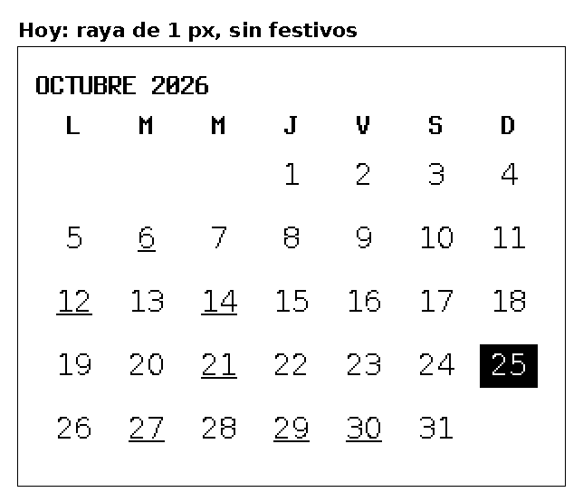
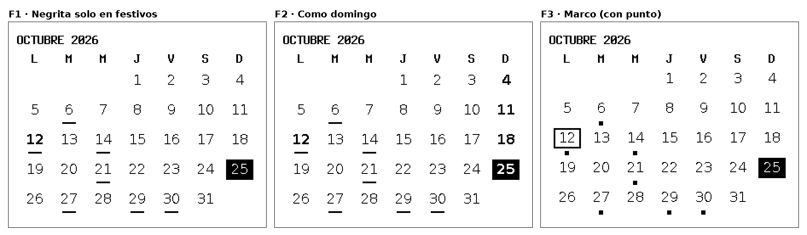
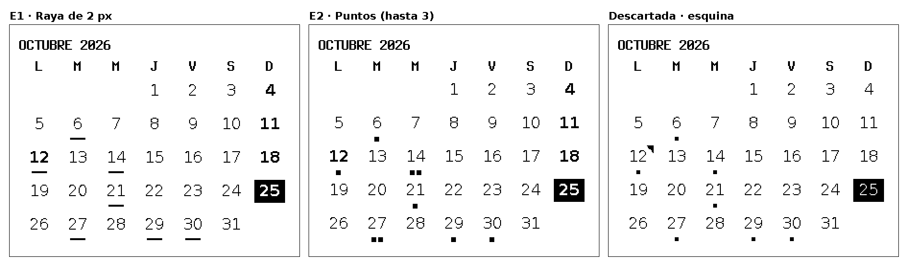
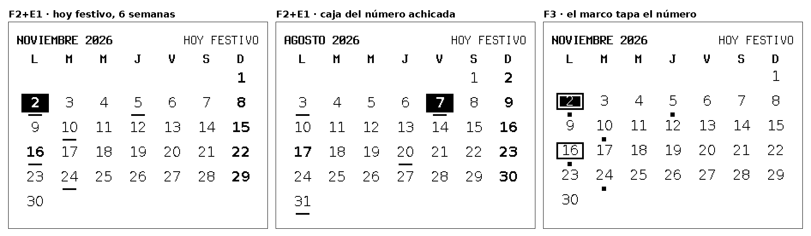
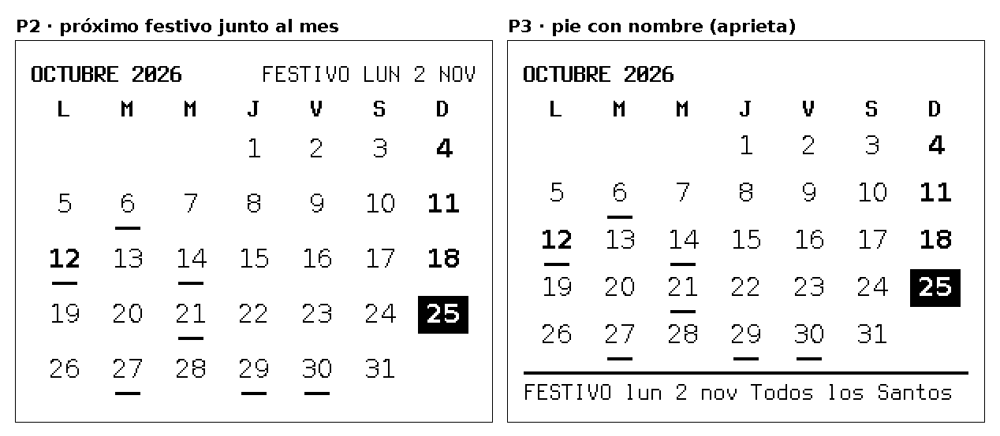
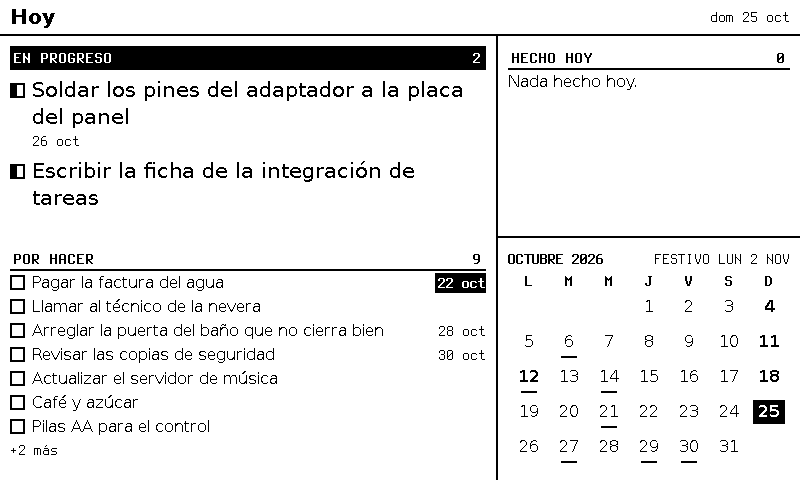
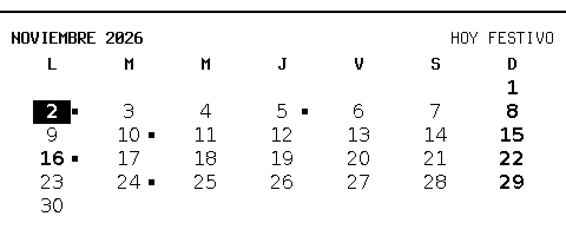

# F-013 · Calendario del mes con festivos y días con eventos

**Estado:** aprobada · el dueño la aprobó el 2026-10-25 (D1 a D5; ADR-0051 y ADR-0052). La parte de conectar los calendarios (antes D6) pasa a **F-014**
**Modelo del programador:** sonnet
**Dependencias nuevas permitidas:** ninguna.
**Rama:** el trabajo sale de `ficha/F-013`, que ya trae el código de F-008 (`ver/F-008`) porque las dos fichas tocan `month-calendar.ts`. **No se une a `main` hasta que F-008 esté cerrada**; al cerrarla se une `main` en `ver/F-013` y se vuelven a correr todas las pruebas de aceptación.

## Decisiones (puerta 1)

| # | Decisión | Aprobado |
|---|----------|----------|
| **D1** ✅ | Festivo | **Negrita**, igual que los **domingos**; **hoy invertido** (en negrita si es domingo o festivo) (ADR-0051) |
| **D2** ✅ | Día con eventos | **Raya de 2 px** debajo del número, en **cada día que cubre** el evento (ADR-0051) |
| **D3** ✅ | Próximo festivo | `FESTIVO LUN 2 NOV` o `HOY FESTIVO` a la derecha del título del mes, solo si cabe entero (ADR-0051) |
| **D4** ✅ | Fuente de festivos | **Nager.Date**, una consulta por país y año, con caché en archivo (ADR-0052) |
| **D5** ✅ | País | `holidays.country` en la configuración de vistas, **`CO` en los ejemplos**, con correcciones `add` / `remove` (ADR-0052) |
| **D6** → | Eventos de los calendarios del dueño | Pasa a **F-014** (iCloud y dos cuentas de Google, con un símbolo por calendario en la agenda) |

## Diseños

PNG de 1 bit del motor. Los de la propuesta se dibujaron con una copia del motor (antes de F-008) a la que se le agregaron las marcas. Panel 800 × 480, 124 ppp. Ampliados ×2 sin suavizado. **Manda el contrato**: las medidas exactas de los CA salen de una implementación de referencia de estas reglas sobre el código de F-008.

**Antes:** raya de 1 px en el día en que empieza un evento, sin festivos.



**Opciones de festivo** (se eligió la del medio, F2):



**Opciones de evento** (se eligió E1, la raya):



**Casos de borde:** mes de 6 semanas, con la caja del número más baja para que la raya quepa.



**Próximo festivo** (se eligió P2, junto al mes):





**Vertical:** la raya no cabe y la marca pasa a un punto a la derecha.



## Contexto
El bloque `month-calendar` (F-005, ajustado en F-008) muestra el mes con hoy invertido y subraya con 1 px el día en que **empieza** un evento. El dueño pidió marcar los **festivos del país**, configurables para cualquier país, y los **días con eventos**. Aplican ADR-0009 y ADR-0040 a ADR-0045 (integraciones), ADR-0032 (cada bloque es dueño de su diseño), ADR-0035 (dibujar cuando hay información nueva), ADR-0048 y ADR-0049 (foco y grosores), ADR-0051 y ADR-0052.

## Alcance
- Marcas de D1 a D3 en `month-calendar`, con las reglas de espacio de abajo.
- Un evento marca **todos los días que cubre** dentro del mes.
- `holidays` en la configuración de vistas; el motor recibe la lista con `setHolidays` y aplica las correcciones.
- Integración `festivos` (Nager.Date) con caché en archivo; el cliente con guardia acepta integraciones **sin llave**.
- `npm run render` acepta `--holidays <archivo>` para ver los festivos en las vistas previas.

**Fuera de alcance:** leer los calendarios del dueño (F-014); el nombre del festivo dentro del mes; festivos regionales (`counties`); cambiar letras o tamaños del tema; foco dentro del calendario; el bloque `agenda` (no cambia).

## Reglas del dibujo
Todo en px del panel y relativo a la caja de contenido del bloque (la de F-008). Se conservan de F-008: `colW`, `rowH`, `left`, `top`, `numW = min(colW − 2, 2 × texto)` y el título del mes en negrita de detalle desde `focusPad`. `texto` = tamaño en px de la letra de texto (16 a 124 ppp).

1. **Caja del número:** `caja = max(texto + 4, min(round(1,5 × texto), rowH − 7))`. Los 7 px son 2 de separación, 2 de raya y 3 de aire hasta la fila siguiente.
2. **Marca debajo** si `rowH ≥ caja + 7`. Entonces `alto del grupo = caja + 4`; si no, `alto del grupo = caja`.
3. **Posición de la caja** (igual para todos los días, tengan o no eventos): `x = left + columna × colW + floor((colW − numW) / 2)`, `y = top + fila × rowH + floor((rowH − alto del grupo) / 2)`, ancho `numW`, alto `caja`. El número va centrado en la caja (`line-height` = `caja`).
4. **Raya:** 2 px de alto y `texto` px de ancho, en `x + floor((numW − texto) / 2)`, `y + caja + 2`. Negra, también debajo de hoy.
5. **Punto al lado** si no hay marca debajo y `colW − numW ≥ 14`: cuadrado negro de 5 × 5 px en `x + numW + 2`, `y + floor((caja − 5) / 2)`.
6. **Sin lugar:** si no cabe ni debajo ni al lado, no se dibuja marca y `hidden` del bloque suma 1 por cada día del mes con eventos.
7. **Negrita** (`font-weight:700` vía `fontCss(texto, true)`) en la columna del domingo y en los festivos; los demás días en `400`.
8. **Hoy:** fondo negro y número blanco en la caja (regla 3).
9. **Próximo festivo:** solo cuando el bloque dibuja su propio título de mes (sin `title` en el `slot`). La fila del título es un contenedor de alto `groupRow`, `overflow:hidden`, `display:flex; flex-wrap:wrap; justify-content:space-between; column-gap:8px`: el mes a la izquierda en negrita de detalle y la etiqueta a la derecha en letra de detalle normal. Si no cabe, la etiqueta baja a una segunda línea que queda oculta, así que nunca se corta ni pisa el mes. Texto: `HOY FESTIVO` si hoy es festivo; si no, `FESTIVO ` + `upperDate(día)` del primer festivo de los próximos 366 días; sin festivos en ese plazo, nada.

## Requisitos
- **R1.** Un día es festivo si está en la lista que entregó `setHolidays`, más `add`, menos `remove`. Sin `holidays` en la configuración, `setHolidays` se acepta pero no hay festivos.
- **R2.** Días de un evento (`eventDays`): de día completo, de `start` a `end − 1 día` (el fin es exclusivo, como en iCalendar); con hora, cada día local (zona de la configuración) entre `start` y `end`, sin contar el día de `end` si termina justo a las `00:00`; sin `end`, solo el día de `start`; si `end` es antes de `start`, solo el día de `start`; como máximo 62 días.
- **R3.** El resumen de lo que dibuja el calendario incluye los festivos ya corregidos: si cambian, `hoy` se redibuja (ADR-0035). El cambio de día ya está en la clave de dibujo.
- **R4.** Integración `festivos`: pide el año local de hoy y, desde el 1 de diciembre, también el siguiente. Una entrada guardada vale 30 días. Error de red, de estado o de tamaño: se queda lo que hay y se reintenta a la hora. `404`: país desconocido, se registra una vez y no se vuelve a pedir ese año en 24 h. Revisa cada hora si algo venció (`pollS: 3600`).
- **R5.** De la respuesta de Nager.Date se toman solo `date` y `localName` (recortado a 60 caracteres) de las entradas con `global: true` y `"Public"` en `types`. Las demás se descartan.
- **R6.** Nunca bloquea el dibujo ni el arranque: sin red y sin caché, el mes sale sin festivos. Un archivo de caché dañado o con otro país se ignora (como en ADR-0044).
- **R7.** Sin la integración encendida no sale nada a la red, aunque haya `holidays.country`; se registra una vez `holidays: festivos integration is off`.

## Contrato

**Configuración de vistas** (`ViewsConfig`, campo opcional al nivel de `timezone`):
```json
"holidays": {
  "country": "CO",
  "add": [{ "date": "2026-12-24", "name": "Nochebuena" }],
  "remove": ["2026-01-12"]
}
```
- `country` obligatorio, `^[A-Z]{2}$`. `add`: de 0 a 50, `date` válida (`validDate`), `name` de 1 a 60 caracteres, sin campos de más. `remove`: de 0 a 50 fechas válidas. Errores con `ConfigError` y puntero: `/holidays/country`, `/holidays/add/0/date`, `/holidays/remove`.
- `config/tablero.views.example.json` gana `"holidays": { "country": "CO" }`.

**Motor**
- `server/src/engine/holidays.ts`:
  - `export interface Holiday { date: string; name: string }`
  - `export function applyCorrections(list: Holiday[], add: Holiday[], remove: string[]): Holiday[]`: ordenada por fecha, sin fechas repetidas; si `add` repite una fecha, gana el nombre de `add`; `remove` quita también lo que vino en `add`.
  - `export function nextHoliday(list: Holiday[], today: DayParts, withinDays = 366): Holiday | undefined` (incluye hoy).
  - `export function holidayLabel(list: Holiday[], today: DayParts): string | undefined`.
- `server/src/engine/dates.ts`: `export function eventDays(start: string, end: string | undefined, timeZone: string): DayParts[]` (R2).
- `Engine.setHolidays(items: unknown, meta?: { readAt?: Date }): { ok: true; changed: boolean } | { ok: false; error: string }`. Valida: arreglo de 0 a 400 `{date, name}` con fecha válida y nombre de 1 a 60; si no, `ok: false` y no cambia nada. `changed` es `false` si la lista corregida es igual a la anterior.
- `BlockContext` gana `holidays: ReadonlyMap<string, string>` (clave `dayKey`, valor el nombre), ya corregida.

**Cliente con guardia** (`server/src/integrations/http.ts`, zona sensible)
- `Manifest` gana `needsKey: boolean` (`trilium-tareas`: `true`).
- `guardedHttp(base, keyFile: string | undefined, manifest, options)`: con `needsKey: false` no lee llave ni manda `Authorization`; con `needsKey: true` y sin `keyFile`, `IntegrationHttpError("key-missing")`.

**Integración `festivos`** (`server/src/integrations/holidays-nager.ts`)
- Manifiesto: `{ id: "festivos", version: "1", delivers: "holidays", needsKey: false, hosts: "configured", routes: [{ method: "GET", prefix: "/api/v3/PublicHolidays/" }], writes: false, pollS: 3600 }`.
- `export function createHolidays(options: { http: GuardedHttp; country: string; engine: Pick<Engine, "setHolidays">; stateFile?: string; clock?: () => Date; log?: Log }): { start(): void; cycle(): Promise<void>; idle(): Promise<void>; stop(): Promise<void> }`.
- Pide `GET /api/v3/PublicHolidays/<año>/<país>` con **tope de 64 KiB** (`maxBytes: 65_536`) y 5 s.
- `stateFile` (600, escritura atómica, tope de 64 KiB al cargar): `{ "version": 1, "country": "CO", "years": { "2026": { "readAt": "<RFC 3339>", "items": [{ "date": "...", "name": "..." }] } } }`.
- Registros: `{ integration: "festivos", event: "read" | "cached" | "error" | "unknown-country", year, status?, items? }`. Nunca los nombres.
- `integrations.json` gana una entrada opcional: `"festivos": { "baseUrl": "https://date.nager.at", "stateFile": "/ruta/privada/festivos.json" }`. `baseUrl` por defecto `https://date.nager.at` (con `parseBase`; en las pruebas, `http://127.0.0.1:<puerto>`); `stateFile` opcional y absoluto. `config/integrations.example.json` la muestra.
- `server/src/main.ts`: con `festivos` encendida y `holidays.country` en las vistas, crea la integración, la arranca y la detiene en el apagado (un paso más de `shutdown`, 6 s como `integrations`). Con `festivos` encendida y sin `holidays`, registra una vez `festivos: no country in views` y no la crea.

**Vista previa:** `npm run render -- … --holidays <archivo>`: arreglo JSON `{date, name}` de 64 KiB como máximo, pasa por `setHolidays`; si no es válido, sale con código 2 y el error.

## Datos de prueba
- **Eventos:** `config/calendario.data.example.json` = `config/tablero.data.example.json` con `calendario.items` igual a:

| id | title | start | end |
|----|-------|-------|-----|
| `e-01` | Cita con el odontólogo | `2026-10-06T19:00:00-05:00` | |
| `e-02` | Cumpleaños | `2026-10-14` | |
| `e-03` | Reunión de la junta | `2026-10-14T08:00:00-05:00` | |
| `e-04` | Clase de cerámica | `2026-10-21T18:30:00-05:00` | |
| `e-05` | Técnico de la nevera | `2026-10-27T10:00:00-05:00` | |
| `e-06` | Viaje | `2026-10-29` | `2026-11-01` |
| `e-07` | Almuerzo familiar | `2026-11-02T12:30:00-05:00` | |
| `e-08` | Médico | `2026-11-05T09:00:00-05:00` | |
| `e-09` | Taller | `2026-11-24T09:00:00-05:00` | |

- **Festivos `CO` 2026** (respuesta de Nager.Date del 2026-10-25, para la respuesta grabada; todas con `global: true` y `types: ["Public"]`): `2026-01-01` Año Nuevo · `01-12` Día de los Reyes Magos · `03-23` Día de San José · `04-02` Jueves Santo · `04-03` Viernes Santo · `05-01` Primero de Mayo · `05-18` Ascensión del señor · `06-08` Corpus Christi · `06-15` Sagrado Corazón · `06-29` San Pedro y San Pablo · `07-13` Día de la Virgen de Chiquinquirá · `07-20` Declaracion de la Independencia de Colombia · `08-07` Batalla de Boyacá · `08-17` La Asunción · `10-12` Día de la Raza · `11-02` Dia de los Santos · `11-16` Independencia de Cartagena · `12-08` La Inmaculada Concepción · `12-25` Navidad. Los campos de cada entrada: `date`, `localName`, `name`, `countryCode`, `fixed`, `global`, `counties` (`null`), `launchYear` (`null`), `types`.
- Paneles: `P124` = 800 × 480, 124 ppp, 1 bit; `V124` = 480 × 800. Vistas: `config/tablero.views.example.json`.
- Píxel «negro» = 1 en la imagen `raw1` (como en F-008).

## Criterios de aceptación
**Lógica**
- **CA1.** Configuración: `holidays` válido se carga; `country: "co"` → error en `/holidays/country`; `add` con `2026-02-30` → `/holidays/add/0/date`; 51 fechas en `remove` → `/holidays/remove`; un campo desconocido en `holidays` → error con su puntero.
- **CA2.** `applyCorrections` con los 19 de 2026, `add = [{2026-12-24, "Nochebuena"}, {2026-12-25, "Navidad en casa"}]` y `remove = ["2026-01-12"]` → 19 entradas ordenadas, sin `2026-01-12`, con `2026-12-24` y con `2026-12-25` llamado «Navidad en casa».
- **CA3.** `holidayLabel` con los 19 de 2026: hoy `2026-10-25` → `FESTIVO LUN 2 NOV`; `2026-11-02` → `HOY FESTIVO`; `2026-12-26` → `undefined` (sin los de 2027); lista vacía → `undefined`.
- **CA4.** `eventDays` en `America/Lima`: `2026-10-29` a `2026-11-01` → 29, 30 y 31 de octubre; `2026-10-30T22:00:00-05:00` a `2026-10-31T02:00:00-05:00` → 30 y 31; `2026-10-30T20:00:00-05:00` a `2026-10-31T00:00:00-05:00` → solo el 30; sin `end` → solo el día de `start`; `end` antes de `start` → solo `start`; `2026-01-01` a `2026-04-11` → 62 días.
- **CA5.** `setHolidays` con los 19 → `{ ok: true, changed: true }`; la misma lista otra vez → `changed: false`; una fecha `2026-13-01` → `ok: false` y la lista anterior sigue; 401 entradas → `ok: false`. Tras el primer `setHolidays`, el `hash` de `hoy` cambia; tras el segundo, no.

**Dibujo** (motor real, `config/tablero.views.example.json` + `config/calendario.data.example.json`, `setHolidays` con los 19 de 2026)
- **CA6 (`hoy`, P124, reloj `2026-10-25T20:00:00Z`).** Hoy (25): negro en `(748, 400)`, `(779, 400)`, `(748, 423)` y `(779, 423)`; blanco en `(747, 410)`, `(780, 410)`, `(760, 399)` y `(760, 424)`. Raya del 6: negro en `(561, 356)`, `(576, 357)` y `(568, 356)`; blanco en `(560, 356)`, `(577, 356)`, `(568, 355)` y `(568, 358)`. Viaje: negro en `(646, 461)`, `(685, 461)` y `(724, 462)` (29, 30 y 31); blanco en `(607, 461)` (28). Etiqueta: hay negro en el rectángulo `x 640–793, y 249–268`; el mes (`x 510–600`, mismas `y`) también tiene negro. `hidden.mes = 0`.
- **CA7 (negritas, mismo caso).** En el HTML del bloque (`monthCalendar` con el contexto de esa vista), el estilo del elemento que contiene el número del día (el mismo elemento o su padre inmediato) declara `font-weight:700` en 4, 11, 18, 25 (domingos) y 12 (festivo), y `font-weight:400` en 13, 19 y 26. En la imagen, la caja del 12 (`x 514–545`, `y 365–388`) tiene al menos 1,5 veces los píxeles negros que la misma caja dibujada con `setHolidays([])`; la del 13 (`x 553–584`, mismas `y`) tiene los mismos con y sin festivos.
- **CA8 (6 semanas, P124, reloj `2026-11-02T13:00:00Z`).** Hoy (2, festivo): negro en `(514, 322)`, `(545, 322)`, `(514, 343)` y `(545, 343)`; blanco en `(513, 330)` y `(546, 330)`. Raya del 2: negro en `(522, 346)` y `(537, 347)`; en `x = 529`, blanco en `y` 344, 345, 348, 349 y 350. Etiqueta `HOY FESTIVO`: negro en el rectángulo `x 690–793, y 249–268`. `hidden.mes = 0`.
- **CA9 (vertical, V124, reloj `2026-11-02T13:00:00Z`).** Hoy: negro en `(32, 685)`, `(63, 685)`, `(32, 704)` y `(63, 704)`. Punto del 2: los 25 píxeles de `x 66–70, y 692–696` en negro; blanco en `(65, 694)`, `(71, 694)`, `(68, 691)` y `(68, 697)`. Punto del 5: `x 258–262`, mismas `y`, en negro. Sin raya: `y 705–707`, `x 40–55`, todo blanco.
- **CA10 (sin lugar, P124, reloj `2026-10-25T20:00:00Z`).** Vista `mini`: `grid.columns [37, 63]`, `rows [42, 58]`, `areas [["mes", "otro"], ["abajo", "otro"]]`, `mes` = `month-calendar` de `calendario`, `otro` y `abajo` = `task-board` de `tablero` (`abajo` con `stages: ["done"]`). Resultado: `hidden.mes = 7` (6, 14, 21, 27, 29, 30 y 31 de octubre) y el calendario se dibuja sin marcas de evento.
- **CA11 (sin festivos).** Mismo caso que CA6 con `setHolidays([])`: no hay negro en `x 640–793, y 249–268`; las cajas de los domingos tienen los mismos píxeles negros que en CA6.

**Integración `festivos`** (servidor falso local en un puerto libre que elige la prueba, respuestas grabadas, reloj inyectado)
- **CA12.** Primer `cycle()` con el reloj en `2026-10-25T20:00:00Z`: un solo `GET /api/v3/PublicHolidays/2026/CO`, `setHolidays` con 19 entradas y el `stateFile` escrito con modo 600. Con `2026-12-01T15:00:00Z` (sin caché) pide 2026 y 2027.
- **CA13.** Con el `stateFile` de CA12 y el servidor apagado: `start()` entrega las 19 sin pedir nada; con un `readAt` de hace 31 días pide de nuevo y, al fallar, sigue con las 19 y registra `error`.
- **CA14.** Respuesta de 65 536 + 1 bytes → error `too-large`, no se llama `setHolidays` con datos nuevos. Una entrada con `global: false` y otra con `types: ["Bank"]` no aparecen. `localName` de 80 caracteres llega recortado a 60.
- **CA15.** País `XX` con respuesta `404`: registra `unknown-country` una sola vez; otro `cycle()` 1 h después no pide nada; 25 h después pide otra vez.
- **CA16.** Cliente con guardia: con el manifiesto de `festivos` y sin `keyFile`, la petición sale **sin** cabecera `Authorization`; con el de `trilium-tareas` y sin `keyFile` → `key-missing`. Un `baseUrl` `http://ejemplo.org` → error `host`.
- **CA17.** `holidays.country` en las vistas y `integrations.json` sin `festivos`: el servidor falso no recibe ninguna petición en 3 s y el registro tiene `holidays: festivos integration is off` una sola vez.
- **CA18.** Registros: nada de lo registrado por la integración contiene `Navidad` ni otro `localName`.

**Lo que ya existe**
- **CA19.** `npm run render -- --views config/tablero.views.example.json --data config/calendario.data.example.json --panel w=800,h=480,dpi=124,depth=1 --out <carpeta> --now 2026-10-25T20:00:00Z --holidays <archivo con los 19>` escribe `hoy.png` con lo de CA6; un archivo de 65 KiB o con una fecha mala sale con código 2.
- **CA20.** Las pruebas de aceptación de F-005, F-006 y F-008 siguen pasando (no fijan píxeles del mes: piden el rectángulo negro de hoy y `hidden` del mes en 0).

## Presupuestos
- Dibujo de `hoy`: la mediana sigue dentro del presupuesto de F-008 (se anota antes y después).
- Festivos: como máximo 2 peticiones por país y mes en marcha normal.

## Seguridad
- [x] Toda entrada externa con **límite de tamaño antes de parsear**: respuesta de Nager.Date (64 KiB), `stateFile` (64 KiB), `--holidays` (64 KiB).
- [x] Servicios locales solo en **127.0.0.1** (nada nuevo escucha).
- [x] Dependencias nuevas: ninguna.
- `http.ts` es zona sensible: el cambio de `needsKey` lo revisa el revisor en modo juicio. Sigue siendo el único `fetch` hacia integraciones.
- I-reglas: `festivos` declara su ruta; cualquier otra la rechaza el cliente con guardia (como en F-009). Nager.Date solo recibe el país y el año.

## Archivos
**A crear:** `server/src/engine/holidays.ts` (+ `.test.ts`), `server/src/integrations/holidays-nager.ts` (+ `.test.ts`), `config/calendario.data.example.json`.
**A tocar:** `server/src/engine/blocks/month-calendar.ts`, `server/src/engine/blocks/types.ts`, `server/src/engine/dates.ts`, `server/src/engine/config.ts`, `server/src/engine/engine.ts`, `server/src/engine/testing.ts` (si hace falta para el contexto), `server/src/integrations/manifest.ts`, `server/src/integrations/http.ts`, `server/src/integrations/config.ts`, `server/src/main.ts`, `server/scripts/render.ts`, `config/tablero.views.example.json`, `config/integrations.example.json`, los README de las carpetas que cambian.
**Verificador:** `tests/acceptance/F-013/` (con sus respuestas grabadas).
**Arquitecto (al cerrar):** `docs/seguridad.md` (host de `festivos`).

## Resultado esperado
En `hoy`, domingos y festivos en negrita, hoy invertido, una raya de 2 px bajo cada día con eventos (también los del medio de un viaje) y, junto al mes, cuándo es el próximo festivo. Cambiar `holidays.country` cambia los festivos sin tocar código, y sin red el calendario sigue con lo último guardado.

## Terminado (se marca al cerrar)
- [ ] Todos los CA pasan en la verificación (informe adjunto).
- [ ] `tools/revisar` limpio, o hallazgos resueltos o anotados como mejora.
- [ ] `tools/check-scope` limpio para cada rol.
- [ ] Resultado obtenido y resumen para aprobar escritos; métricas y lecciones actualizadas.
- [ ] El dueño aprobó integrar.

## Listo para programar (se marca antes de pedir aprobación)
- [x] Cada CA se puede comprobar con una prueba, con valores concretos.
- [x] El contrato (interfaces, formatos, errores) está escrito.
- [x] Los archivos a crear o tocar están listados.
- [x] Presupuestos y reglas de seguridad que aplican, nombrados.
- [x] Lo que queda fuera de alcance, escrito.
- [x] **Nombres de archivos, rutas, puertos y URLs** que las pruebas necesiten, escritos.
- [x] Toda **función que se pruebe tiene nombre y firma**, y todo **contador o medida** dice desde cuándo cuenta.

---

## Resultado obtenido
*(Lo llena el arquitecto al cerrar.)*

## Resumen para aprobar
*(Una pantalla, con `docs/plantillas/resumen-aprobacion.md`.)*
