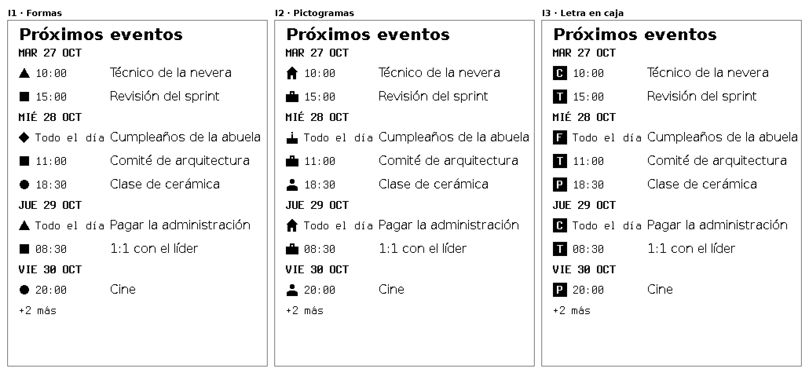
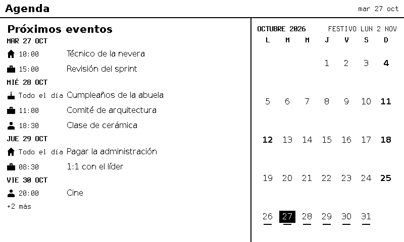

# F-014 · Los calendarios del dueño en la pantalla, con un símbolo por calendario

**Estado:** borrador. Decisiones D1 a D7 **sin aprobar**. Rama aparte `ficha/F-014`, que sale de `ficha/F-013` (usa sus marcas del mes) y no entra a `main` antes que F-013
**Modelo del programador:** sonnet
**Dependencias nuevas permitidas:** depende de D6. Propuesta: `ical.js` (MPL-2.0, sin dependencias propias). Sin aprobar.

## Qué pidió el dueño
Ver en la pantalla los eventos de **varios calendarios**: los del iPhone (iCloud), el **personal** de Google y el **corporativo** de Google. En la lista de próximos eventos, un **símbolo simple por tipo de calendario** que sirva para distinguirlos de un vistazo.

## Decisiones que pide esta ficha (puerta 1)

| # | Decisión | Propuesta (sin aprobar) | Otras opciones |
|---|----------|-------------------------|----------------|
| **D1** | Símbolo por calendario | **I2 · Pictogramas** de 16 px (alto de la letra de texto), a la izquierda de la hora: persona, maletín, casa, pastel, corazón y estrella. Cada calendario elige el suyo en la configuración | I1 · formas (círculo, cuadrado, triángulo, rombo, aro); I3 · letra blanca en caja negra |
| **D2** | Calendarios del iPhone (iCloud) | **Calendario público de iCloud**, uno por calendario: un enlace de solo lectura de ese calendario y nada más | CalDAV con una contraseña de app: lee todos los calendarios con una credencial, pero esa contraseña también abre el correo y los contactos de la cuenta |
| **D3** | Google personal | **Dirección secreta en formato iCal** de cada calendario: solo lectura, no vence, sin OAuth | API de Google con OAuth (pide la app en «Producción» para que el permiso no venza a los 7 días) |
| **D4** | Google corporativo | **Lo decide lo que permita la empresa.** Primero se mira si el calendario corporativo ofrece la dirección secreta iCal; si la ofrece, igual que D3 | Si no: (a) OAuth con la cuenta de la empresa (el administrador puede bloquearlo); (b) compartir solo «ocupado» con la cuenta personal; (c) no mostrarlo |
| **D5** | Títulos de trabajo en la casa | Opción por calendario **`titles: false`**: la pantalla muestra `Ocupado` en vez del título (la hora y el símbolo sí) | Mostrar siempre los títulos |
| **D6** | Leer el formato iCalendar | **`ical.js`** (de Mozilla, MPL-2.0, sin dependencias): repeticiones (`RRULE`, `EXDATE`, excepciones) y zonas horarias, que es donde fallan los lectores caseros | Lector propio sin repeticiones (los eventos semanales no saldrían) |
| **D7** | Festivos en la agenda | Los festivos de F-013 aparecen en la agenda como evento de día completo con la **estrella** | No mostrarlos (ya están en el mes) |

### Por qué estas propuestas
- **D1.** A 124 ppp un pictograma de 16 px se reconoce (diseño 1). A 14 px el maletín y el pastel se volvían rayas, por eso van a 16 px y sin detalles blancos finos. Las formas se distinguen igual de bien, pero hay que aprender qué significa cada una; la letra en caja pesa más que la hora y compite con ella. Son dibujos del motor (SVG), no emojis ni letras de una fuente.
- **D2.** El enlace público solo abre el calendario elegido. La contraseña de app de iCloud no se puede limitar al calendario.
- **D3 y D4.** La dirección secreta sirve igual para iCloud, Google y Outlook: un solo lector para todo. En cuentas de empresa el administrador puede apagarla, así que el corporativo depende de lo que se encuentre en la configuración (ver «Lo que tiene que mirar el dueño»). La política de la empresa sobre datos de trabajo en un servidor personal sigue pendiente, igual que para Jira.
- **D5.** Aunque la empresa permita leer el calendario, quizá no convenga que los títulos de trabajo queden a la vista en la casa.

## Diseños

PNG de 1 bit del motor con la geometría de F-008 y las marcas de F-013, con una semana de ejemplo: casa (iCloud), trabajo (Google corporativo), personal (Google personal), un cumpleaños y un festivo. Ampliados ×2 sin suavizado.



**Vista `agenda` con pictogramas** (la propuesta):



## Lo que tiene que mirar el dueño (antes de aprobar)
1. **Google corporativo:** en Google Calendar en la web, con la cuenta de la empresa: Configuración → el calendario → *Integrar el calendario*. ¿Aparece **«Dirección secreta en formato iCal»**? Si no aparece, la empresa la tiene apagada y D4 va por (a), (b) o (c).
2. **Google personal:** el mismo lugar, con la cuenta personal (un enlace por cada calendario que se quiera ver).
3. **iCloud:** en el iPhone, Calendario → Calendarios → (i) del calendario → **Calendario público**. Cada uno da un enlace `webcal://`.
4. **Los enlaces son secretos** (quien los tenga lee el calendario): no se pegan en el chat ni en el repo. Van a un archivo con permisos 600 en el servidor; la guía para crearlo la da la ficha cuando se apruebe.

## Contexto
F-013 dejó el mes con festivos y una raya en cada día con eventos, pero la fuente `calendario` sigue vacía. El bloque `agenda` (F-005) ya lista los próximos eventos por día con su hora. Aplican ADR-0009, ADR-0040 a ADR-0045 (integraciones), ADR-0023 (nada privado en el repo), ADR-0049 (trazos de 2 px) y ADR-0051 y ADR-0052.

## Alcance (borrador)
- Integración `ical-calendario`: varias direcciones, cada una con un `id`, un símbolo y `titles`; junta todo en una fuente `events`.
- `CalendarEvent` gana `icon` (uno de la lista fija) y el bloque `agenda` lo dibuja a la izquierda de la hora; sin `icon`, la columna no ocupa espacio.
- `titles: false` cambia el título por `Ocupado` **antes** de que llegue al motor y al archivo de estado.
- Festivos en la agenda (si D7).

**Fuera de alcance:** escribir en los calendarios; invitaciones; ubicación y notas (no se copian); OAuth (salvo que D3 o D4 lo pidan, en cuyo caso va en otra ficha); avisos.

## Contrato (borrador, se cierra al aprobar)
`integrations.json`:
```json
"ical-calendario": {
  "source": "calendario",
  "calendarsFile": "/ruta/privada/calendarios.json",
  "stateFile": "/ruta/privada/calendarios.estado.json"
}
```
`calendarsFile` (600, fuera del repo, 32 KiB como máximo, de 1 a 10 calendarios):
```json
[
  { "id": "casa", "icon": "casa", "url": "https://…" },
  { "id": "personal", "icon": "persona", "url": "https://…" },
  { "id": "trabajo", "icon": "maletin", "url": "https://…", "titles": false }
]
```
- `url` solo `https:` (un `webcal://` se toma como `https://`), hasta 2048 caracteres. `icon`: `persona`, `maletin`, `casa`, `pastel`, `corazon`, `estrella`.
- Cada lectura: 2 MiB como máximo **antes de parsear**, 5 000 `VEVENT` y 2 000 eventos expandidos como máximo, ventana `[primer día del mes − 7 días, hoy + 62 días]`, cada 15 min.
- Si un calendario falla, los demás siguen y la fuente muestra `sin datos desde`.
- **Nunca** se registra la dirección ni un título: cada calendario se nombra por su `id`.

## Criterios de aceptación
*(Se escriben al aprobar D1 a D7.)*

## Seguridad
- [ ] Toda entrada externa con **límite de tamaño antes de parsear** (2 MiB por calendario, 32 KiB el archivo de calendarios).
- [ ] Servicios locales solo en **127.0.0.1** (nada nuevo escucha).
- [ ] Dependencias nuevas nombradas arriba (`ical.js` si D6).
- Las direcciones son secretos: archivo 600, nunca en registros, en `state.json` ni en el archivo de estado. Con `titles: false` el título no se guarda en ningún lado.
- Los hosts permitidos son los de las direcciones configuradas (`hosts: "configured"`), solo `https:`.

---

## Resultado obtenido
*(Lo llena el arquitecto al cerrar.)*

## Resumen para aprobar
*(Una pantalla, con `docs/plantillas/resumen-aprobacion.md`.)*
