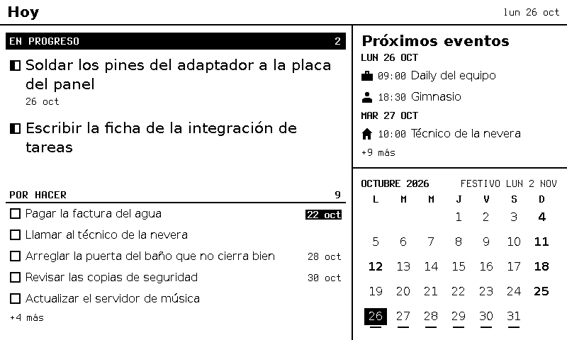
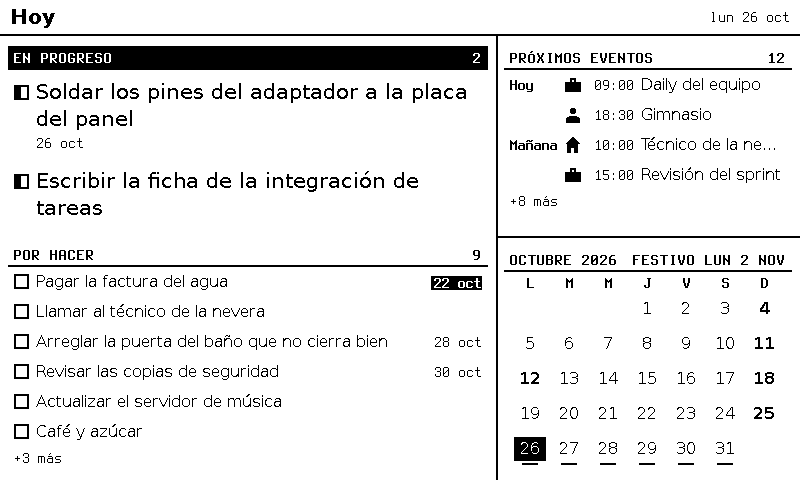
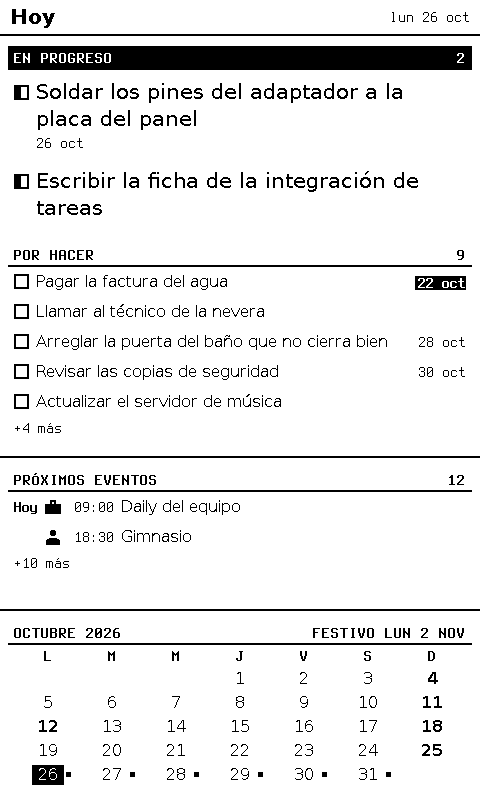
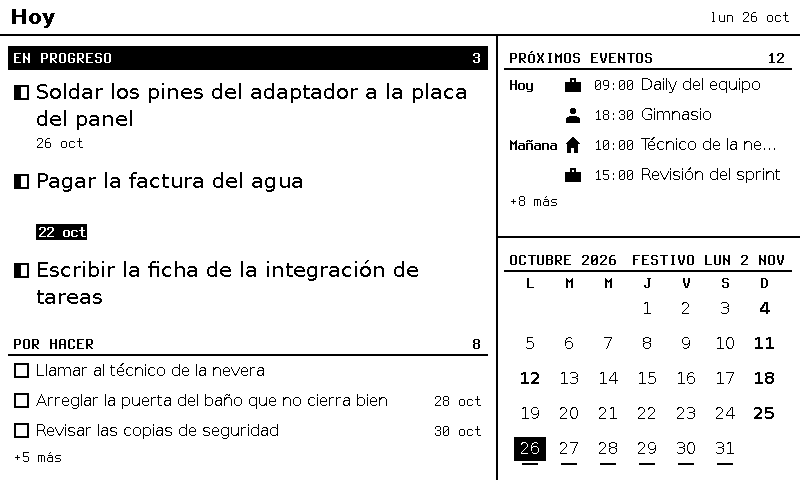
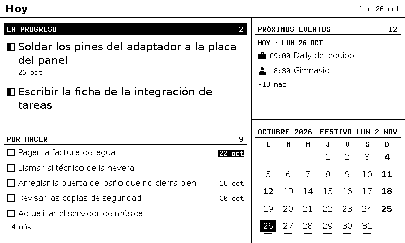

# F-015 · «Hoy» con un solo encabezado y Aceptar que avanza una etapa

**Estado:** cerrada · integrada a `main` el 2026-10-25 (el dueño aprobó la puerta 2) · el dueño la aprobó el 2026-10-25 (puerta 1; D1 a D3, ADR-0055 y ADR-0056)
**Modelo del programador:** sonnet
**Dependencias nuevas permitidas:** ninguna.

## Decisiones (puerta 1)

| # | Decisión | Aprobado |
|---|----------|----------|
| **D1** ✅ | Encabezados | Todo encabezado de bloque es la **franja** de `task-board` (mayúsculas, raya de `line`, texto corto a la derecha); el mes también. En la agenda de «hoy», el día va en una **columna** (`Hoy`, `Mañana`, `Mié 28`), escrita solo en el primer evento de cada día, en lugar de filas de día: caben 4 eventos en vez de 3 (ADR-0056) |
| **D2** ✅ | Filas grandes sin fecha | Una fila que manda o una tarjeta de `task-board` sin `due` ni `category` **no reserva la línea de debajo**: en «hoy» cabe una tarea más en *Por hacer* (ADR-0056) |
| **D3** ✅ | Aceptar sobre una tarea | **Etapa siguiente, en ciclo:** *Por hacer* → *En progreso* → *Hecho* → *Por hacer*. Reemplaza a ADR-0039 (ADR-0055) |

Las tareas de Jira en «hoy» van en otra ficha (F-016), que espera una aprobación externa al proyecto.

## Diseños

PNG de 1 bit del motor real. Los de la propuesta salen de una implementación de referencia de las reglas de esta ficha, con `config/hoy.views.example.json` + `config/hoy.data.example.json`, panel 800 × 480 a 124 ppp, reloj `2026-10-26T13:00:00Z` y los 19 festivos `CO` de 2026. **Manda el contrato**: las medidas de los CA salen de esa referencia.

**Antes:** cada bloque con un encabezado distinto; «Próximos eventos» con título de 12 pt y filas de día.



**Después (D1 y D2):** franja en eventos y mes, columna de día, 4 eventos; «Por hacer» muestra 6 tareas en vez de 5 porque «Escribir la ficha…» (sin fecha) ya no reserva su línea de fecha.



**Vertical:**



**D3, un Aceptar sobre «Pagar la factura del agua»:** pasa a *En progreso*, como fila que manda, en su posición del tablero (entre `b-01` y `b-03`); el foco la sigue porque su zona conserva el id.



**Descartada (solo la franja, con filas de día):** caben 2 eventos.



## Contexto
En «hoy» conviven cuatro estilos de encabezado: la franja negra de la etapa que manda, la franja con raya de las demás etapas, el título de 12 pt de los bloques con `title` (`titleRow`, F-005) y la línea sin raya del mes (F-013). El dueño pidió que los eventos dejen de verse como de otra pantalla. Además, Aceptar sobre una tarea de *Por hacer* la marcaba *Hecho* (ADR-0039), y el dueño quiere que pase a *En progreso*. Aplican ADR-0005 (los dos botones no cambian), ADR-0032 (cada bloque es dueño de su diseño), ADR-0035, ADR-0037 (orden = posición del tablero), ADR-0038 (etapas), ADR-0041 (escribir sin pisar), ADR-0048 y ADR-0049 (foco y grosores), ADR-0053, ADR-0055 y ADR-0056.

## Alcance
- `stripRow` en `blocks/common.ts`, usada por `task-board`, por `titleRow` y por el título del mes.
- `titleRow` dibuja una franja; cada bloque le pasa su texto de la derecha; el aviso «sin datos desde» lo reemplaza.
- Título propio del mes como franja, con el próximo festivo a la derecha solo si cabe entero.
- Opción `layout` del bloque `agenda` (`"days"` por defecto, `"column"` nueva) y `dayLabel` en `dates.ts`.
- D2 en `task-board`.
- D3 en `engine.apply`; el motor deja de recordar la etapa anterior.
- Ejemplos nuevos `config/hoy.views.example.json` y `config/hoy.data.example.json` (la distribución de «hoy» que usa el dueño, sin datos suyos).
- Las pruebas unitarias que cambian por esto (`month-calendar`, `task-board`, `trilium-tasks`).

**Fuera de alcance:** Jira (F-016); cambiar letras o medidas del tema; la columna de día en la agenda de pantalla completa (sigue con filas de día); Aceptar largo (ADR-0005 no cambia); el firmware; la configuración real del servidor (la cambia el arquitecto al integrar); el desborde de `hechas` en `tablero` a 200 ppp con «Nada hecho hoy.», que ya pasa en `main` (ver *Hallazgo previo*).

## Reglas del dibujo
Medidas del tema `base` (sin cambios): a 124 ppp `strip` = 24, `line` = 2, `focusPad` = 6, `gap` = 7, `row` = 30, `groupRow` = 22, `leadLine` = 27, `metaLine` = 20, `cardLine` = 20, `focusGap` = 3. Todo relativo a la caja de contenido del bloque (la de F-008).

1. **Franja** (`stripRow`): un rectángulo de `w` × `strip` en `y`, con relleno lateral `focusPad`, `line-height: strip`, `letter-spacing: 1px` y letra de detalle en negrita. Izquierda: la etiqueta en **mayúsculas** (`toUpperCase()`), cortada con «…» si no cabe. Derecha: `right`, sin cortar (`white-space: nowrap`). Normal: fondo blanco y una raya negra de alto `line` y ancho `w` en `y + strip − line`. Con `lead`: fondo negro, texto blanco y sin raya. Con `dropRight`: la derecha se dibuja **solo si cabe entera** junto a la etiqueta, separada al menos `gap`; si no, no se dibuja (la regla 9 de F-013).
2. **Las franjas de `task-board`** pasan a dibujarse con `stripRow` y quedan iguales, píxel a píxel, a las de hoy (CA12).
3. **Título de un bloque** (`titleRow`, solo si el `slot` tiene `title`): la franja con `slot.title` y, a la derecha, el aviso «sin datos desde HH:MM» de la fuente si lo hay; si no, el texto que pasa el bloque. Alto = `strip` (a 124 ppp, igual que el `titleRow` de antes). Texto de cada bloque: `agenda` = la **cantidad de eventos** de la ventana (sin contar festivos); `task-list` e `issue-list` = la cantidad de elementos de la fuente; `task-board` y `month-calendar` con `title` = nada.
4. **Título propio del mes** (`month-calendar` sin `title`): la franja con `MES AAAA` y, con `dropRight`, la etiqueta del próximo festivo de F-013 (`FESTIVO LUN 2 NOV`, `HOY FESTIVO`). Alto `strip` (antes `groupRow`); lo demás del mes (letras de la semana, cajas, rayas, puntos) se calcula igual que en F-013 desde debajo de la franja.
5. **Agenda con `layout: "column"`:** sin filas de día. Cada fila de evento (y de festivo, con `holidays: true`) lleva primero una columna de día, con el texto de `dayLabel` **solo en la primera fila de cada día** (en las demás, vacía). La columna mide lo que mide el texto más ancho de lo dibujado (`max-content` de la misma cuadrícula de la agenda); letra de detalle en negrita, sin cortar. Después, como hoy: pictograma (si alguna fila dibujada lo tiene), hora y título. El alto de cada fila sigue siendo `row`; las filas siguen la regla común («+N más»). Con `layout: "days"` o sin `layout`, la agenda sigue con filas de día (`upperDate`) como en F-014.
6. **Fila que manda o tarjeta sin detalle** (D2): en `task-board`, una tarea de una etapa `lead` o `card` sin `due` y sin `category` mide `metaLine` menos (a 124 ppp: fila que manda 66 en vez de 86, tarjeta 52 en vez de 72) y no dibuja la línea de detalle. El `focusGap` de antes no cambia. Con `due` o `category`, igual que hoy.

## Requisitos
- **R1.** Aceptar corto (`act: "toggle"`) sobre una tarea **con etapa** de `task-board` o `task-list` que no sea de solo lectura: `todo` → `doing` → `done` → `todo`. Al pasar a `done`: `done: true` y `doneAt` = la hora del reloj. Al pasar a `doing` o `todo`: `done: false` y sin `doneAt`. `onToggle` recibe `{ sourceId, taskId, stage: <la nueva>, previous: <la que tenía> }`.
- **R2.** Las tareas **sin etapa** de `task-list` siguen alternando `done` (F-005). Una tarea sin etapa en `task-board` se toma con `stageOf` (`todo` o `done`) y sigue el ciclo de R1.
- **R3.** El motor ya no guarda la etapa anterior de las tareas (se quita el mapa en memoria). `duplicate` y `stale` siguen igual.
- **R4.** La integración de Trilium no cambia: escribe la columna de `change.stage` (`En progreso` incluida) con las mismas reglas de F-009 (sin pisar, cola, 24 h).
- **R5.** `server/README.md`: el bloque `agenda` documenta `layout`; `task-board` documenta D2 y el ciclo de Aceptar; los encabezados, la franja. `config/README.md`: los dos ejemplos nuevos.

## Contrato

**`server/src/engine/blocks/common.ts`**
```ts
/** Section strip (ADR-0056): label on the left, `right` on the right, a `line` rule at the bottom. */
export function stripRow(
  context: BlockContext,
  label: string,
  right: string,
  y: number,
  options?: { lead?: boolean; dropRight?: boolean },
): Raw;

/** The block's title as a strip (only with `slot.title`); the stale notice wins over `right`. */
export function titleRow(context: BlockContext, right?: string): { html: Raw; height: number };
```

**`server/src/engine/dates.ts`**
```ts
/** `Hoy`, `Mañana` (today + 1) or `<Dom|Lun|Mar|Mié|Jue|Vie|Sáb> <d>`. */
export function dayLabel(day: DayParts, today: DayParts): string;
```

**Configuración de vistas:** el bloque `agenda` acepta `options.layout`: `"days"` | `"column"`. Otro valor → `ConfigError` en `/views/<i>/slots/<area>/options/layout` con `must be days or column`. En otro bloque, `layout` es un campo desconocido (como hoy).

**Motor:** `Engine.apply` con las reglas de R1 a R3; `ToggleChange` no cambia de forma.

**Ejemplos nuevos**
- `config/hoy.views.example.json`: `timezone` `America/Lima`, `holidays: { "country": "CO" }`, aparatos `"*"` con `["hoy", "tablero"]`. Vista `hoy`: `grid.columns [62, 38]`, `rows [45, 55]`, `areas [["tareas", "proximos"], ["tareas", "mes"]]`; `portrait.columns [100]`, `rows [55, 20, 25]`, `areas [["tareas"], ["proximos"], ["mes"]]`; `tareas` = `task-board` de `tablero` con `stages ["doing", "todo"]` y `lead: true`; `proximos` = `agenda` de `calendario` con `title: "Próximos eventos"` y `options { "days": 7, "layout": "column" }`; `mes` = `month-calendar` de `calendario`. Vista `tablero`: la misma de `config/tablero.views.example.json`.
- `config/hoy.data.example.json`: `tablero` = el de `config/tablero.data.example.json`; `calendario` = el de `config/agenda.data.example.json` (los dos sin cambios).

## Datos de prueba
- Paneles `P124` = `w=800,h=480,dpi=124,depth=1`, `P200` (igual con `dpi=200`) y `V124` = `w=480,h=800,dpi=124,depth=1`.
- «Los ejemplos de hoy» = `config/hoy.views.example.json` + `config/hoy.data.example.json`, reloj **`2026-10-26T13:00:00Z`** (lunes 26, 08:00 en Lima) y `setHolidays` con los 19 festivos `CO` de 2026 de F-013. «Los del tablero» y «los de F-005», como en F-008.
- Ids de zona en `hoy` (de `zoneId("hoy", <fuente>, <id>)`): `b-01` `z4ba4457e13`, `b-02` `z5b74b95d24`, `b-03` `z3d65c6d137`, `b-04` `zf8f7e4b81e`, `a1` `zf8faa2bc7d`, `a2` `zef968bcff6`, `a3` `zca171a63fb`, `a4` `z36b3904560`.
- Negro = bit 1 en `raw1` (como en F-008). Pruebas con el Chromium real, como en F-006.

## Criterios de aceptación
**Lógica**
- **CA1 (configuración).** Los ejemplos de hoy cargan. `layout: "lista"` en `proximos` → `ConfigError` en `/views/0/slots/proximos/options/layout`; `layout: "column"` en `tareas` (`task-board`) → error de campo desconocido en `/views/0/slots/tareas/options/layout`.
- **CA2 (`dayLabel`).** Con hoy `2026-10-26`: el 26 → `Hoy`; el 27 → `Mañana`; el 28 → `Mié 28`; `2026-11-01` → `Dom 1`; el 25 → `Dom 25`. Con hoy `2026-12-31`: `2027-01-01` → `Mañana`.
- **CA3 (ciclo).** Con los ejemplos de hoy y `onToggle` anotado, tres `toggle` seguidos sobre `b-02` (con `idle()` entre uno y otro), cada uno `applied`: `onToggle` recibe, en orden, `{stage: "doing", previous: "todo"}`, `{stage: "done", previous: "doing"}` y `{stage: "todo", previous: "done"}` (con `sourceId: "tablero"`, `taskId: "b-02"`). Tras el primero, `b-02` tiene `stage: "doing"`, `done: false` y no tiene `doneAt`; tras el segundo, `done: true` y `doneAt` = `2026-10-26T13:00:00.000Z`; tras el tercero, `stage: "todo"`, `done: false`, sin `doneAt`. Un `toggle` sobre `b-01` (`doing`) da `{stage: "done", previous: "doing"}`. Repetir el id de la primera acción → `duplicate` y no llama a `onToggle`.
- **CA4 (sin etapa).** Con los de F-005, `toggle` sobre `t-001` (`task-list`, sin etapa) alterna `done` como antes y no llama a `onToggle`.

**Dibujo** (motor real, los ejemplos de hoy)
- **CA5 (`hoy`, P124: zonas).** En orden: `b-01` `{8, 73, 480, 86}`, `b-03` `{8, 162, 480, 66}`; `b-02`, `b-04`, `b-05`, `b-06`, `b-07`, `b-08` en `{8, 267, 480, 30}` y `y` + 30 cada una (la última en `y = 417`); `a1` `{504, 70, 288, 30}`, `a2` `y = 100`, `a3` `y = 130`, `a4` `y = 160` (mismo `x`, `w`, `h`). Total **12**; `hidden = { tareas: 3, proximos: 8, mes: 0 }`; `overflow = []`, `tooSmall = []`, `bandInk = []`. Acciones: las de tareas `toggle`, las de eventos `open`.
- **CA6 (`hoy`, P124: franjas).** Franja de eventos: negro en `(600, 68)`, `(600, 69)`, `(504, 68)` y `(791, 68)`; blanco en `(600, 67)`, `(600, 70)`, `(503, 68)` y `(792, 68)`. Hay tinta en `x 510–651, y 51–62` (la etiqueta) y en `x 741–791, y 46–67` (el `12`). En el HTML del bloque, la etiqueta es `PRÓXIMOS EVENTOS` y la derecha `12`. Raya de *Por hacer*: negro en `(200, 265)` y `(200, 266)`, blanco en `(200, 264)` y `(200, 267)`. Franja del mes: negro en `(600, 270)` y `(600, 271)`, blanco en `(600, 269)` y `(600, 272)`; sin tinta en `x 616–632, y 250–268` (el aire entre `OCTUBRE 2026` y `FESTIVO LUN 2 NOV`), con tinta en `x 633–783, y 250–268`.
- **CA7 (`hoy`, P124: columna de día).** Hay tinta en `x 504–560` dentro de la fila de `a1` (`y 76–93`, el `Hoy`) y de la de `a3` (`y 136–153`, el `Mañana`); no hay tinta en `x 504–560` en las de `a2` (`y 106–123`) ni `a4` (`y 166–183`). No hay tinta en `x 557–564, y 70–189`: el pictograma, la hora y el título de las cuatro filas empiezan a la misma `x`.
- **CA8 (`hoy`, V124).** `hidden = { tareas: 4, proximos: 10, mes: 0 }`, `tooSmall = []`. `a1` `{8, 492, 464, 30}` y `a2` `{8, 522, 464, 30}`; raya de la franja de eventos: negro en `(200, 490)` y `(200, 491)`, blanco en `(200, 489)` y `(200, 492)`. Hay tinta en `x 8–44` en la fila de `a1` (`y 498–515`) y no en la de `a2` (`y 528–545`).
- **CA9 (D2).** En `hoy` P124, `b-03` (sin `due` ni `category`) mide 66 y `b-01` (con `due`) 86. En `tablero` P124 (los ejemplos de hoy): `b-03` en `en_progreso` mide 66; en `por_hacer`, `b-04` (sin `due`) mide 52 y `b-02` (con `due`) 72. En el HTML de la fila de `b-03` no hay elemento de la línea de detalle.
- **CA10 (Aceptar se ve).** Tras un `toggle` sobre `b-02` e `idle()`: zonas de `hoy` P124 `b-01` `{8, 73, 480, 86}`, `b-02` `{8, 162, 480, 86}`, `b-03` `{8, 251, 480, 66}`, luego `b-04`, `b-05`, `b-06` desde `{8, 356, 480, 30}`; `hidden.tareas = 5`. Casilla a medias de `b-02`: negro en `(15, 181)`, blanco en `(23, 181)`. Tras el tercer `toggle` (CA3), `hoy` tiene las mismas zonas que en CA5.
- **CA11 (aviso en la franja).** Con `setSource("calendario", <sus eventos>, { readAt: 2026-10-26T12:50:00Z })` y el reloj a las `13:00Z`, la derecha de la franja de eventos es `sin datos desde 07:50` y no `12`. Con `readAt` de las `12:58Z`, `12`.
- **CA12 (franjas de tareas iguales).** Con los del tablero, P124 y el reloj de F-008 (`2026-10-24T17:00:00Z`), en `hoy`, `x 0–495`: la franja que manda (`y 46–69`) es igual píxel a píxel a la de `main` antes de esta ficha, y la de *Por hacer* también, pero 20 px más arriba (en `main`, `y 263–286`; ahora, `y 243–266`, por D2). Para comparar, la prueba guarda la imagen de `main` como dato grabado en `tests/acceptance/F-015/`.

**Lo que ya existe**
- **CA13 (propiedades).** Para los ejemplos de hoy, los del tablero, los de F-005 y `config/agenda.views.example.json` + `config/agenda.data.example.json`, en P124, P200 y V124, como en F-008 CA3: toda zona alineada a 8, `bandInk = []`, `gray = 0`. `overflow = []` salvo `tablero` en P200 con `hechas` vacío (ver *Hallazgo previo*), y `tooSmall` igual que en `main` para cada vista y panel.
- **CA14 (Trilium).** Con el falso de F-009: un `toggle` sobre una tarjeta en *Por hacer* escribe `{"value":"En progreso"}`; otro, `{"value":"Hecho"}`; otro, `{"value":"Por hacer"}`. Dos `toggle` seguidos con el falso lento (300 ms): a lo sumo 2 `PATCH` y termina en `Hecho`.
- **CA15 (compatibilidad).** `npm run test:acceptance` pasa, con las pruebas de *Pruebas anteriores que cambian* actualizadas.

## Pruebas anteriores que cambian
Salen de correr F-001 a F-014 contra la implementación de referencia (2026-10-25). El verificador puede tocar **solo** estas, y solo lo que se dice de cada una. Con los del tablero en P124 y el reloj de F-008, las zonas nuevas son: `hoy` = `b-01` `{8, 73, 480, 86}`, `b-03` `{8, 162, 480, 66}`, `b-02` … `b-08` desde `{8, 267, 480, 30}` (+30), `b-12` `{504, 70, 288, 30}`, `b-13` `{504, 100, 288, 30}`, `hidden.tareas = 3` (10 zonas); `tablero` = `b-01` `{264, 73, 288, 86}`, `b-03` `{264, 162, 288, 66}`, `b-02` `{8, 73, 240, 72}`, `b-04` `{8, 148, 240, 52}`, `b-05` `{8, 203, 240, 72}`, `b-06` `{8, 278, 240, 72}`, `b-07` `{8, 353, 240, 52}`, `b-12` `{568, 73, 224, 52}`, `b-13` `{568, 128, 224, 52}`, `hidden.por_hacer = 4`.

- **D2 (geometría de tareas):** F-006 CA3, CA4, CA8, CA9 y CA13 (vista previa: `hoy` pasa de 9 a 10 zonas); F-008 CA4 y CA5. Pasan a las zonas de arriba; en `V124` y `P200`, a las propiedades de CA13. La etiqueta vencida de `b-02` en `hoy`: negro en `(481, 276)` y `(481, 289)`, blanco en `(481, 275)` y `(481, 290)` (antes 296 y 309). La raya de *Por hacer* sube de `y 285–286` a `265–266`.
- **D3 (ciclo):**
  - F-006 CA6: el primer `toggle` sobre `b-01` (*En progreso*) sigue llevándola a *Hecho* (lo que comprueba no cambia); el segundo la lleva a *Por hacer* (ya no vuelve a *En progreso*); con un **tercero** vuelve a *En progreso*, y ahí el `hash` de `hoy` es igual al primero y la primera zona es `b-01`.
  - F-008 CA6: el `toggle` sobre `b-02` la lleva a *En progreso*, `{8, 162, 480, 86}`, entre `b-01` y `b-03`; para comprobar que el foco la sigue hasta *Hecho hoy* (`{504, 70, 288, 30}`) hacen falta dos `toggle`.
  - F-009 CA7: el primer `toggle` escribe `{"value":"En progreso"}`, el segundo `{"value":"Hecho"}`; para terminar en *Por hacer* hacen falta tres. La prueba con el falso lento hace dos `toggle` y termina en `Hecho` (CA14 de esta ficha).
  - F-009 CA9: la marca pendiente que se escribe al volver es `{"value":"En progreso"}`.
- **Encabezado del mes** (regla 4): F-013 CA6 a CA9 y CA19. **Todas las `y` de los días del mes bajan 2 px**; las `x` no cambian. Los rectángulos de la etiqueta del próximo festivo (`y 249–268`) siguen sirviendo: la etiqueta queda dentro (`y 255–264`) y la raya nueva está en `y 270–271`.
- **Pruebas que corren las anteriores:** F-013 CA20 y F-014 CA14 pasan solas cuando pasan las de arriba.
- **F-014 CA13** *(aclarado el 2026-10-25 tras la verificación 1)*: comparaba píxel a píxel las vistas de `config/views.example.json` + `config/data.example.json` con las de antes de F-014, y F-015 cambia a propósito los títulos de esas vistas (la franja), así que esa igualdad ya no puede darse. Se reemplaza por la propiedad que protegía: con esos ejemplos (ningún evento con `icon`), en P124 y V124, el HTML de cada bloque `agenda` no tiene ningún `<svg` y su cuadrícula tiene dos columnas (`grid-template-columns` sin la columna de pictograma).

**No cambian por esta ficha** y fallan igual en `main` cuando se corren en una copia sin `.git` ni configuración local (no son hallazgos): F-002 CA19, F-007 CA6, F-010 CA4 y F-012 CA1. F-002 CA21 (Prism) y F-005 CA27 fallan a veces con todo el lote por carga y pasan solas.

## Hallazgo previo (no es de esta ficha)
Con los ejemplos del tablero en P200 y un día sin tareas hechas (`2026-10-26`), la vista `tablero` da `overflow = ["hechas"]` (la fila «Nada hecho hoy.»). Pasa igual en `main`. Se anota como mejora.

## Presupuestos
Dibujar `hoy` en P124 no pasa de lo medido en F-008 (se anota antes y después en la prueba de CA5).

## Seguridad
- [x] Toda entrada externa con **límite de tamaño antes de parsear**: no hay entradas nuevas; `layout` es una opción de la configuración, ya acotada por `parseViewsConfig`.
- [x] Servicios locales solo en **127.0.0.1** (nada nuevo escucha).
- [x] Dependencias nuevas: ninguna.

## Archivos
**A crear:** `config/hoy.views.example.json`, `config/hoy.data.example.json`.
**A tocar:** `server/src/engine/blocks/common.ts`, `server/src/engine/blocks/agenda.ts`, `server/src/engine/blocks/month-calendar.ts`, `server/src/engine/blocks/task-board.ts`, `server/src/engine/blocks/task-list.ts`, `server/src/engine/blocks/issue-list.ts`, `server/src/engine/dates.ts`, `server/src/engine/config.ts`, `server/src/engine/engine.ts`, sus `*.test.ts` (incluido `server/src/integrations/trilium-tasks.test.ts`), `server/README.md`, `config/README.md`.
**Verificador:** `tests/acceptance/F-015/` y las pruebas de *Pruebas anteriores que cambian*.
**Arquitecto:** ADR-0055, ADR-0056, ADR-0039 (reemplazada), `docs/disenos/F-015/`; al integrar, `layout: "column"` en la vista `hoy` de la configuración real.

## Resultado esperado
En «hoy», los cuatro bloques tienen el mismo encabezado; los eventos muestran 4 filas con el día a la izquierda y «Por hacer» una tarea más. Un Aceptar sobre una tarea de *Por hacer* la lleva a *En progreso* (y a Trilium), el siguiente a *Hecho* y el siguiente otra vez a *Por hacer*.

## Terminado (se marca al cerrar)
- [x] Todos los CA pasan en la verificación (informe adjunto).
- [x] `tools/revisar` limpio, o hallazgos resueltos o anotados como mejora.
- [x] `tools/check-scope` limpio para cada rol.
- [x] Resultado obtenido y resumen para aprobar escritos; métricas y lecciones actualizadas.
- [x] El dueño aprobó integrar (2026-10-25).

## Listo para programar (se marca antes de pedir aprobación)
- [x] Cada CA se puede comprobar con una prueba, con valores concretos.
- [x] El contrato (interfaces, formatos, errores) está escrito.
- [x] Los archivos a crear o tocar están listados.
- [x] Presupuestos y reglas de seguridad que aplican, nombrados.
- [x] Lo que queda fuera de alcance, escrito.
- [x] **Nombres de archivos, rutas, puertos y URLs** que las pruebas necesiten, escritos.
- [x] Toda **función que se pruebe tiene nombre y firma**, y todo **contador o medida** dice desde cuándo cuenta.

---

## Resultado obtenido
- **Código** (programador, vuelta 1, sin desvíos): `stripRow` y `titleRow(context, right?)` en `common.ts`; franjas de `task-board` con `stripRow`; título del mes como franja con `dropRight`; `layout` de `agenda` y `dayLabel`; D2 en `task-board`; ciclo en `engine.apply` (sin el mapa `previousStage`); ejemplos `config/hoy.{views,data}.example.json`; README de `server/` y `config/`. Pruebas unitarias nuevas o cambiadas en `month-calendar`, `task-board`, `trilium-tasks`, `agenda` y `strip.test.ts` (500 pasan).
- **Igual a la referencia:** la vista `hoy` del programador (P124, los ejemplos de hoy) sale **idéntica byte a byte** a la de la implementación de referencia del arquitecto, y con las mismas zonas.
- **Pruebas** (verificador, fase pruebas): 45 de F-015 y las de *Pruebas anteriores que cambian*; ningún CA marcado no verificable. Dos valores los calculó el verificador y no estaban escritos (F-008 CA6 tras dos `toggle`: `hidden.tareas = 2`; F-006 CA6 tras el segundo: `hash` distinto).
- **Verificación 1:** **CUMPLE**, 45 de 45. Fuera de F-015, **F-014 CA13** fallaba por píxeles: comparaba con la imagen de antes de F-014 las vistas de los ejemplos de F-005, cuyos títulos F-015 cambia a propósito. La ficha decía que era del entorno: **error del arquitecto** (en la copia sin `.git` fallaba antes por otra causa y la tapaba). Se aclaró en *Pruebas anteriores que cambian* (la propiedad que protegía: sin pictogramas, no hay columna de pictograma). F-002 CA21 (Prism) falló con todo el lote; solo, pasa (2 de 2 en `ver/F-015` y en `main`).
- **Verificación 2** (solo pruebas): F-014 CA13 reformulada pasa; F-015 45 de 45; F-014 entera pasa. CA14 de F-014 (que vuelve a correr las anteriores) falló una vez con cuatro Chromium a la vez (F-005 `busy`) y pasó sola: el intermitente de carga ya conocido.
- **Revisión:** `tools/revisar --base main` **limpio** (salida 0), sin modelo.
- **Mejoras anotadas:** (1) `tablero` a 200 ppp desborda con «Nada hecho hoy.» (ya en `main`); (2) con el aviso «sin datos desde», la etiqueta de una franja angosta se corta («PRÓX…»); (3) F-005 CA27 y F-002 CA21 intermitentes con carga; (4) los avisos `security/detect-*` de `tests/acceptance` siguen (85).
- **Costo en agentes:** USD 4,26 (programador 1,20; verificador 2,47 + 0,33 + 0,24; integrador 0,02).
- **En el panel real** (2026-10-25, con F-017 ya integrada): el dueño mandó una foto de «hoy» en el GDEY075T7, con el ESP32 por USB y sus propios datos. Se ve como en la referencia: la misma franja en los cuatro bloques (la negra solo en *En progreso*); la columna de día en los eventos (`Mar 27`, `Jue 29`, y vacía en el segundo evento del 29), con 3 eventos en la ventana y los títulos largos cortados con «…»; una tarea en progreso sin fecha en la fila corta de D2, con *Por hacer* justo debajo; en el mes, la etiqueta del festivo en letra normal (F-017), el domingo 25 invertido en negrita y las rayas bajo los días con eventos. La foto lleva datos personales, así que vive solo en la base de conocimiento del dueño (ADR-0023). No sirve para juzgar el fantasma ni los tiempos de refresco (M9).

## Resumen para aprobar

## Para aprobar · F-015 · «Hoy» con un solo encabezado y Aceptar que avanza una etapa

**Qué cambió:** todos los bloques llevan la misma franja de encabezado (también los eventos y el mes). En «hoy», el día de los eventos va en una columna y caben 4 en vez de 3; una tarea en progreso sin fecha ya no deja una línea vacía, así que cabe una tarea más en *Por hacer*. Aceptar sobre una tarea la pasa a la etapa siguiente: *Por hacer* → *En progreso* → *Hecho* → *Por hacer*, y se escribe en Trilium.

**Criterios:** 15 de 15 pasan · vueltas: programación 1, verificación 2 (la segunda solo para una prueba de F-014 que la ficha había clasificado mal)

**Revisión:** limpia · zonas sensibles: no
**Dependencias nuevas:** ninguna

**Riesgos o pendientes:** al integrar, el arquitecto pone `layout: "column"` en la vista `hoy` real y reinicia el servicio; no se probó en el panel. F-016 (Jira) sigue bloqueada.

**Decisión que se pide:** integrar a `main` (aprobado el 2026-10-25). En vivo el mismo día: `layout: "column"` en la vista `hoy` real y servicio reiniciado.
