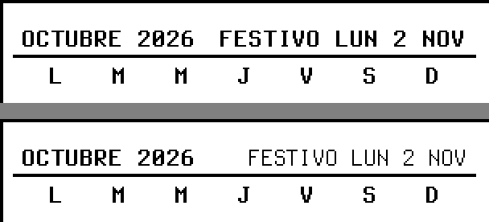

# F-017 · Etiqueta del festivo en letra normal y despertar cada 10 min con USB

**Estado:** cerrada · integrada a `main` el 2026-10-25 (preaprobado) · el dueño pidió los dos cambios el 2026-10-25 y que no se esperara su aprobación (ni para la ficha ni para integrar si sale limpio); ADR-0057 y ajuste de ADR-0056
**Modelo del programador:** sonnet
**Dependencias nuevas permitidas:** ninguna.

## Decisiones

| # | Decisión | Aprobado |
|---|----------|----------|
| **D1** ✅ | Etiqueta del próximo festivo | En la franja del mes, `FESTIVO LUN 2 NOV` / `HOY FESTIVO` vuelve a la letra de detalle **normal**, sin negrita ni espaciado, como antes de F-015. El mes (`OCTUBRE 2026`), la raya y la regla de «solo si cabe entera» no cambian (ajuste de ADR-0056) |
| **D2** ✅ | Despertar con USB | `next_wake_s` = **600 s** si la pantalla manda `Tintero-Power: usb`; 1800 s con `battery`, como hoy (ADR-0057) |

## Diseños

Franja del mes en `hoy` (P124, los ejemplos de hoy de F-015, reloj `2026-10-26T13:00:00Z`), ampliada ×2: arriba como quedó en F-015; abajo, con D1. Sale de una implementación de referencia de esta ficha con el motor real.



## Contexto
F-015 hizo de todo encabezado una franja; la etiqueta del festivo heredó la negrita y el espaciado de 1 px, y el dueño prefiere cómo se veía antes. Aparte, el servidor manda siempre `next_wake_s = 1800` (`--next-wake-s`, F-003), aunque cada petición trae `Tintero-Power`. Aplican ADR-0005, ADR-0006 (C progresiva y dibujo por adelantado), ADR-0035, ADR-0056 y ADR-0057.

## Alcance
- `stripRow` gana la opción `plainRight`; el título del mes la usa.
- `ServerConfig.nextWakeUsbS`, la opción `--next-wake-usb-s` y el `next_wake_s` del índice según `Tintero-Power` (con motor y en el modo demostración).
- `Engine.index` recibe el intervalo de la pantalla y `prewarm` lo usa.
- Documentación: `server/README.md` (la opción) y `firmware/README.md` (que `next_wake_s` cambia con la alimentación).

**Fuera de alcance:** el firmware (lo escribe el dueño, ADR-0013; ya obedece `next_wake_s`); cambiar el contrato; otros textos de franja (cuentas y avisos siguen en negrita); la unidad de systemd (sin la opción, vale el valor por defecto).

## Requisitos
- **R1.** `stripRow(context, label, right, y, { dropRight: true, plainRight: true })`: el texto de la derecha se dibuja con `font-weight: 400` y `letter-spacing: 0`; todo lo demás de la franja (alto, raya, etiqueta izquierda en negrita con espaciado de 1 px, «solo si cabe entera») como en F-015. Sin `plainRight`, igual que hoy.
- **R2.** El título propio del mes (`month-calendar` sin `title`) usa `plainRight`. Ningún otro bloque la usa.
- **R3.** `GET /api/v1/index` responde `next_wake_s` = `nextWakeUsbS` si las cabeceras validadas traen `power: "usb"`; si no, `nextWakeS`. Si `ServerConfig` no trae `nextWakeUsbS` (configuración armada por código), vale `nextWakeS`. Igual en el modo demostración de F-003.
- **R4.** `--next-wake-usb-s`: entero de `LIMITS.minWakeS` (30) a `LIMITS.maxWakeS` (86 400), **600 por defecto**, con los mismos errores que `--next-wake-s` (`UsageError`, salida 2). `--next-wake-s` sigue igual (1800 por defecto).
- **R5.** El motor recuerda, por pantalla, el intervalo que recibió en su último `index` y `prewarm` calcula la próxima despertada con él (`lastIndexMs + wakeS · 1000`); sin intervalo, `EngineOptions.nextWakeS`, como hoy.

## Contrato
- `server/src/engine/blocks/common.ts`:
  ```ts
  export function stripRow(
    context: BlockContext,
    label: string,
    right: string,
    y: number,
    options?: { lead?: boolean; dropRight?: boolean; plainRight?: boolean },
  ): Raw;
  ```
- `server/src/app.ts`: `ServerConfig` gana `nextWakeUsbS?: number`.
- `server/src/args.ts`: `parseOptions(argv)` devuelve `config.nextWakeUsbS` (600 por defecto).
- `server/src/engine/engine.ts`:
  ```ts
  index(device: string, panel: Panel, options?: { view?: string; wakeS?: number }): Promise<…>; // lo demás igual
  ```
  El servidor pasa en `wakeS` el mismo valor que pone en `next_wake_s`.

## Datos de prueba
- «Los ejemplos de hoy» = `config/hoy.views.example.json` + `config/hoy.data.example.json`, reloj `2026-10-26T13:00:00Z`, `setHolidays` con los 19 festivos `CO` de 2026 (F-013), panel `P124` = `w=800,h=480,dpi=124,depth=1`. Negro = bit 1 en `raw1`.
- Cabeceras de una pantalla (F-001): `Tintero-Protocol: 1`, `Tintero-Firmware: test`, `Tintero-Power: battery|usb`, `Tintero-Formats: raw1`, `Tintero-Panel: w=800,h=480,dpi=124,depth=1`.

## Criterios de aceptación
**D1**
- **CA1 (estilo).** En el HTML de `monthCalendar` con los ejemplos de hoy, el elemento con el texto `FESTIVO LUN 2 NOV` declara `font-weight:400` y `letter-spacing:0` (o no hereda los de la franja: su estilo computado es peso 400 y espaciado 0); el de `OCTUBRE 2026` sigue en peso 700 con espaciado de 1 px. Con el reloj en `2026-11-02T13:00:00Z`, lo mismo para `HOY FESTIVO`.
- **CA2 (píxeles).** Con los ejemplos de hoy en P124: la tinta de `x 633–791, y 250–268` empieza en `x = 651` y termina en `x = 784` (sin tinta en `x 633–650` de esa franja); hay tinta en `y 255–264` y ninguna en `y 250–254` ni `265–268`. La raya del mes sigue: negro en `(600, 270)` y `(600, 271)`.
- **CA3 (nada más cambia).** La imagen de `hoy` de CA2 es igual, píxel a píxel, a la de `main` antes de esta ficha (dibujada con los mismos datos y reloj) **fuera** del rectángulo `x 633–791, y 248–269`. La prueba guarda la imagen de `main` como dato grabado en `tests/acceptance/F-017/`.

**D2**
- **CA4 (opción).** `parseOptions([])` → `config.nextWakeUsbS = 600` y `config.nextWakeS = 1800`; `--next-wake-usb-s 900` → 900; `--next-wake-usb-s 29` y `--next-wake-usb-s 86401` → `UsageError` que nombra `--next-wake-usb-s`; `--next-wake-usb-s 10m` → `UsageError`.
- **CA5 (modo demostración).** Servidor sin motor en `127.0.0.1` (puerto libre que elige la prueba), por defecto: `GET /api/v1/index` con `Tintero-Power: battery` → `next_wake_s: 1800`; con `usb` → `600`. Con `--next-wake-s 1200 --next-wake-usb-s 300`: 1200 y 300. Con un `ServerConfig` armado por código sin `nextWakeUsbS` y `nextWakeS: 1800`: `usb` → 1800.
- **CA6 (con motor).** Servidor con los ejemplos de hoy: `battery` → `next_wake_s: 1800`, `usb` → `600`; los dos índices pasan `validateIndex` (F-001).
- **CA7 (dibujo por adelantado).** Motor con los ejemplos de hoy, `nextWakeS: 1800` y un `Renderer` falso; `setSource("tablero", <sus tareas>, { readAt: t0 })` con `t0 = 2026-10-26T13:00:00Z`; `index("p1", P124, { wakeS: 600 })` en `t0` e `idle()`. Con el reloj en `t0 + 539 s`, `prewarm()` e `idle()` no dibujan nada; con el reloj en `t0 + 541 s`, dibujan (las vistas de la despertada de `t0 + 600 s`, que ya llevan «sin datos desde 08:00»). Con `wakeS: 1800`, o sin `wakeS`, en `t0 + 541 s` no dibujan nada.
- **CA8 (documentación).** `server/README.md` nombra `--next-wake-usb-s` con su valor por defecto; `firmware/README.md` dice que `next_wake_s` cambia con `Tintero-Power` (600 con `usb`, 1800 con `battery`, por defecto).

**Lo que ya existe**
- **CA9 (compatibilidad).** `npm run test:acceptance` pasa. Corrida contra la referencia en un *worktree* real: **ninguna prueba de aceptación anterior cambia**. Fallan a veces con todo el lote por carga, y pasan solas: F-005 CA27, el presupuesto de F-008 CA4 y las que corren las anteriores (F-013 CA20, F-014 CA14). F-007 CA6 necesita `tools/revisar --base main` antes (como siempre). La prueba unitaria `server/src/server.test.ts` («has defaults») cambia por R4.

## Presupuestos
Sin cambios: el índice con USB es el mismo trabajo que con batería.

## Seguridad
- [x] Toda entrada externa con **límite de tamaño antes de parsear**: `Tintero-Power` ya la valida `validateDeviceHeaders`; la opción nueva es un entero acotado.
- [x] Servicios locales solo en **127.0.0.1** (nada nuevo escucha).
- [x] Dependencias nuevas: ninguna.

## Archivos
**A tocar:** `server/src/engine/blocks/common.ts`, `server/src/engine/blocks/month-calendar.ts`, `server/src/engine/engine.ts`, `server/src/app.ts`, `server/src/args.ts`, `server/src/main.ts` (texto de uso y paso de la opción), sus `*.test.ts` (incluido `server/src/server.test.ts`), `server/README.md`, `firmware/README.md` (solo la línea de `next_wake_s`).
**Verificador:** `tests/acceptance/F-017/`.
**Arquitecto:** ADR-0057, ajuste de ADR-0056, `docs/disenos/F-017/`; al integrar, reiniciar el servicio `tintero` (su unidad no pasa `--next-wake-usb-s`, así que vale 600).

## Resultado esperado
La etiqueta del próximo festivo se ve como antes de F-015, en letra normal junto al mes en negrita. Una pantalla enchufada por USB vuelve a preguntar cada 10 minutos; con batería, cada 30.

## Terminado (se marca al cerrar)
- [x] Todos los CA pasan en la verificación (informe adjunto).
- [x] `tools/revisar` limpio, o hallazgos resueltos o anotados como mejora.
- [x] `tools/check-scope` limpio para cada rol.
- [x] Resultado obtenido y resumen para aprobar escritos; métricas y lecciones actualizadas.
- [x] El dueño aprobó integrar (preaprobado si salía limpio; integrada el 2026-10-25 y servicio reiniciado).

## Listo para programar (se marca antes de pedir aprobación)
- [x] Cada CA se puede comprobar con una prueba, con valores concretos.
- [x] El contrato (interfaces, formatos, errores) está escrito.
- [x] Los archivos a crear o tocar están listados.
- [x] Presupuestos y reglas de seguridad que aplican, nombrados.
- [x] Lo que queda fuera de alcance, escrito.
- [x] **Nombres de archivos, rutas, puertos y URLs** que las pruebas necesiten, escritos.
- [x] Toda **función que se pruebe tiene nombre y firma**, y todo **contador o medida** dice desde cuándo cuenta.

---

## Resultado obtenido
- **Código** (programador, vuelta 1, sin desvíos ni dudas): `plainRight` en `stripRow` y en el título del mes; `--next-wake-usb-s` (600) y `ServerConfig.nextWakeUsbS`; `next_wake_s` según `Tintero-Power` con motor y en el modo demostración; `index({ wakeS })` guardado por pantalla y usado por `prewarm`; `server/README.md` y la línea de `next_wake_s` en `firmware/README.md`. 504 pruebas unitarias pasan.
- **Pruebas** (verificador, fase pruebas): 23 en `tests/acceptance/F-017/`, con la imagen de `main` grabada para CA3. Nota: el primer `prewarm` de un motor dibuja también una sonda de letras; CA7 cuenta solo los dibujos de vista.
- **Verificación 1:** **CUMPLE**, CA1 a CA9. Con el lote completo y la máquina con carga 4–6, fallan presupuestos de tiempo (F-005 CA27, F-008 CA4, **F-015 CA5** y las que las corren, F-013 CA20 y F-014 CA14); todas pasan solas. Ninguna prueba anterior cambió, como predijo la referencia.
- **Revisión:** `tools/revisar --base main` **limpio** (salida 0), sin modelo.
- **Mejoras anotadas:** F-015 CA5 (presupuesto de 420 ms) se suma a los intermitentes por carga; conviene un modo de las pruebas de tiempo que no corra en paralelo con el resto del lote.
- **Costo en agentes:** USD 1,46 (programador 0,38; verificador 0,91 + 0,16; integrador 0,02).

## Resumen para aprobar

## Para aprobar · F-017 · Etiqueta del festivo en letra normal y despertar cada 10 min con USB

**Qué cambió:** en la franja del mes, «FESTIVO LUN 2 NOV» vuelve a la letra normal de antes de F-015. Una pantalla enchufada por USB recibe `next_wake_s = 600` (10 min); con batería sigue en 1800. Los dos valores se configuran (`--next-wake-usb-s`, `--next-wake-s`) y el servidor dibuja por adelantado según el intervalo de cada pantalla.

**Criterios:** 9 de 9 pasan · vueltas: programación 1, verificación 1

**Revisión:** limpia · zonas sensibles: no
**Dependencias nuevas:** ninguna

**Riesgos o pendientes:** al integrar, reiniciar el servicio `tintero`. No se probó con el panel.

**Decisión que se pide:** integrar a `main` (preaprobado por el dueño si salía limpio)
