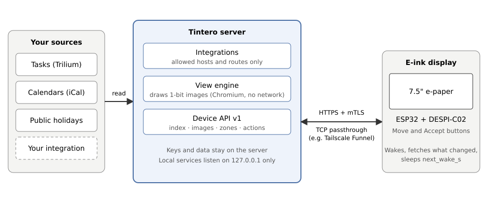

# Exposure

[Leer en español](../es/exposure.md)

The displays live in your house, but they must reach the server over the internet. This page explains how to do that safely. The short version: **TLS from the display all the way to the server, always**, and the server answers only your displays.

## The rule: TLS end to end

- The server itself ends the TLS and asks every display for its client certificate ([Certificates](certificates.md)). Nothing in between can read or change the traffic.
- The server listens **only on `127.0.0.1`**. Asking for another address (`--host`) makes it exit with an error. Something else on the machine must carry bytes from the internet to that local port.
- That "something else" may only **pass TCP bytes through**. It must not end the TLS, and it must not offer plain HTTP. **Never** put a proxy that ends the TLS in front of the server, and never expose HTTP.

## Option 1: Tailscale Funnel on its own node

[Tailscale Funnel](https://tailscale.com/kb/1223/funnel) can pass TCP from the internet to a machine in your tailnet. Run it on a **separate node** of your own, not on the server's machine: a Funnel on the server would publish the server's name in public DNS. The templates are in `deploy/funnel/`: a `tailscale/tailscale` container that joins your tailnet as a node called `tintero`, opens Funnel on its port 443 **only**, and forwards the bytes unchanged to Tintero on `127.0.0.1:<TLS port>`. Tintero still ends the TLS and checks the certificate.

1. **In the Tailscale admin console:**
   - Add `tag:tintero` to `tagOwners`, and give `tag:tintero` the `funnel` attribute in `nodeAttrs`.
   - Make an auth key that is not reusable, not ephemeral, pre-approved, tagged `tag:tintero`, and valid for 1 day.
   - If your policy has access rules, do **not** let `tag:tintero` reach any other device of the tailnet. It is the part that faces the internet.
2. **Save the key** in a file outside the repository, mode 600, with one line: `TS_AUTHKEY=<key>`.
3. **Fill the templates** in `deploy/funnel/` and put the results in a folder outside the repository (`config/serve.json` and `compose.yaml` inside it):
   - `serve.json.in`: replace `@TINTERO_TLS_PORT@` with the local TLS port of the server (for example `8443`).
   - `compose.yaml.in`: replace `@TAILSCALE_IMAGE@` with the `TAILSCALE_IMAGE` line from `tools/images.conf`, `@UID@:@GID@` with the user and group ids that will own the folder, and `@AUTHKEY_FILE@` with the path of the key file.
   - (`tools/instalar-funnel` does this for you from a local settings file; see `docs/configuracion-local.md`, in Spanish.)
4. **Open it:** `docker compose up -d` in that folder. **Close it:** `docker compose down`.
5. **Use the name.** The displays connect to `https://tintero.<your-tailnet>.ts.net`, for example `tintero.example.ts.net` (port 443). That is the `--host` you give to `npm run pki -- server` and `npm run pki -- firmware`.

Remember that a `*.ts.net` name is public: it appears in public certificate logs. Nothing here depends on the name being secret. The protection is the certificate on every request.

## Option 2: another TCP pass-through

Any service that forwards **raw TCP** on port 443 to your local TLS port is fine, for example a small relay machine on the internet that passes TCP through a tunnel to the machine that runs Tintero. The local end must still deliver to `127.0.0.1` on the server's machine (the server never listens anywhere else). The same rule holds: it forwards bytes and the server ends the TLS. Do not use an "HTTPS proxy", a CDN or a tunnel mode that ends the TLS for you, because it would see your traffic and could not check the display's certificate.

## Who can connect: the list of devices

The server only serves displays that are on its **list of devices** (`--devices`, a file outside the repository). A display needs both a certificate signed by your authority **and** a line in the list. Turning the list off or leaving it empty so that "everything works" is not an option: the server needs it to start with TLS. The server counts at most two different panel sizes per display (`--max-panels`) and 32 connections (`--max-connections`) by default.

## Silence toward strangers

Anyone else (a scanner, a browser, a display with a certificate that is not on the list) gets an **empty 404**: no body, nothing that tells what runs there. So a wrong certificate, a missing one and an unlisted one look the same from outside. If your own display gets a 404, check the certificate, the list of devices and the clock ([Certificates](certificates.md)).

## What never to do

- Never use plain HTTP to reach the server from outside, and never end the TLS in a proxy.
- Never make the server listen on `0.0.0.0` or on a public address.
- Never open the file permissions of keys or of the list of devices (keep mode 600, folder 700).
- Never turn off certificate checks in the firmware or the emulator.
- Never skip the list of devices.
