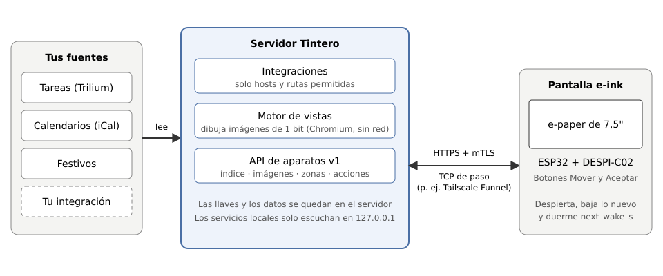

# Exposición

[Read in English](../en/exposure.md)

Las pantallas viven en tu casa, pero tienen que llegar al servidor por internet. Esta página explica cómo hacerlo de forma segura. En resumen: **TLS desde la pantalla hasta el servidor, siempre**, y el servidor atiende solo a tus pantallas.

## La regla: TLS de punta a punta

- El propio servidor termina el TLS y le pide su certificado de cliente a cada pantalla ([Certificados](certificates.md)). Nada en el camino puede leer ni cambiar el tráfico.
- El servidor escucha **solo en `127.0.0.1`**. Si le pides otra dirección (`--host`), sale con un error. Algo más en la máquina tiene que llevar los bytes de internet hasta ese puerto local.
- Ese «algo más» solo puede **pasar bytes TCP de largo**. No debe terminar el TLS ni ofrecer HTTP sin cifrar. **Nunca** pongas delante del servidor un proxy que termine el TLS, y nunca expongas HTTP.

## Opción 1: Tailscale Funnel en un nodo propio

[Tailscale Funnel](https://tailscale.com/kb/1223/funnel) puede pasar TCP desde internet a una máquina de tu tailnet. Córrelo en un **nodo aparte** tuyo, no en la máquina del servidor: un Funnel en el servidor publicaría su nombre en el DNS público. Las plantillas están en `deploy/funnel/`: un contenedor `tailscale/tailscale` que entra a tu tailnet como un nodo llamado `tintero`, abre Funnel **solo** en su puerto 443 y reenvía los bytes sin tocarlos a Tintero en `127.0.0.1:<puerto TLS>`. Tintero sigue terminando el TLS y revisando el certificado.

1. **En la consola de administración de Tailscale:**
   - Agrega `tag:tintero` a `tagOwners` y dale a `tag:tintero` el atributo `funnel` en `nodeAttrs`.
   - Crea una llave de acceso no reutilizable, no efímera, preaprobada, con `tag:tintero` y de 1 día.
   - Si tu política tiene reglas de acceso, **no** dejes que `tag:tintero` llegue a ningún otro aparato del tailnet. Es la parte que da la cara a internet.
2. **Guarda la llave** en un archivo fuera del repositorio, con permisos 600 y una sola línea: `TS_AUTHKEY=<llave>`.
3. **Rellena las plantillas** de `deploy/funnel/` y deja los resultados en una carpeta fuera del repositorio (`config/serve.json` y `compose.yaml` dentro de ella):
   - `serve.json.in`: cambia `@TINTERO_TLS_PORT@` por el puerto TLS local del servidor (por ejemplo `8443`).
   - `compose.yaml.in`: cambia `@TAILSCALE_IMAGE@` por la línea `TAILSCALE_IMAGE` de `tools/images.conf`, `@UID@:@GID@` por los ids de usuario y grupo dueños de la carpeta, y `@AUTHKEY_FILE@` por la ruta del archivo de la llave.
   - (`tools/instalar-funnel` lo hace por ti a partir de un archivo de configuración local; ver `docs/configuracion-local.md`.)
4. **Abrirlo:** `docker compose up -d` en esa carpeta. **Cerrarlo:** `docker compose down`.
5. **Usar el nombre.** Las pantallas se conectan a `https://tintero.<tu-tailnet>.ts.net`, por ejemplo `tintero.example.ts.net` (puerto 443). Ese es el `--host` que le das a `npm run pki -- server` y a `npm run pki -- firmware`.

Recuerda que un nombre `*.ts.net` es público: aparece en los registros públicos de certificados. Nada aquí depende de que el nombre sea secreto. La protección es el certificado en cada petición.

## Opción 2: otra salida TCP de paso

Sirve cualquier servicio que reenvíe **TCP crudo** del puerto 443 a tu puerto TLS local, por ejemplo una máquina de relevo pequeña en internet que pase el TCP por un túnel hasta la máquina donde corre Tintero. El extremo local tiene que entregar a `127.0.0.1` en la máquina del servidor (el servidor nunca escucha en otro lado). Rige la misma regla: reenvía bytes y el servidor termina el TLS. No uses un «proxy HTTPS», una CDN ni un modo de túnel que termine el TLS por ti, porque vería tu tráfico y no podría revisar el certificado de la pantalla.

## Quién puede conectarse: la lista de aparatos

El servidor solo atiende a las pantallas de su **lista de aparatos** (`--devices`, un archivo fuera del repositorio). Una pantalla necesita un certificado firmado por tu autoridad **y** una línea en la lista. Apagar la lista o dejarla vacía para que «todo funcione» no es una opción: el servidor la necesita para arrancar con TLS. Por defecto, el servidor cuenta como máximo dos paneles distintos por pantalla (`--max-panels`) y 32 conexiones (`--max-connections`).

## Silencio ante extraños

Cualquier otro (un escáner, un navegador, una pantalla con un certificado que no está en la lista) recibe un **404 vacío**: sin cuerpo, sin nada que diga qué corre ahí. Así, un certificado equivocado, uno ausente y uno no listado se ven igual desde afuera. Si tu propia pantalla recibe un 404, revisa el certificado, la lista de aparatos y la hora ([Certificados](certificates.md)).

## Lo que nunca se hace

- Nunca uses HTTP sin cifrar para llegar al servidor desde afuera, y nunca termines el TLS en un proxy.
- Nunca hagas que el servidor escuche en `0.0.0.0` ni en una dirección pública.
- Nunca abras los permisos de las llaves ni de la lista de aparatos (déjalos en 600, y la carpeta en 700).
- Nunca apagues la revisión de certificados en el firmware ni en el emulador.
- Nunca te saltes la lista de aparatos.
