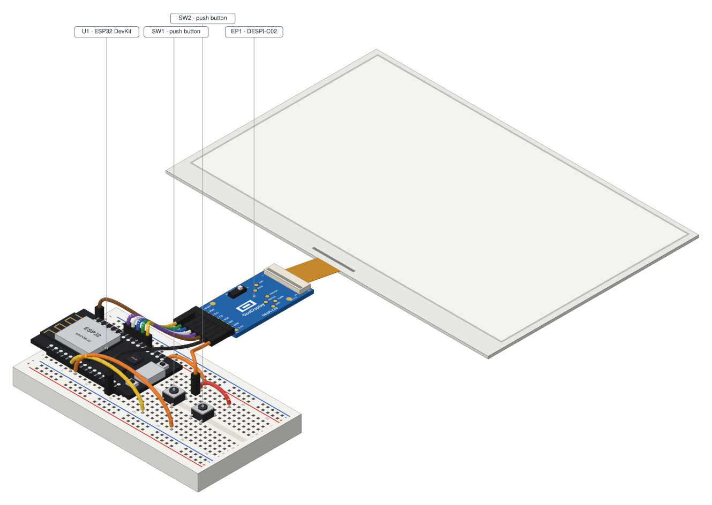

# Hardware

[Read in English](../en/hardware.md)

Esta página lista las piezas, muestra cómo cablearlas y explica cómo compilar y grabar el firmware. Nada de esto es necesario para probar Tintero: para el emulador, mira [Primeros pasos](getting-started.md).

## Piezas

| Pieza                                    | Notas                                                                                                                              |
| ---------------------------------------- | ---------------------------------------------------------------------------------------------------------------------------------- |
| ESP32 DevKit                             | Una placa ESP32 DevKit estándar (`esp32dev` en PlatformIO). Se programa por USB.                                                   |
| Adaptador DESPI-C02                      | Conecta el cable plano del panel al ESP32. Pon su interruptor **RESE** en **0,47**, como en el circuito de abajo.                  |
| Panel e-paper GDEY075T7                  | 7,5", 800 × 480, blanco y negro. Se enchufa en el DESPI-C02.                                                                       |
| Dos pulsadores                           | **Mover** y **Aceptar**. Pulsadores normales, sin resistencia externa.                                                             |
| Protoboard, cables y cable USB           | Para el ESP32. También hace falta una red Wi-Fi de 2,4 GHz (el ESP32 no se conecta a redes de 5 GHz).                              |

## Cableado

DESPI-C02 al ESP32 DevKit:

| Pin del DESPI-C02 | Pin del ESP32 |
| ----------------- | ------------- |
| BUSY              | GPIO4         |
| RES               | GPIO16 (RX2)  |
| D/C               | GPIO17 (TX2)  |
| CS                | GPIO5         |
| SCK               | GPIO18        |
| SDI               | GPIO23        |
| 3.3V              | 3V3           |
| GND               | GND           |

Pulsadores:

| Pulsador | Conexión                |
| -------- | ----------------------- |
| Mover    | entre GPIO32 y 3V3      |
| Aceptar  | entre GPIO33 y 3V3      |

Los pulsadores usan la ***pull-down* interna** del ESP32: la activa el firmware, así que no agregas ninguna resistencia. Un botón pulsado se lee **HIGH**; suelto, LOW. GPIO32 y GPIO33 son pines RTC, por lo que pueden despertar al ESP32 del sueño profundo.

En el firmware, el cableado del panel está en `firmware/src/panel.cpp` y el de los pulsadores en `firmware/src/buttons.cpp`.

## El circuito

El circuito de los dos pulsadores y el panel, dibujado sobre una protoboard:



- Página interactiva: [`tintero-buttons.html`](../../hardware/tintero-buttons/out/tintero-buttons.html) (ábrela en un navegador; no necesita servidor).
- El origen del circuito: [`circuit.json`](../../hardware/tintero-buttons/circuit.json). Se hizo con `protoboard-iso`.

## Compilar y grabar el firmware

El firmware es C++ para [PlatformIO](https://platformio.org/); basta la línea de comandos `pio`. Está en `firmware/`. Sus notas (con el detalle del protocolo) están en [`firmware/README.es.md`](../../../firmware/README.es.md).

1. **Wi-Fi.** Copia la plantilla y escribe tu red de 2,4 GHz. Git ignora este archivo:

   ```bash
   cp firmware/include/secrets.h.example firmware/include/secrets.h
   ```

2. **Certificados de esta pantalla.** Primero crea tu autoridad privada y el certificado de la pantalla ([Certificados](certificates.md)). Luego escribe el encabezado con el nombre del servidor y la llave **solo de esta pantalla**:

   ```bash
   npm run pki -- firmware /path/to/pki --host tintero.example.ts.net p1
   ```

   El resultado es `firmware/include/tintero_certs.h`, con permisos 600. Git lo ignora, y la herramienta se niega a escribir una llave donde git pueda verla.

3. **Compilar y grabar** con el ESP32 conectado por USB:

   ```bash
   cd firmware
   pio run -t upload
   pio device monitor    # opcional: monitor serie a 115200
   ```

4. **Autoriza la pantalla** en la lista de aparatos del servidor ([Certificados](certificates.md) y [Exposición](exposure.md)). Mientras no lo hagas, el servidor responde 404 vacío a todo.

Para una segunda pantalla, genera su propio `tintero_certs.h` con su propio id (`p2`) y graba otra vez.

## Bueno saber

- El firmware confía **solo** en tu autoridad privada. Nunca apaga la revisión de certificados ni confía en autoridades públicas.
- Mientras la *flash* no esté cifrada, quien robe una pantalla puede leer la llave de esa pantalla. Cada pantalla lleva solo su propia llave, así que robar una no expone a las demás. Para revocar una pantalla, quita su línea de la lista de aparatos del servidor (el servidor la relee solo; reiniciarlo también sirve).
- **Licencia de un firmware compilado:** el código fuente del firmware es MIT, pero un binario compilado enlaza GxEPD2 (GPL-3.0), así que el **binario** es GPL-3.0. Este repositorio no publica binarios. Si distribuyes uno, cumple la GPL-3.0 (ver [NOTICE](../../../NOTICE)).
